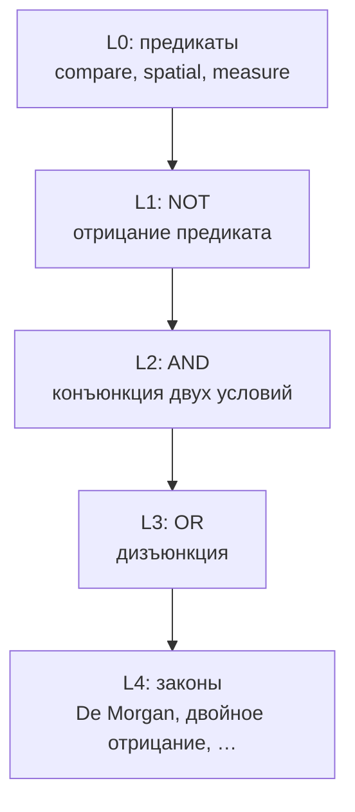

# CASA-ADR-0029: Логическая композиция (AND, OR, NOT) — отдельный трек

**Статус:** черновик — **на обсуждение** (не блокирует compare / literacy / spatial v1)  
**Дата:** 2026-06-04  
**Уровень абстракции (ориентир):** русская школа, **~8–9 класс** — связки, отрицание, элементарные тождества; не смешивать с детским spatial на lum.  
**Связано:**

- [CASA-compare-greater-less-v1.md](CASA-compare-greater-less-v1.md) — предикаты compare / measure / spatial (**без** «и» как логики)
- [CASA-learning-protocol-vis-math-v1.md](CASA-learning-protocol-vis-math-v1.md) — один vis + один lexical → один sleep
- [CASA-visual-3D-tract-future.md](CASA-visual-3D-tract-future.md) — сенсорика 3D; **не** этот ADR
- lesson-13–14 sets / `math.set.*` — **соседний трек** (см. § «Множества ↔ логика»)
- [articles/ru/vis-math-sets-without-oracle.md](../articles/ru/vis-math-sets-without-oracle.md) — эталон probe без oracle

---

## Решение (одной фразой)

**Логические связки и законы — отдельный curriculum-трек:** сначала устойчивые **предикаты** (spatial, compare, …), затем **connectives** AND / OR / NOT на **символических** кадрах; **законы логики** — ещё позже, на схемах высокой абстракции. Не учить «правее и ниже» как четвёртый spatial-id и не смешивать connective с предикатом в одном sleep.

---

## Зачем отдельный ADR

| Вопрос | Ответ |
|--------|--------|
| A правее и ниже B на одной картинке? | Два **предиката** на поле возможны; слово **«и»** — уже **логика**, не spatial |
| Почему не в S3b/S3c? | Один JPEG → tie `leftOf` + `belowOf` + … на max score = ambiguous в probe |
| Почему не в sets? | ∩, ∪, **дополнение** — **множества** (`math.set.*`); De Morgan на пропозициях — `math.logic.*`, другие кадры |
| Когда? | После probes know на предикатах; **не** параллельно с первым ingest spatial |

---

## Множества ↔ логика (буквально соседи)

Один и тот же смысл, **разные id и кадры** — не смешивать в один sleep.

| Операция над множествами | `math.set.*` (lesson-13–14) | Логика | `lang.meta.logic.*` / `math.logic.*` |
|-------------------------|----------------------------|--------|--------------------------------------|
| пересечение ∩ | `math.set.intersect` — **есть** | AND ∧ | `lang.meta.logic.and` — L2 |
| объединение ∪ | `math.set.union` — **есть** | OR ∨ | `lang.meta.logic.or` — L3 |
| **дополнение** A̅, «не A» (в U) | `math.set.complement` — **план, в репо пока нет** | NOT ¬ | `lang.meta.logic.not` — L1 |
| разность A\\B | `math.set.difference` — **есть** | (нет прямого ¬; составное) | позже |
| подмножество ⊂ | `math.set.subset` — **есть** | импликация ⇒ | отдельный ADR |
| не пересекаются ∅ | `math.set.disjoint` — **есть** | (нет прямого ∨) | — |

**Забытая операция (sets-трек):** **дополнение** — «всё вне A» относительно универсума U (рамка Венна / прямой). Кадр: затенённый фон U, A вырезан или контрастен; cue `A̅`, `∁`, surface «дополнение». Один sleep → `math.set.complement` только.

**Педагогический мост (L4, ~8–9 кл.):** De Morgan  
`∁(A ∪ B) ≡ ∁A ∩ ∁B` — **отдельные** moment'ы на Venn и на схеме logic, потом связь словами, не один JPEG на всё.

**Probe sets:** на `venn-region-complement` (план) hint `math.set.complement`; не путать с `math.set.difference` (A без B) — в статье уже путаница intersect/difference, complement добавит третий дискриминатор.

---

## Слои (порядок обучения)

| Ступень | Содержание (RU) | Vis | Пример id (черновик) |
|---------|-----------------|-----|----------------------|
| **L0** | уже в compare | точки, отрезки, одна ось | `lang.meta.spatial.*`, `lang.meta.compare.*` |
| **L1** | «не» | схема: предикат зачёркнут / пустая зона | `lang.meta.logic.not` |
| **L2** | «и» | два предиката + явный connective (подпись или разнесённые зоны) | `lang.meta.logic.and` |
| **L3** | «или» | ветвление, два исхода | `lang.meta.logic.or` |
| **L4** | законы | таблицы истинности, тождества A∧B ≡ … | `math.logic.*` (уточнить при lab) |

**Школа ~8–9 класс:** L1–L3 — базовые связки; **L4** — уже «довольно высокая абстракция» (формальные преобразования), только на **искусственных** схемах, не на фото коров.

---

## Принципы (как compare)

1. **Один sleep — один смысл:** один connective **или** один закон на moment; не `AND` + `leftOf` + `belowOf` в одном ingest.
2. **Предикаты отдельно:** «левее», «ниже» освоены **до** кадра «левее **и** ниже».
3. **Probe:**
   - connective: hint = `lang.meta.logic.and`, один лидер → know;
   - **композиция предикатов** (эксперимент): отдельный probe «оба в top-k» — **не** стандартный `verdict_lex_probe` с одним hint (см. [probe_lex_verdict.py](../lab/visual-curriculum/probe_lex_verdict.py)).
4. **Без oracle на read:** teacher hint только в JSON отчёта.
5. **Не reinforce снаружи** как норма — среда и повтор moment'ов (см. learning-protocol); исключения — tie-break ADR отдельно.

---

## Не путать

| Трек | «И» / «не» | Кадры |
|------|------------|--------|
| **Spatial** | «левее», «ниже» — **отношения**, не связки | lesson-19–21, одна ось |
| **Sets** | ∩ ∪ ⊂ ∁ **дополнение** A̅; разность A\\B | lesson-13–14 (+ complement **план**) |
| **Logic (этот ADR)** | AND OR NOT; законы | новые lesson, символика |
| **Literacy** | слово «и» как **союз в тексте** | `lang.word.*` — не автоматически `logic.and` |

Связь literacy ↔ logic: позже **отдельный** moment «союз и в предложении» → `logic.and`, не смешивать с первым корпусом слов.

---

## Черновик онтологии

| id | Surface (RU) | Когда |
|----|--------------|--------|
| `math.set.complement` | дополнение / A̅ (в U) | sets S? (план) |
| `lang.meta.logic.not` | не (логическое) | L1 |
| `lang.meta.logic.and` | и (логическое) | L2 |
| `lang.meta.logic.or` | или | L3 |
| `math.logic.de_morgan` | (схема) | L4 |
| `math.logic.double_negation` | (схема) | L4 |

Предикаты остаются в `lang.meta.spatial.*` / `lang.meta.compare.*`; **не** вводить `spatial.downRight` вместо `logic.and`.

---

## Связь с «диагональю» (правее + ниже)

| Подход | Оценка |
|--------|--------|
| Один кадр, два spatial-id без «и» | Допустимый **lab-эксперимент** после S3b/S3c; probe multi-leader |
| Один id «по диагонали» | Жест четвёртого паттерна, **не** композиция |
| Кадр + `lang.meta.logic.and` + подпись «и» | **Канон** L2, после стабильных предикатов |

---

## Non-goals (v1 черновика)

- Не входить в `run_geom_stages_*` / compare ingest.
- Не заменять sets curriculum.
- Не требовать 3D / Orion metric.
- Не полный курс логики (импликация, кванторы ∀∃) — отдельные ADR позже.

---

## Очередь (после gates)

| # | Задача | Зависит от |
|---|--------|------------|
| 0 | **`math.set.complement`** на Venn/nline (отдельно от logic) | sets ∩∪ stable |
| 1 | Spatial + compare probes стабильны | S3–S4 |
| 2 | Lesson + JPEG L1 NOT | ADR принят |
| 3 | L2 AND, L3 OR + probes | L1 |
| 4 | Lab: diagonal composite (multi-hint probe only) | S3b/S3c know |
| 5 | L4 laws на truth-table cards | L2–L3 |
| 6 | Статья / связка с sets (∩ vs ∧ — **разные** id) | lab |

---

## Открытые вопросы

1. Connectives в `lang.meta.logic.*` или `math.logic.*`?
2. Визуализация AND: одна карточка с текстом «P и Q» или два мини-кадра в одном JPEG (риск lum tie)?
3. Как в probe различать «знает AND» от «знает только leftOf» на composite без отдельного hint?
4. Нужен ли явный мост sets ∩ → logic.and и **∁ → logic.not** (педагогически после L1 + complement probe)?

---

*При принятии — одна строка-ссылка из compare-канона и literacy-roadmap; реализация lab не начинается до закрытия S4e–S5 gates.*
