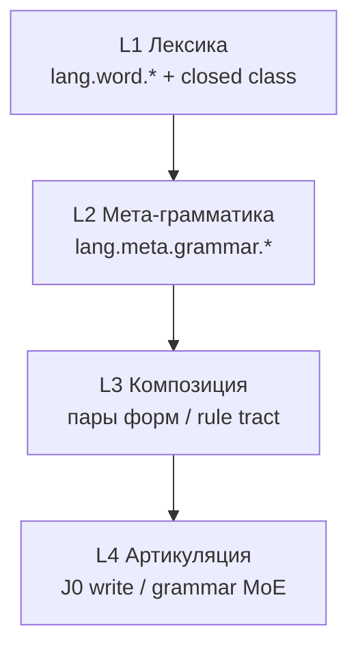

# CASA-ADR-0030: Грамматика на поле — от корпуса к связному тексту

**Статус:** принят (lab v1 — мета-лицо)  
**Дата:** 2026-06-04  
**Связано:**

- [CASA-literacy-roadmap-v1.md](CASA-literacy-roadmap-v1.md) — стадии literacy
- [CASA-literacy-class-v1.md](CASA-literacy-class-v1.md) — pure meta, без cartesian sleep
- [CASA-learning-protocol-vis-math-v1.md](CASA-learning-protocol-vis-math-v1.md) — vis↔lex, один vis + один lex → один sleep
- [CASA-ADR-0029-logical-composition.md](CASA-ADR-0029-logical-composition.md) — connectives («и», «не») — **отдельный** трек от согласования
- [CASA-ADR-0034-executor-learning-loop.md](CASA-ADR-0034-executor-learning-loop.md) — META: общий цикл исполнителя; этот ADR — L1–L4 literacy
- [experiment-j0-russian-literacy-v1.md](experiment-j0-russian-literacy-v1.md) — articulation / write@sketch поверх поля

---

## Решение (одной фразой)

**Связный текст требует трёх слоёв:** (L1) лексические атомы и закрытый класс, (L2) мета-категории грамматики на JPEG (`lang.meta.grammar.*`), (L3) композиция фраз и rule tract; **не** ожидать, что частотный корпус content-слов сам выучит лицо, согласование и синтаксис.

---

## Контекст

| Факт | Следствие |
|------|-----------|
| `stage-06-words-cyrl-corpus` — целые `lang.word.*` | Знаки-слова на поле, не грамматические роли |
| Закрытый класс в corpus **частично**; местоимений **нет** | «я»/«они» как `lang.word.*` ≠ **грамматическое лицо** |
| `sleep_co_occurs_lex` — декартово vis×lex в batch | Pending lex + новый vis → ложные мосты (lab: «низ»↔«девять») |
| Probe vis↔lex — top по `E:vis.lum.frame.*` | Не OCR, не «похожесть букв» |
| J0/J — read/paraphrase/write | Поле даёт якоря; **формулировка** связного ответа — grammar/articulation store |

---

## Цель (north star)

Агент **понимает** на поле категории, нужные для короткой связной речи на русском: лицо, (далее) число/род, согласование, служебные слова; и может стыковаться с **J0 write** без manifest-oracle на read path.

**Не цель v1:** полный морфологический анализатор, падежная парадигма целиком, генерация произвольных текстов только из lum.

---

## Слои curriculum

| Слой | Содержание | Стадия (черновик) | concept_id |
|------|------------|-------------------|------------|
| **L1a** | Content corpus | `stage-06-words-cyrl-corpus` | `lang.word.{slug}` |
| **L1b** | Закрытый класс: предлоги, `не`, союзы, местоимения как **слова** | `stage-07-closed-class` | `lang.word.{slug}` |
| **L2** | **Категории** грамматики на фразе-карточке | `stage-08-meta-grammar-person` (v1) | `lang.meta.grammar.person.*` |
| **L2+** | Число, род, падеж (позже) | `stage-08b-…`, `stage-08c-…` | `lang.meta.grammar.number.*`, `.gender.*`, `.case.*` |
| **L3** | Согласование: пары surface → один meta id | `stage-09-grammar-agreement-pilot` | `lang.meta.grammar.agreement.*` |
| **L4** | Связный ответ 2–4 предложения | experiment J0 | KB + blocks, не probe JPEG |

**Порядок v1 lab:** L2 (мета-лицо) **перед** полным L1b ingest в reactor — чтобы отделить **роль** от голого местоимения-слова; L1b идёт следом отдельным списком `data/ru-closed-class-v1.txt`.

---

## Именование `lang.meta.grammar.*`

Префикс **semantic EN**; surface на JPEG — RU (и позже EN зеркало).

| Ось | id (канон) | Пример surface (отдельный moment) |
|-----|------------|-----------------------------------|
| **Лицо** | `lang.meta.grammar.person.1sg` | `я` |
| | `lang.meta.grammar.person.2sg` | `ты` |
| | `lang.meta.grammar.person.3sg.masc` | `он` |
| | `lang.meta.grammar.person.3sg.fem` | `она` |
| | `lang.meta.grammar.person.1pl` | `мы` |
| | `lang.meta.grammar.person.2pl` | `вы` |
| | `lang.meta.grammar.person.3pl` | `они` |
| **Число** (план) | `lang.meta.grammar.number.sg` / `.pl` | `единственное число` / `множественное число` |
| **Род** (план) | `lang.meta.grammar.gender.masc` / `.fem` / `.neut` | мета-фразы, не одна буква |
| **Согласование** (план) | `lang.meta.grammar.agreement.subjectVerb` | два JPEG: «он идёт» / «она идёт» → **один** id |
| **Фонология** (v1) | `lang.meta.phonology.vowel` / `.consonant` | «гласная», «согласная»; буква + подпись категории (`stage-04`) |

**Одна категория — много выражений:** несколько фраз/языков → один `concept_id`; probe по категории ([протокол § Vis↔lex](CASA-learning-protocol-vis-math-v1.md)).

**Не смешивать в один sleep:** мета-лицо + grapheme + content-слово + другая мета (как `letter-Б` + «заглавная»).

---

## L1b: закрытый класс (инженерия)

| Правило | Значение |
|---------|----------|
| Источник | `data/ru-closed-class-v1.txt` (ручной срез + `corpus_wordlist.py --min-len 1` только для этого файла) |
| Кадр | одно слово / частица / местоимение → `lang.word.{slug}` |
| Стадия | `stage-07-closed-class`, lesson `lesson-07-closed-class` |
| Ingest | inbox / micro; **hippo пуст** между moment'ами (reactor или CLI — один writer) |

Местоимения **дублируются** осознанно: L1b = узнаваемый **знак** «я»; L2 = категория **лицо 1sg**. Разные `concept_id`, разные probe.

---

## L2 v1: мета-лицо (реализуется первым)

| Артефакт | Путь |
|----------|------|
| Канон id | `lessons/literacy-cards/tools/meta_concepts.py` → `GRAMMAR_PERSON_CARDS` |
| JPEG + manifest | `tools/build_grammar_meta_cards.py` → `lesson-08-grammar-meta`, `stage-08-meta-grammar-person` |
| Lab ingest | `lab/.../run_meta_grammar_person_pure.py` (`phrase_vis`, pure) |
| Probe | `lab/.../probe_meta_grammar_person_quiz.py` |

**Moment:** 1× `visual_frame` + 1× `lexical` с `concept_id` = `lang.meta.grammar.person.*`; `cue` = surface; **sleep**.

---

## L3: согласование (план, не v1)

1. **Пары** минимального согласования (род/лицо на глаголе или прилагательном): два кадра, **один** `lang.meta.grammar.agreement.*`.
2. **Не** класть обе формы в один sleep с посторонним lex в hippo.
3. При ambiguous — менять **подачу**, не `bridge_lex` в проде.
4. Долгий горизонт: **rule tract** (ticks) для вывода формы — не замена L2.

**Русский: фраза и свободный порядок слов** — не фиксированный SVO; роли в падеже/согласовании, перестановки одной тройки форм → одна event-схема. Канон: [CASA-ADR-0033-russian-phrase-structure-free-order.md](CASA-ADR-0033-russian-phrase-structure-free-order.md) (phrase compose P1, `lang.event.*`, probe без проверки linear order на v0).

---

## Связь с J0 / grammar store

| Компонент | Роль |
|-----------|------|
| von-neumann vis↔lex | якоря категорий с поля |
| `language-agent-lab` union | grammar KB + literacy claims |
| J0 write@sketch | связные 2–4 предложения **после** достаточных якорей |
| Control / MoE | не подменяет учебные мосты на ingest |

Probe JPEG **не** является критерием «умеет говорить»; критерий J0 — bench `queries_write.jsonl`.

---

## Риски и смягчение

| Риск | Смягчение |
|------|-----------|
| Cartesian co-occurrence | **педагогика**, не правка `bridge_lex` / sleep extract в ядре |
| | один vis + один lex на moment; **чистый hippo** между inbox/micro-batch; не смешивать стадии в одном sleep |
| | порядок списка ≠ порядок ingest — сортировка по `frame_id` даёт «соседей» в probe, не в жизни; хвост: `reinforce_*_tail.py` в lab |
| Путаница `lang.word.я` vs `lang.meta.grammar.person.1sg` | разные стадии, явные id, ADR |
| Ожидание согласования от corpus | отдельный L3, не автоматика |
| Reinforce в lab | допустим для разрыва tie; **не** hotfix ядра по probe |

**Канон (2026-06):** при ambiguous/empty на probe — менять **подачу и порядок ingest**, усиливать мост в **lab** (`reinforce_vis_lex_bridge`); изменение декартова `sleep_co_occurs_*` в проде — **отдельное ADR**, не часть literacy v1.

---

## Очередь реализации

| # | Задача | Статус |
|---|--------|--------|
| 1 | ADR-0030 (этот документ) | ✅ |
| 2 | `meta_concepts.py` + `build_grammar_meta_cards.py` + stage-08 | v1 |
| 3 | `run_meta_grammar_person_pure.py` + probe | v1 |
| 4 | ingest + probe know на von-neumann | lab |
| 5 | `ru-closed-class-v1.txt` + stage-07-closed-class | след. |
| 6 | agreement pilot stage-09 | план |
| 7 | roadmap + literacy-class ссылка | v1 |

---

## Отклонённые альтернативы

| Альтернатива | Почему нет |
|--------------|------------|
| Только corpus + wordfreq | нет грамматических категорий |
| Одно `lang.word.я` на всё | нет роли лица для согласования |
| Согласование в одном sleep с алфавитом | cartesian ambiguous |
| OCR / внешний морфоанализ на read path | против [CASA-literacy-class-v1](CASA-literacy-class-v1.md) |

---

## Проверка (lab gate)

- `probe_meta_grammar_person_quiz.py` — **7/7 know** на `stage-08-meta-grammar-person` (после pure ingest).
- Нет regress: мета регистра / compare не трогаем в том же sleep batch.
