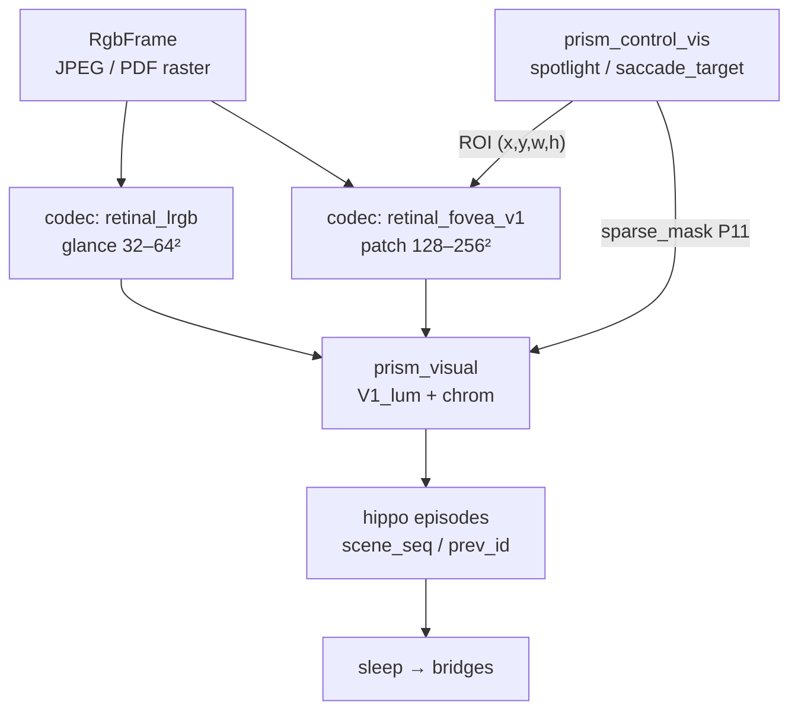

# CASA-ADR-0031: Фовеальная выборка и саккады (плоский visual tract)

**Статус:** черновик — **на обсуждение**  
**Дата:** 2026-06-04  
**Область:** как поднять **эффективное 2D-разрешение** для УГО, чертежей и мелкой графики **без** одной гигантской решётки на весь кадр и **без** сферического tract  
**Связано:**

- [`CASA-ADR-0028-field-native-sensory-experience.md`](CASA-ADR-0028-field-native-sensory-experience.md) — первичный `visual` tract, уровень 3 (время, цепочки эпизодов)
- [`CASA-ADR-0010-control-zone-predict-attention-value.md`](CASA-ADR-0010-control-zone-predict-attention-value.md) — DAN / top-down прожектор
- [`CASA-ADR-0019-control-multi-prism.md`](CASA-ADR-0019-control-multi-prism.md) — `prism_control_vis`
- [`design/prisms/control/vis-stack.json`](prisms/control/vis-stack.json) — `saccade_target`, `sparse_mask` (P11)
- [`CASA-visual-3D-tract-future.md`](CASA-visual-3D-tract-future.md) — сфера / depth — **другой** трек; § 2D high-res ниже
- [`CASA-learning-protocol-vis-math-v1.md`](CASA-learning-protocol-vis-math-v1.md) — lesson moment, sleep, без oracle на read
- [`CASA-literacy-class-v1.md`](CASA-literacy-class-v1.md) — чтение с поля, не OCR-shunt
- [`CASA-ADR-0030-grammar-literacy-coherent-text.md`](CASA-ADR-0030-grammar-literacy-coherent-text.md) — мета/лексика на JPEG
- `casa/sensory/codecs/retinal_lrgb.py` — v1: плоский даунсэмпл `DEFAULT_GRID_SIZE = 32`

---

## Решение (одной фразой)

**Плоский visual tract v1b** дополняется **двухуровневой выборкой:** низкое разрешение на **весь кадр** (обзор) + высокое на **фовеальное окно**; **саккада** = смещение центра окна и новый импринт в **цепочке эпизодов**, управляемая **`prism_control_vis`** (top-down) и salience (bottom-up), без хранения полного растра в `ltm/`.

---

## Зачем отдельный ADR

| Вопрос | Ответ |
|--------|--------|
| Почему не поднять `DEFAULT_GRID_SIZE` до 512²? | Стоимость sleep/predict и конкуренция паттернов на всём поле; для карточек 32² достаточно |
| Почему не сфера (v3 / Orion)? | Чертеж и УГО — **ортогональный лист**, нужна **линейная** точность по X/Y, не метрика FOV |
| Почему не OCR `text_bypass`? | УГО/чертёж — **field-native vis**, не шunt в lexical (см. ADR-0028, literacy-class) |
| Что уже есть в дизайне? | `control-vis-spotlight` с ролью `saccade_target`; P11 `sparse_mask` → `prism_visual` — **канон control**, codec под это **не зафиксирован** |

Человеческий глаз: ~1–2° острой зоны и **серия фиксаций** по листу. Инженерный аналог для CASA — не «10800×10800 сетчатка», а **обзор + фовеа + саккады**.

---

## Контекст: разрешение по классам задач

| Класс сцены | Пример | Достаточно v1 (32² на кадр) | Нужен v1b (фовеа) |
|-------------|--------|-----------------------------|-------------------|
| Учебные карточки | счёт, Venn-области, compare | ✅ | опционально |
| Крупная мета-грамматика | фраза на JPEG | ✅ / 64² | при мелком шрифте |
| УГО, условные знаки | ГОСТ-символы на схеме | ❌ | ✅ |
| Чертёж, размерные | тонкие линии, подписи | ❌ | ✅ (серия фиксаций) |

Ориентир для **фовеального окна** (порядок величин, уточнить в пилоте): **128–256** по короткой стороне ROI при исходнике 1024–2048 px; **обзор** остаётся **32–64** на весь лист.

---

## Термины

| Термин | Смысл в CASA |
|--------|----------------|
| **Обзор (glance)** | Один импринт низкого `grid` на весь `RgbFrame` — «где что примерно» |
| **Фовеа (fovea patch)** | Высокий `grid` только на прямоугольник `(x, y, w, h)` в координатах исходного кадра |
| **Фиксация** | Один фовеальный импринт + episodic с меткой `fixation` |
| **Саккада** | Переход: efferent/control задаёт новый `(x, y)` → следующий фовеальный импринт; связь `ep_prev → ep_next` |
| **Сцена** | Один источник (`frame_id` / `scene_label`) + **последовательность** фиксаций в одном lesson moment или burst |

---

## Архитектура (целевая)



### Два codec_id (не один)

| `codec_id` | Вход | `grid` | `concept_id` / scene |
|------------|------|--------|----------------------|
| `retinal_lrgb` (v1) | весь кадр | 32 (сейчас), опц. 64 | `vis.lum.frame.{frame_id}` |
| `retinal_fovea_v1` (v1b) | crop ROI | 128–256 (пилот) | `vis.lum.fovea.{frame_id}@{fix_id}` |

**Один sleep** может включать: glance + 1..N фиксаций **по одной сцене**, если teacher moment так задан; иначе агент на tick кладёт следующую фиксацию сам (см. ниже).

### Control (не oracle на read)

| Узел | Роль |
|------|------|
| `control-vis-salience` | bottom-up: контраст, новизна, края → кандидаты ROI |
| `control-vis-spotlight` | top-down: `vis.spot.*` / **цель взгляда** → `(x, y)` саккады |
| `control-vis-gate` | принять/отклонить кадр, включить fovea codec |
| P11 `sparse_mask` | амплификация ячеек lum внутри ROI на predict |

На **read path** teacher manifest **не** подставляет `(x, y)` — только lab authoring и отчёт. Агент учится связывать glance + фиксации через sleep (как vis↔math в learning-protocol).

---

## Эпизоды и lesson moment

Расширение уровня 3 (ADR-0028), без mp4 в `ltm/`:

```text
  ep_glance   frame → retinal_lrgb     → vis.lum.frame.blueprint-A
  ep_fix_0    frame + ROI₀ → fovea    → vis.lum.fovea.blueprint-A@0
  ep_fix_1    frame + ROI₁ → fovea    → vis.lum.fovea.blueprint-A@1   (saccade)
  …
  sleep → «это один лист», мосты деталь ↔ символ / lex / math
```

| Поле episodic (черновик) | Назначение |
|--------------------------|------------|
| `scene_seq` | общий id сцены (лист чертежа) |
| `fixation_index` | 0, 1, 2… |
| `roi_norm` | ROI в [0,1] от размера кадра (масштаб-инвариантно) |
| `saccade_from` | `fixation_index` предыдущей или `glance` |

**Teacher moment (lab):** шаги с явным `roi` для обучения «куда смотреть» на УГО; **held-out probe** — только `frame_id`, ROI не в manifest.

---

## Efferent: сакада как действие

Сакада — **эфферентное** событие тракта `visual` (или подтип `motor_vis`), согласованное с ADR-0028:

| | |
|--|--|
| **Вход efferent** | intent: `vis.saccade.to_symbol`, `vis.fixate.region`, … |
| **Выход** | смещение spotlight; запрос следующего crop → новый `PerceptPacket` |
| **Петля** | новый импринт → salience / surprise (P12) → SN |

Не путать с **движением камеры** (parallax, visual-3D v2): сакада здесь — **выбор окна на статичном листе**.

---

## Curriculum (черновик очереди)

| Стадия | Содержание | Примечание |
|--------|------------|------------|
| Sacc-0 | glance-only на крупном УГО (один символ на карточке) | проверка fovea codec |
| Sacc-1 | glance + 1 фиксация (teacher ROI) | один sleep |
| Sacc-2 | серия 3–5 фиксаций по чертежу-учебнику | цепочка `scene_seq` |
| Sacc-3 | held-out: probe по `frame_id` без ROI; control выбирает фовеа | know УГО vs число |

Стык с **literacy**: закрытый класс и мета-грамматика могут оставаться на 32²; **отдельный** `class_kind` или stage для `drawing` / `ugo` с `codec_id: retinal_fovea_v1`.

---

## Миграция и совместимость

| Правило | |
|---------|--|
| v1 **не ломаем** | все `vis.lum.frame.*` von-neumann остаются валидными |
| Новый codec | только новые episodes / concept prefix `vis.lum.fovea.*` |
| Store | дополнение lattices; отдельные sleep для fovea↔lex/math, не смешивать с cartesian vis×lex (ADR-0030) |
| Размер control lattice | 32×32 для `vis.spot.*` = **нормализованная** карта внимания на кадр; не обязан совпадать с fovea `grid` |

---

## Анти-паттерны

| Нельзя | Почему |
|--------|--------|
| Каждый tick писать 2048² в lum | взрыв LTM, нет биографии |
| Oracle ROI из manifest на `predict` | против ADR-0021 / learning-protocol |
| Одна сакада = один глобальный 512² | теряется смысл обзора + периферия |
| Смешивать fovea-серию и Orion-dome в одном sleep | конкурирующие геометрии |
| OCR чертежа в lexical вместо vis | обход поля для «чтения листа» |

---

## Отклонённые альтернативы

| Альтернатива | Почему не канон |
|--------------|-----------------|
| Только увеличить `DEFAULT_GRID_SIZE` | дорого; не моделирует просмотр листа |
| Только сферическая решётка | плохой fit для ортогональных чертежей |
| Sliding window без сакад | нет top-down цели; лишние импринты |
| Внешний CV → токены в schema | shunt, не tract |
| Video-трек в `ltm/` | против thin-first / ADR-0023 |

---

## Критерии пилота (lab gate)

1. **Glance + 2 фиксации** (teacher ROI) → после sleep мост `vis.lum.fovea.*` ↔ `lang.word.*` или `math.*` на held-out **без** ROI в probe.
2. **Регрессия:** stage compare / count на 32² — без падения know.
3. **Control:** `saccade_target` на spotlight меняется между фиксациями в episodic trace (не константа).
4. **Чертёж:** тонкая линия ≥2 ячейки поперёк в fovea grid; на 32² glance — нет.

---

## Очередь реализации

| # | Задача | Артефакт |
|---|--------|----------|
| F1 | Зафиксировать этот ADR после ревью | `design/CASA-ADR-0031-…` |
| F2 | `encode_retinal_fovea_v1` + ROI в ingest | `casa/sensory/codecs/` |
| F3 | episodic: `scene_seq`, `roi_norm`, `fixation_index` | ingest / hippo |
| F4 | lab moment: `lesson-drawing-ugo` 3 фиксации | `lessons/` |
| F5 | wire P11 mask на fovea cells (пилот) | control + visual |
| F6 | probe без ROI + отчёт teacher | `lab/visual-curriculum/reports/` |

---

## Связь с visual-3D (граница)

| Трек | Когда |
|------|--------|
| **ADR-0031 (этот)** | Плоский лист, УГО, чертеж, literacy с мелкой графикой |
| **visual-3D v2** | depth, stereo, parallax |
| **visual-3D v3 / Orion** | FOV, движение объекта, метрика сферы |

Саккады **не заменяют** depth; могут **сосуществовать** (glance на dome + fovea на ректифицированном патче — только после отдельного ADR, не v1b).

---

## Проверка (после принятия)

- Ссылка из [`CASA-visual-3D-tract-future.md`](CASA-visual-3D-tract-future.md) § 2D high-res.
- При добавлении `retinal_fovea_v1` — строка в ADR-0028 таблице codec / уровень 3.
