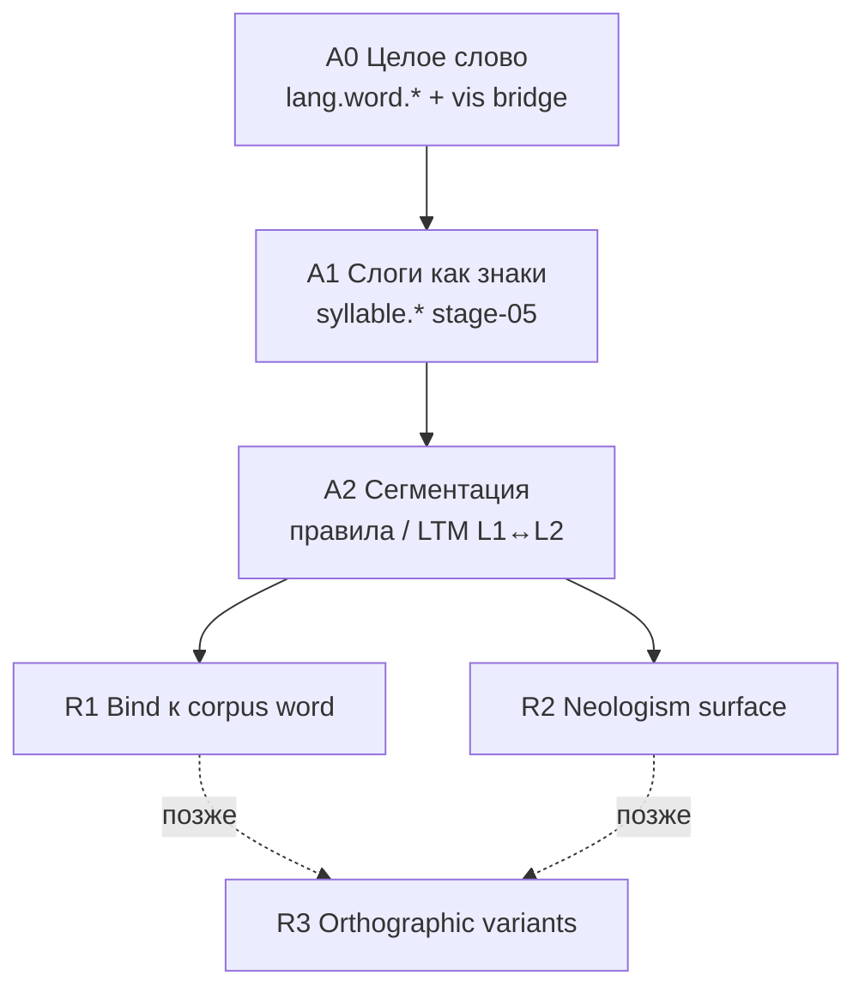

# CASA-ADR-0032: Аналитическое чтение (слоги → слово)

**Статус:** черновик — **на обсуждение** (не блокирует corpus ingest / compare / ADR-0030)  
**Дата:** 2026-06-04  
**Уровень абстракции (ориентир):** осознанное «чтение по слогам» после букв/слогов/целых слов; не OCR, не полная семантика «нового слова».  
**Связано:**

- [CASA-literacy-roadmap-v1.md](CASA-literacy-roadmap-v1.md) — stage-05 слоги, stage-06 корпус; § «не собирать слово в runtime» уточняется **этим** ADR
- [CASA-literacy-font-legibility-experiment-v1.md](CASA-literacy-font-legibility-experiment-v1.md) — L1/L2/L3 probe; здесь — **R4** аналитический read
- [CASA-ADR-0030-grammar-literacy-coherent-text.md](CASA-ADR-0030-grammar-literacy-coherent-text.md) — связный текст, L3 согласование; **после** устойчивого аналитического read на коротких формах
- [CASA-learning-protocol-vis-math-v1.md](CASA-learning-protocol-vis-math-v1.md) — один vis + один lex → один sleep; композиция — **отдельные** moment’ы и probe, не cartesian batch
- [memory-hierarchy.md](memory-hierarchy.md) — `L1_syllable`, `L2_word_*`, substrate repair (lab); visual tract — `syllables-ru`, `lexicon-ru`
- KB: [cursor-session-f4a4bba6-casa-lab-arc-v0.md](../../knowledge/work/cursor-session-f4a4bba6-casa-lab-arc-v0.md) — слог на полке L2↔L1, «волк» = один слог

---

## Решение (одной фразой)

**Аналитическое чтение — отдельный read-трек:** длинная строка на vis **без** целого моста `vis.lum.frame.*` → `lang.word.*` режется на слоги (правила / структура LTM), по кускам голосуют **уже выученные** `syllable.*` / `grapheme.*`, затем **сверка** с лексикой (`lang.word.*` в корпусе или **новый** токен для неологизма). Это **не** побочный эффект stage-05 и **не** замена whole-word ingest.

---

## Зачем отдельный ADR

| Вопрос | Без ADR (путаница) | С ADR |
|--------|-------------------|--------|
| «Государство» в LTM, JPEG не учили | кажется, что корпус + слоги сами склеятся на predict | явный контур R1: сегмент → слоги → bind к `lang.word.*` |
| Stage-05: 56 слогов know | кажется, что это уже «чтение по слогам» любого слова | stage-05 = **знаки-слоги**; R* = **композиция** на незнакомом целом кадре |
| Слово «краш» не в учебном списке | ждать ingest в corpus | R2: слоги + правила → **новый** lexical якорь (неологизм) |
| «ютуб» / «ютьюб» | один `lang.word.*` | R3 (позже): варианты написания, не v1 |

---

## Уровни чтения (не смешивать с probe L1–L3)

| Уровень | Смысл для учителя | Пример | Трек / probe |
|---------|-------------------|--------|----------------|
| **W0** | Узнаю **целую** карточку среди выученных | учили `word-…-sans` → know | L1 `trained_bridge`, corpus ingest |
| **W1** | Слово **в лексике**, целого vis **нет** | `государство` в L2/L3, novel `frame_id` | **R1** analytic + corpus bind |
| **W2** | Слова **нет в корпусе**, но это слово языка | «краш», заимствование | **R2** neologism compose |
| **W3** | Нет устойчивой орфографии | ютуб / ютюб / YouTube | **R3** variant cluster (отложено) |
| **S** | «Новое слово» = смысл, контекст, части | гипотезы значения | ADR-0030 / J0, **не** этот ADR |

Probe font-legibility **L3** (`grapheme_syllable_top` на novel frame) — лишь **диагностика** «всплыли ли слоги без `lang.word`»; критерий R1/R2 — отдельный `probe_analytic_read_*.py`.

---

## Слои curriculum (read path)



| Ступень | Содержание | Зависимости |
|---------|------------|-------------|
| **A0** | Whole-word JPEG, micro-ingest | `stage-03` / `stage-06` |
| **A1** | Слоговые карточки целиком | `stage-05-syllable-cyrl` |
| **A2** | Таблица слогов для headword (authoring) или раскладка на полке L2→L1 | substrate ingest / `data/` metadata |
| **R1** | Длинное слово на **новом** `frame_id` → сегменты ⊆ выученных слогов → top-1 = ожидаемый `lang.word.*` **уже в store** | A0 частично не нужен для **этого** слова; A1 + A2 + lexicon |
| **R2** | Та же цепочка; итог — **новый** `lang.word.{slug}` или episodic surface + sleep | lazy lexicon / promote; **не** manifest-oracle |
| **R3** | Несколько surface → один sense-id или `lang.word.variant.*` | орфография, транслит, бренды |

**Порядок lab v1:** A1 (есть) → A2 пилот на 5–10 слов → **R1** probe → R2 только после стабильного R1 на тех же слогах.

---

## R1: слово в памяти, визуально не учили

### Поведение (north star)

1. Показать JPEG с surface `государство`, `frame_id` **без** урока на этот id.
2. Сегментатор выдаёт цепочку слогов, совместимую с русской слогоделением и с **пересечением** выученных `syllable.*` (пилот: ручная разметка в manifest / sidecar JSON).
3. По каждому сегменту (или по скользящему окну lum — v2) — predict → `syllable.*` / `grapheme.*` с порогом know.
4. Агрегатор: если цепочка слогов **сошлась** с headword, голос `lang.word.государство` из **lexicon lattice** (уже в LTM) перевешивает пустой whole-word vis-мост.
5. Verdict probe: **analytic_know** — не тот же механизм, что L1 `trained_bridge`, но тот же **lexical id** в top-1.

### Что **не** делаем в v1

- Не правим `bridge_lex.predict_lex_for_vis_cue` «чтобы длинные слова сами собирались».
- Не считаем OCR / побуквенный decode на 32×32 достаточным.
- Не требуем полной семантики (W2/S).

### Связь с substrate

В lab arc слово на полке L2 **структурно** стыкуется со слогами L1; NCA **repair** чинит раскладку. Visual tract **не наследует** это автоматически: нужен либо **экспорт** слоговой цепочки в metadata при corpus ingest, либо **rule tract** `rule.syllabify.ru.v0` на wake (отдельный эпизод `kind: rule`), без подмены emergent vis→lex.

---

## R2: неологизм («краш» и т.п.)

| Факт | Следствие |
|------|-----------|
| Нет `lang.word.краш` в учебном корпусе | R1 **не** может «узнать» готовый токен |
| Слоги «краш» могут быть выучены визуально (`syllable.кра`, `syllable.ш` — если есть в stage-05) | compose даёт **surface hypothesis** |
| Слово всё равно **лексема** языка | после стабильного read: **lazy ingest** / workbook → `lang.word.краш` на sleep, без обязательного JPEG whole-word |

**Критерий R2 (lab):** analytic chain know на слогах + **новый** slug в episodic/workbook; повторный probe после одного micro-moment (optional whole-word card) — отдельный этап.

**Отличие от W2 (семантика):** R2 — «прочитал и зафиксировал форму»; значение, жарг, англ. crush — grammar/context/J0.

---

## R3: варианты написания (следующий уровень)

| Пример | Проблема | Направление (не v1) |
|--------|----------|---------------------|
| ютуб / ютюб / YouTube | нет одной нормы | `lang.word.variant.*` или entity + weak orthography links |
| Транслит | несколько slug | homoglyph / linked boot (см. f4a4 bilingual) |
| Опечатка на вывеске | близкий lum | отдельно от R1: **noise curriculum**, не слоговый bind |

ADR-0032 **не** закрывает R3; только фиксирует границу, чтобы R1 не раздували под «все написания сразу».

---

## Архитектура predict (черновик контракта)

```text
cue = vis.lum.frame.{novel_frame_id}
  → segmenter(surface | layout_meta | rule) → [s1, s2, …, sn]
  → for each si: predict_chunk(si) → top syllable/grapheme votes
  → compose_vote(chain) + lexicon_word_vote(headword?) + lattice_L2_prefix?
  → anchors[]: [{ concept_id, score, via: "analytic" | "whole" | "lex_only" }]
```

| Компонент | Роль | Где живёт (план) |
|-----------|------|------------------|
| **Segmenter** | строка → слоги | `data/analytic-syllables-v1.json` / rule episode |
| **Chunk predict** | vis фрагмент или proxy-cue на слог | lab: crop windows или **отдельные** syllable JPEG в lesson «разбор слова» |
| **Compose** | согласованность цепочки + слово из LTM | `casa/prisms/visual/analytic_read.py` (новый модуль) |
| **Probe** | `probe_analytic_read_corpus.py`, `probe_analytic_read_neologism.py` | `lab/visual-curriculum/` |

**Hot path v1:** compose может быть **offline probe-only** (учительский отчёт), без включения в `run_agent` wake, пока нет gate.

---

## Педагогика и moment’ы (не cartesian)

| Тип moment | Vis | Lex | Sleep |
|------------|-----|-----|-------|
| Слог целиком | syllable JPEG | `syllable.*` | один (stage-05) |
| Слово целиком | word JPEG | `lang.word.*` | один (corpus) |
| **Разбор слова (пилот)** | одно слово + **подписанные** зоны слогов **или** цепочка отдельных vis в одном episode chain | каждый слог → `syllable.*`; финальный тик → `lang.word.*` | **цепочка** эпизодов, не один sleep на N×M пар |

Запрещено: один sleep на «все слоги корпуса × одно длинное слово» (ложные мосты, как в ADR-0030 § `sleep_co_occurs_lex`).

---

## Probe (lab)

| Probe | Вход | Pass |
|-------|------|------|
| `probe_analytic_read_corpus` | слова ∈ LTM, **не** ingested на `frame_id`; sidecar слогов | top-1 `lang.word.*` == teacher; `via=analytic`; слоги ≥ порога know |
| `probe_analytic_read_neologism` | surface ∉ corpus; слоги выучены | chain know; допускается новый slug после promote |
| (diag) | как сейчас | `probe_word_recognition_modes` L3 — только «всплыли ли syllable в top-k» |

Отчёт: `teacher-analytic-read.json` — отдельно от `teacher-word-recognition-modes.json`.

---

## Инженерия v1 (пилот)

| # | Задача |
|---|--------|
| 1 | `data/literacy/analytic-segments-ru-pilot-v1.json` — 5–10 headwords, слоги, пересечение со stage-05 |
| 2 | JPEG «длинное слово» с novel `frame_id` (как font sweep) |
| 3 | `probe_analytic_read_corpus.py` — R1 без правок `bridge_lex` |
| 4 | Док: ссылка из roadmap § stage-05 |
| 5 | R2 «краш» — один neologism после R1 gate |

---

## Принципы (как compare / literacy)

1. **Read ≠ semantics** — R1/R2 проверяют **форму и lexical id**, не «понимает ли краш как вылет приложения».
2. **Не OCR-shunt** — сегментация опирается на учебные слоги и правила, не на внешний Tesseract в predict.
3. **Два склада** — `lang.word.*` в LTM (corpus/detcorpus) и `vis.lum` bridges — склейка **явная** (этот ADR).
4. **Не смешивать с ADR-0031** — саккады/фовеа — способ получить chunk vis; аналитика — **что делать с цепочкой**.
5. **Не смешивать с ADR-0029** — «и» между предикатами ≠ слоговая композиция.

---

## Открытые вопросы

- [ ] Сегментация v0: только sidecar vs `rule.syllabify.ru` на поле?
- [ ] Chunk vis на 32×32: crop по bbox vs отдельные кадры в lesson «разбор»?
- [ ] Голос L2 без vis: достаточно ли prefix / lattice decode для R1?
- [ ] Neologism: сразу `lang.word.*` или сначала episodic surface + promote?
- [ ] R3: один sense-id vs несколько `lang.word.*` — отдельный ADR?

---

## Статус принятия

Пока **черновик**. Lab не стартует без явного «go» на пилот R1; stage-06 corpus ingest **параллелен**, не заменяется.
