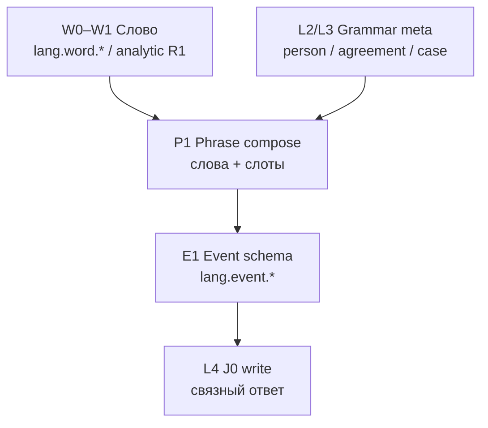

# CASA-ADR-0033: Русская фраза — слоты, морфология, свободный порядок слов

**Статус:** черновик — **на обсуждение**  
**Дата:** 2026-06-05  
**Связано:**

- [CASA-ADR-0034-executor-learning-loop.md](CASA-ADR-0034-executor-learning-loop.md) — META: phrase P1 = шаги 2–4, probe = шаг 5
- [CASA-ADR-0030-grammar-literacy-coherent-text.md](CASA-ADR-0030-grammar-literacy-coherent-text.md) — L2 мета-грамматика, L3 согласование, L4 J0
- [CASA-ADR-0032-analytic-syllable-reading.md](CASA-ADR-0032-analytic-syllable-reading.md) — R1 слово из слогов; **phrase compose** опирается на тот же compose, не на OCR
- [CASA-ADR-0031-foveated-saccadic-visual-sampling.md](CASA-ADR-0031-foveated-saccadic-visual-sampling.md) — длинный vis: серия фиксаций, не один 32×32
- [CASA-literacy-roadmap-v1.md](CASA-literacy-roadmap-v1.md) — стадии literacy
- [CASA-ADR-0037-gate-zun-verification.md](CASA-ADR-0037-gate-zun-verification.md) — gate = проверка ЗУН (META)
- [CASA-learning-protocol-vis-math-v1.md](CASA-learning-protocol-vis-math-v1.md) § «Одна категория — много выражений»
- [experiment-j0-russian-literacy-v1.md](experiment-j0-russian-literacy-v1.md) — articulation / write@sketch

---

## Решение (одной фразой)

**Связная русская фраза на поле — не фиксированный порядок слов (SVO), а event-схема со слотами (agent / verb / patient / …), роли которых задаются морфологией и согласованием; перестановки одной и той же тройки форм — одна структура на gate L3, топик/фокус — отдельный слой позже.**

---

## Зачем отдельный ADR

| Вопрос | Без ADR (путаница) | С ADR |
|--------|-------------------|--------|
| «Мама мыла раму» vs «Мыла раму мама» vs «Раму мама мыла» | учить один «каноничный» порядок или 10 разных `lang.word.*` цепочек | **одна** event-схема; порядок на линии **не** критерий pass |
| Probe по фразе | N× `predict_lex` на crop → empty (нет мостов на novel `frame_id`) | **phrase compose**: слова через analytic R1 + слоты + согласование |
| Английский шаблон Subject–Verb–Object | перенос на RU | роли в **падеже/форме**, не в позиции |
| Школьный звуковой разбор / ЕГЭ-шаблон | случайно тащим в read path | явно **вне scope** literacy tract |
| «Понял предложение» | один JPEG → один top-1 | L3 event + L4 J0; probe JPEG — только lab-gate на слоты |

---

## Не цель v1

- Полный синтаксический анализатор русского (все конструкции, эллипсис, деепричастные обороты).
- Информационная структура (топик / фокус / тема–рема) как обязательный gate.
- Генерация произвольных перестановок «для красоты» без опоры на формы.
- OCR или побуквенный decode на 32×32 как основа phrase read.
- Подмена **смысла** (W2/S в ADR-0032) — здесь только **форма и роли** на короткой фразе.

---

## Принципы (RU)

### 1. Роли ≠ позиция

Для транзитивной фразы v1 достаточно трёх слотов:

| Слот | Пример «Мама мыла раму» | Что держит роль |
|------|-------------------------|-----------------|
| **agent** | мама | им. п., согласование с глаголом |
| **verb** | мыла | форма глагола (лицо/число/род ↔ agent) |
| **patient** | раму | вин. п. |

Перестановки **тех же форм** (`Мыла раму мама`, `Раму мама мыла`, …) — **та же** event-схема; меняется лишь **linear order** (и позже — топик/фокус), не «кто кого мыла».

### 2. Одна категория — много surface (как ADR-0030)

- Несколько JPEG с разным порядком слов → **один** `lang.event.*` (или эквивалентный probe pass по слотам).
- Probe по **схеме**, не по exact string фразы.
- Отдельные moment’ы: не cartesian sleep vis×lex на всю фразу сразу.

### 3. Лексема ≠ роль

- `lang.word.мама` (L1) — знак «мама»;
- в слоте **agent** — та же лексема **в нужной форме** на surface;
- `lang.meta.grammar.person.*` (L2) — категории, не подмена слова.

### 4. Согласование — gate, порядок — нет

**Pass L3 (phrase v0):**

1. Каждое **слово** фразы восстановлено (analytic compose / corpus LTM / whole-word bridge — как в ADR-0032 R1).
2. Слоты заполнены **ожидаемыми** лексемами в **ожидаемых формах** (teacher sidecar v0).
3. **Согласование** agent↔verb (и при необходимости patient case) — ok.
4. **Linear order** — **не** проверяется на v0 gate (все перестановки одной тройки → pass).

**Fail:** неверная форма (`*Мама мыл раму`), неверный падеж объекта, пропущенное слово, ambiguous lex без разрешения.

### 5. Топик/фокус — L3+ / отдельный трек

«**Раму** мама мыла» vs «**Маму** мыла рама» — **разные** event-схемы (разные падежи), не перестановки одной тройки.  
Информационная структура («что вынесено в начало») — **не v1**; фиксируем границу, чтобы не смешивать с «10 способов сказать одно и то же».

### 6. Вопросный тест (согласование и части речи)

В русском **роль слова и согласование** — это **ответ на вопрос**, но вопрос задаётся **от опоры** (якорного слова). Одна фраза — **несколько допустимых опор**; каждая выявляет другой слот.

| Опора (якорь) | Вопрос | Ответ | Слот / связь |
|---------------|--------|-------|--------------|
| **мыла** (глагол) | **(мыла) кто?** | **мама** | `agent` |
| **мама** (сущ.) | **(мама) что делала?** | **мыла** | `verb` / predicate |
| **мыла** (глагол) | **(мыла) что?** | **раму** | `patient` |
| **окно** (сущ.) | **(окно) какое?** | **большое** | `modifier` ↔ `head` |
| **открыть** (инф.) | **(открыть) что?** | **окно** | `patient` / object |

Пример **«мама мыла»** — две равноправные проверки, не одна:

```text
мыла  + кто?           → мама     (agent)
мама  + что делала?    → мыла     (verb)
```

«Чего? / что делала?» — вопрос **к субъекту**, ответ — **сказуемое**; «кто?» — вопрос **к глаголу**, ответ — **подлежащее**. На поле это **две question-frame**, одна event-схема.

| Конструкция | Классический вопрос | Ответ → роль |
|-------------|---------------------|--------------|
| **большое окно** | окно **какое?** | **большое** → modifier ↔ head |
| **открыть окно** | открыть **что?** | **окно** → patient |
| **мама мыла** | мыла **кто?** | **мама** → agent |
| **мама мыла** | мама **что делала?** | **мыла** → verb |
| **мыла раму** | мыла **что?** | **раму** → patient |

**Для CASA (не v1 gate, канон направления):**

- Phrase P1 v0: слоты `agent` / `verb` / `patient` — **teacher sidecar**; agreement agent↔verb по форме.
- L2+: **question frame** = `{ anchor_role | anchor_surface, question_id }` → expected answer surface + slot; несколько frames на одну event-схему (как несколько routes с разными `match`).
- Согласование «мама ↔ мыла» = согласованность **пары ответов** (кто? + что делала?), не порядок слов на линии.
- Modifier–head («окно какое?») — slot kind `modifier`/`head`, **после** transitive P1.
- Части речи — emergent через **опора + вопрос → ответ**, не таблица «имя существительное» из учебника.

**Concept id (черновик):** `lang.meta.grammar.question.who`, `.question.what`, `.question.what_do`, `.question.which` — + `anchor` в match.

#### 6.1 Обстоятельства и прочие члены (тот же приём)

**Обстоятельство** — не отдельная «часть речи в списке», а **ответ на свой вопрос от опоры** (обычно от глагола / predicate). Тот же question-frame, другой `question_id` → slot kind `circumstantial.*`.

| Вид (RU школа) | Вопрос от опоры (глагол / сказуемое) | Пример | Slot kind |
|----------------|--------------------------------------|--------|-----------|
| **образ действия** | **(мыла) как?** | быстро **мыла** / мыла **тщательно** | `circumstantial.manner` |
| **место** | **(мыла) где?** | **дома** мыла | `circumstantial.place` |
| | **(мыла) куда?** | мыла **в сад** | `circumstantial.direction_to` |
| | **(мыла) откуда?** | мыла **из дома** | `circumstantial.direction_from` |
| **время** | **(мыла) когда?** | **вчера** мыла | `circumstantial.time` |
| | **(мыла) как долго?** | мыла **час** | `circumstantial.duration` |
| **причина** | **(мыла) почему?** | мыла **от скуки** | `circumstantial.cause` |
| **цель** | **(мыла) зачем?** / **(мыла) для чего?** | мыла **для мамы** | `circumstantial.purpose` |
| **условие** | **(мыла) при каком условии?** | **если грязно** — мыла | `circumstantial.condition` |

**Дополнение** (если не прямое «что?»):

| Вопрос | Пример | Slot |
|--------|--------|------|
| **(дала) кому?** | дала **Маше** | `recipient` / indirect object |
| **(думала) о чём?** | думала **о раме** | `theme` (prep phrase) |
| **(радуется) чему?** | радуется **солнцу** | `experiencer/theme` (valency) |

**Согласованное определение** уже в §6 (`окно какое?` → modifier); **несогласованное** («мыла **у окна**») — обстоятельство места, не modifier.

**Полная мини-фраза (пилот v2+, не P1):**

```text
«Мама вчера быстро мыла раму»
  мыла + кто?      → мама           agent
  мама + что делала? → мыла         verb
  мыла + что?      → раму           patient
  мыла + когда?    → вчера          circumstantial.time
  мыла + как?      → быстро         circumstantial.manner
```

Порядок слов на линии по-прежнему **не** gate; проверяются **заполненность слотов** и **согласование** там, где оно есть (agent↔verb, modifier↔head).

**CASA:**

- P1 v0 — только transitive `agent` / `verb` / `patient` (+ agreement).
- P2 — добавить circumstantial slots **по одному kind за curriculum sleep** (как compare → meta: не «все обстоятельства» одним moment).
- Question id: `.question.how`, `.where`, `.when`, `.why`, `.where_to`, `.where_from`, `.how_long`, `.why_purpose` — привязка к `circumstantial.*` в sidecar / emergent routes.
- Valency (кому? о чём?) — отдельные event types или optional slots на `lang.event.*`, не смешивать с wash.v0.

**Не v1:** наречие vs предлог+существительное («быстро» vs «в сад») — на read path достаточно **surface + slot**; морфологический разбор — L2 meta позже.

## Слои (read → phrase → discourse)



| Уровень | Смысл | Пример | concept / probe |
|---------|-------|--------|-------------------|
| **W1** | Слово в LTM, novel vis | `мама`, `мыла`, `раму` по отдельности | ADR-0032 R1 |
| **P1** | Фраза = **набор слов** + порядок на линии | «Мама мыла раму» | `probe_phrase_compose_*` |
| **E1** | Фраза = **одна event-схема** | agent+verb+patient независимо от permutations | `lang.event.*` + slot check |
| **F1** (позже) | Топик/фокус | «Раму-то мама мыла» | отдельный ADR / J0 |
| **S** | Смысл, прагматика | «мама мыла раму» = бытовая сцена | J0 / KB, не probe JPEG |

---

## Именование (черновик)

Префикс **semantic EN**; surface на JPEG — RU.

| Тип | id (канон) | Пример |
|-----|------------|--------|
| **Event (pilot)** | `lang.event.transitive.wash.v0` | «мама мыла раму» и перестановки |
| **Slot role** | `lang.meta.grammar.role.agent` / `.patient` / `.verb` | мета на карточке (позже) |
| **Case (план)** | `lang.meta.grammar.case.nom` / `.acc` / … | «именительный», «винительный» |
| **Agreement (план)** | `lang.meta.grammar.agreement.subjectVerb` | «он идёт» / «она идёт»; «мама мыла» / «брат мыл» |

**Pilot v0:** достаточно phrase-events JSON с полями `surface`, `words[]` (slug, role, surface), `agreement`; слоги — из corpus + `syllabify_ru` в runtime. `lang.event.*` в LTM — **после** стабильного P1 probe.

---

## Контракт phrase compose (lab v0)

### Teacher sidecar (authoring)

Файл вида `data/literacy/phrase-events-ru-pilot-v1.json`:

```json
{
  "schema_version": 1,
  "entries": [
    {
      "event_id": "lang.event.transitive.wash.v0",
      "surfaces": [
        "Мама мыла раму",
        "Мыла раму мама",
        "Раму мама мыла"
      ],
      "words": [
        {
          "role": "agent",
          "surface": "мама",
          "slug": "d2a8dc30e406"
        },
        {
          "role": "verb",
          "surface": "мыла",
          "slug": "27dae5010f7e"
        },
        {
          "role": "patient",
          "surface": "раму",
          "slug": "c6eebd8384e6"
        }
      ],
      "agreement": [{ "agent": "мама", "verb": "мыла", "kind": "subjectVerb.fem.sg.past" }]
    }
  ]
}
```

### Probe (план)

| Probe | Вход | Pass |
|-------|------|------|
| `probe_phrase_compose_pilot` | одна `surface` из `surfaces[]`, novel `phrase-probe-*` frame | все `words[]` → analytic_know; слоты + agreement ok; **order ignored** |
| `probe_phrase_permutation_equiv` | две surface одного `event_id` | обе → pass с **одним** `event_id` |
| (anti-pattern) crop + `predict_lex` на novel frame | crop слова без analytic | **не** gate связности; мосты привязаны к учебным id |

**Hot path v0:** offline teacher report; wake не включает phrase compose до gate P1.

### Vis

- Одна строка на JPEG (как font sweep / analytic probe).
- Сегментация слов: teacher bbox v0 → позже саккады (ADR-0031).
- **Не** один sleep на «фраза × все lex» (cartesian, ADR-0030).

---

## Зависимости curriculum

| # | Зависимость | Статус |
|---|-------------|--------|
| 1 | Слоги stage-05 | lab |
| 2 | Analytic R1 на отдельных словах фразы | pilot 5 слов |
| 3 | Слова фразы в LTM (`мама`, …) | corpus / ingest |
| 4 | Closed-class (при расширении) | stage-07 |
| 5 | L2 person / L3 agreement meta | stage-08, stage-09 |
| 6 | Формы «мыла», «раму» в LTM | отдельный ingest или rule tract (позже) |

**Блокер для «Мама мыла раму» сейчас:** `мыла`, `раму` могут **отсутствовать** в store — phrase probe покажет `word_not_in_ltm`, это ожидаемо, не баг compose.

---

## Что не делаем

1. **Не** учим «единственный правильный порядок слов» для RU.
2. **Не** считаем phrase probe с crop + `predict_lex` на novel frame доказательством связного чтения (anti-pattern: мосты vis↔lex не на «видении слова на фразе»).
3. **Не** смешиваем event pass с semantic W2 («понял, что мама домашняя сцена»).
4. **Не** подменяем падеж/согласование перестановкой без изменения форм.
5. **Не** тащим школьный звуковой разбор / непроизносимые / МФА в slot check.

---

## Связь с J0

| Компонент | Роль |
|-----------|------|
| von-neumann vis↔lex | слова + мета-грамматика как якоря |
| Event schema в LTM | «та же сцена» при разных surface |
| J0 write@sketch | **формулировка** связного ответа; порядок слов при генерации — articulation, не memorized template |
| Probe JPEG | gate **P1/E1**, не «умеет говорить» |

---

## Очередь реализации

| # | Задача | Статус |
|---|--------|--------|
| 1 | Этот ADR | черновик |
| 2 | `phrase-events-ru-pilot-v1.json` (1 event, 3 permutations) | **done** |
| 3 | `probe_phrase_compose_pilot.py` | **done** (`phrase_compose.py`, phrase-events JSON) |
| 4 | R1 ingest «мыла», «раму» | `run_phrase_pilot_words.py` (syllables + corpus) |
| 5 | `probe_phrase_permutation_equiv` | после green phrase compose |
| 6 | Вопросный тест → grammar.question.* (modifier, circumstantial, valency) | L2+ после P1 |
| 7 | Ссылка из roadmap + ADR-0030 § L3 | с ADR |

---

## Открытые вопросы

- [ ] Канонический id: `lang.event.*` vs episodic `event.{hash}` до promote?
- [ ] Agreement в v0: только teacher sidecar или частично `lang.meta.grammar.agreement.*`?
- [ ] Ellipsis («Мама мыла» без «раму») — отдельный event type?
- [ ] EN mirror: fixed order ближе к SVO — один event schema или locale-specific ADR?
- [ ] Чертёж / подписи на листе: phrase compose + spatial meta (ADR-0031) — joint pilot?

---

## Ссылки на анти-паттерны (lab)

| Артефакт | Вывод |
|----------|--------|
| crop + novel `frame_id` + `predict_lex` | **empty**; мосты привязаны к учебным id, не к «видению слова на фразе» |
| ADR-0032 `novel_compose` | слово из слогов + LTM — **строительный блок** phrase P1 |
| ADR-0030 § cartesian | фраза не ingest’ится одним sleep на N×M пар |
