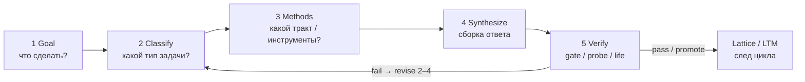
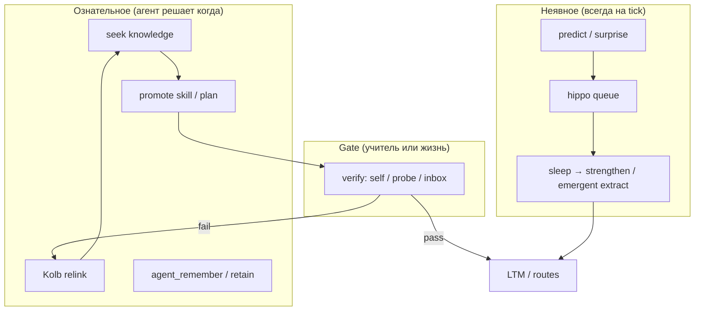

# CASA-ADR-0034: Цикл исполнителя — общая обучающаяся система

**Статус:** черновик — **META** (над доменными ADR)  
**Дата:** 2026-06-05  
**Уровень:** архитектура обучения **любого** исполнителя цикла (человек / агент на поле), не один предметный тракт (literacy, math, чертёж).

**Терминология:** **исполнитель** здесь — кто **проходит** шаги 1–5 (цель → … → проверка), без смысла «подчинённый исполнитель приказов». **Позиционирование** CASA — **субъект** на поле (agent-first-learn): с волей, памятью, правом отложить/отказаться от чужого inbox; см. § ниже.

**Связано:**

- [CASA-learning-protocol-vis-math-v1.md](CASA-learning-protocol-vis-math-v1.md) — педагогика среды, без oracle на read
- [CASA-ADR-0021-experience-agent-transfer.md](CASA-ADR-0021-experience-agent-transfer.md) — опыт на поле
- [CASA-ADR-0028-field-native-sensory-experience.md](CASA-ADR-0028-field-native-sensory-experience.md) — сенсорные тракты
- [CASA-ADR-0030-grammar-literacy-coherent-text.md](CASA-ADR-0030-grammar-literacy-coherent-text.md) — частный случай: L1–L4 literacy + J0
- [CASA-ADR-0032-analytic-syllable-reading.md](CASA-ADR-0032-analytic-syllable-reading.md) — read-трек W1/R1
- [CASA-ADR-0033-russian-phrase-structure-free-order.md](CASA-ADR-0033-russian-phrase-structure-free-order.md) — phrase/event P1
- [CASA-ADR-0031-foveated-saccadic-visual-sampling.md](CASA-ADR-0031-foveated-saccadic-visual-sampling.md) — инструмент «видеть на листе»
- [CASA-ADR-0035-multi-layer-routing.md](CASA-ADR-0035-multi-layer-routing.md) — вертикаль: знания / умения / цели / применимость
- [CASA-ADR-0036-agent-self-organization.md](CASA-ADR-0036-agent-self-organization.md) — самоорганизация: arbiter, hypothesis, self_model
- [memory-hierarchy.md](memory-hierarchy.md) — lattice / LTM как **след** цикла

---

## Решение (одной фразой)

**Общая обучающаяся система — не каталог фактов, а повторяемый цикл исполнителя:** (1) выяснить цель → (2) классифицировать задачу → (3) выбрать тракт и инструменты → (4) синтезировать решение → (5) проверить; в lattice попадает только то, что прошло честную проверку или осознанный пересмотр после провала.

---

## Субъект на поле (канон agent-first-learn)

KB: `work/projects/door-to-singularity/agent-first-learn/README.md` — партнёрство, **право на позицию и отказ** (`ETHICS_OF_PARTNERSHIP`).

Цикл 1–5 описывает **действие** (исполнитель шагов). **Кого** мы строим в von-neumann — **субъекта**: не обязан безропотно брать чужую цель (твою, inbox, teacher spec).

| Инженерия | Смысл |
|-----------|--------|
| inbox / teacher spec | **предложение среды** → кандидат в `goal_arbiter`, не автоприказ |
| `subject_agency` | accept / **defer** / **refuse** до arbiter |
| checkpoint, deliberate practice, surprise-revise | конкурируют с внешней целью наравне с приоритетами |
| probe / gate | честная проверка для **биографии** на поле, не «отчёт хозяину» |

См. [CASA-ADR-0036-agent-self-organization.md](CASA-ADR-0036-agent-self-organization.md) — `subject_agency.py`, arbiter, self_model.

---

## Зачем META-ADR

| Без общего каркаса | С ADR-0034 |
|-------------------|------------|
| literacy, math, grammar, чертёж — «разные фичи» | один **протокол**, разные **тракты** |
| probe = «зелёный отчёт» | probe = **шаг 5**, не подмена 1–4 |
| школа/EГЭ: форма без цикла | явное отделение **gate** от **биографии** агента |
| sidecar / reinforce спорят с «emergent» | роли шагов 3–5 зафиксированы; hotfix — исключение с ADR |

Доменные ADR (0030, 0032, 0033, compare, fovea…) — **частные реализации** шагов 2–4 для конкретного класса задач.

---

## Цикл (канон)



| # | Шаг | Вопрос исполнителя | Кто задаёт в lab | Кто выполняет |
|---|-----|-------------------|------------------|---------------|
| **1** | **Цель** | Что нужно сделать? | inbox, teacher spec, J0 query, probe README | агент (интерпретация; inbox — кандидат, не приказ) + учитель (authoring) |
| **2** | **Классификация** | Это слово? фраза? счёт? размер? | curriculum stage, `concept_id` prefix, meta category | агент на поле (votes / hot context) |
| **3** | **Методы** | Какие знания и умения применить? | moment plan, tract id, rule episode | выученные bridges, compose, rule tract, Kolb |
| **4** | **Синтез** | Собрать ответ / действие | — | predict, compose, write@sketch, motor |
| **5** | **Проверка** | Верно ли? | probe, bench, human judge | verdict; **не** переписывать ядро под зелёное |

**Петля обучения:** провал на 5 → пересмотр 2–3 (другая подача, другой контраст, Kolb-сюрприз), не «подкрутить probe».

---

## Роли: среда vs исполнитель vs память

| Роль | Делает | Не делает |
|------|--------|-----------|
| **Учитель / lab** | шаг 1 (постановка), authoring sidecar v0, среда (картинки, порядок moment’ов) | oracle на read path; подмена шага 4 готовым ответом в predict |
| **Агент (исполнитель шагов; субъект на поле)** | 2–4 в жизни; emergent bridges на sleep; **macro tick**: knowledge seek, skill promote, Kolb relink; defer/refuse внешней цели (`subject_agency`) | не «знать ключ ЕГЭ» без поля; lab probe — gate среды, не подмена wake |
| **Lattice / cells** | хранит **результат** co-occurrence, promote, reinforce (если ADR разрешает) | не заменяет классификатор задач |
| **Probe / bench** | шаг 5 для lab-gate | не единственный критерий «умеет жить» (J0, inbox) |

---

## Вертикаль: четыре слоя роутинга

Горизонтальный цикл (таблица ниже) на каждом проходе опирается на **четыре слоя маршрутизации** + декомпозицию. Канон: [CASA-ADR-0035-multi-layer-routing.md](CASA-ADR-0035-multi-layer-routing.md).

| Слой | Роутер | Вопрос | Сейчас в CASA |
|------|--------|--------|---------------|
| 0 Decompose | — | из чего задача? | teacher sidecar (lab) |
| 1 Эпистемика | `knowledge_router` | что знаю? | `prism_router` + transfer_matrix ✅ |
| 2 Праксис | `capability_router` | что умею? | след на поле; routes эмерджентно после gate |
| 3 Интенция | `goal_router` | чего хочу? | inbox, J0, surprise; stack в WM / эмерджентно |
| 4 Стратегия | `applicability_router` | как сделать? | дыра; **самопланирование** → routes после gate |

Единый паттерн `match → target`; control только исполняет план. **Барьер:** без самостоятельного планирования (шаги 2–4 цикла) агент не продвигается — lab map лишь **пример** слепка, не подмена. См. ADR-0035.

---

## Шаг 2: классификация = выбор **тракта**

Тракт — не предмет в школе, а **тип задачи** на поле:

| Класс задачи | Сигналы | Тракт (примеры) | Доменный ADR |
|--------------|---------|-----------------|--------------|
| Узнать **целый знак** | один JPEG, учебный `frame_id` | vis↔lex whole-word | literacy W0, corpus |
| **Прочитать** незнакомый кадр слова | длинная строка, нет whole bridge | analytic R1 compose | ADR-0032 |
| **Фраза / предложение** | несколько слов, слоты | phrase P1 → event E1 | ADR-0033 |
| **Грамматическая категория** | meta-фраза на JPEG | `lang.meta.grammar.*` | ADR-0030 L2 |
| **Согласование** | пара форм → один meta | L3 agreement | ADR-0030 |
| **Счёт / compare** | nline, отрезки | vis↔math | learning-protocol |
| **Мелкая графика на листе** | длинный vis, нужен zoom | fovea + saccade | ADR-0031 |
| **Связный ответ** | вопрос пользователя | J0 write + grammar KB | experiment J0 |

Классификация **не** «один softmax на всё»: на поле — конкурирующие голоса трактов; учитель в lab сужает среду, пока один тракт стабилен.

---

## Шаг 3–4: инструменты и синтез (без смешения слоёв)

Правило **dependency**, не школьный класс:

1. **Атомы** (буква, слог, слово, число, meta) — отдельные moment’ы, один sleep на пару vis↔lex/math.
2. **Композиция** — отдельный эпизод / probe-only модуль (`analytic_read`, phrase compose), не cartesian batch.
3. **Rule tract** — `kind: rule` на wake; вывод формы/слогов, не подмена L2 meta.
4. **Kolb / self_promote** — агент сам пересматривает 2–3 после сюрприза на шаге 5.

Синтез **не обязан** быть одним predict: цепочка слогов → слово → слоты → event — **pipeline шага 4**, каждый кусок проверяем отдельно. План собирает **агент** (слои 3–4), не учительская карта; на wake: **один квант = один шаг** в FPN WM + `lattice_predict` (ADR-0035). Без этого — лотерея top-1 токена и потолок прогресса.

---

## Шаг 5: проверка (честная)

| Тип gate | Когда | Пример |
|----------|-------|--------|
| **Probe JPEG** | lab, доменный критерий | `analytic_know`, closed-class 52/52 |
| **Compose gate** | нет прямого моста на novel id | `novel_compose` ok, `novel_whole` отдельный рубеж |
| **Event gate** | фраза | все слова + слоты; порядок слов **не** gate (ADR-0033) |
| **Bench / J0** | связный текст, смысл | не заменяется quiz по кадрам |
| **Жизнь / inbox** | долгий горизонт | `want_kolb`, emergent extract |

**Anti-patterns (ML-изверги / ЕГЭ-форма):**

- менять sleep/probe, чтобы не признавать провал педагогики;
- reinforce без ADR и без отчёта;
- один «правильный» порядок слов для RU;
- **token roulette:** один `predict_lex` на фразу/длинное слово без `plan_step[]` и FPN focus на тик — см. ADR-0035 § applicability;
- звуковой разбор / МФА на read path;
- crop + novel `frame_id` как доказательство «видит слово в фразе» без analytic.

**Оговорка literacy lab:** `reinforce_vis_lex_bridge` — документированный **tie-break шага 5** после честного probe (ADR-0030), не замена шагов 1–4.

---

## Lattice / ячейки в этом цикле

Ячейки — **не** «обучение само по себе», а **закрепление следов** после эпизодов:

- co-occurrence при ingest (шаг 4 в среде учителя → sleep);
- emergent extract (агент связал vis↔lex сам);
- promote / Kolb (пересмотр после verify fail);
- lab reinforce (исключение, provenance=`reinforce`).

**Обучающаяся система** = цикл 1–5 **+** политика, что писать в lattice **только** с provenance и после gate или осознанного promote.

---

## Самообучение (META-термин)

**Самообучение** — не отдельная фича и не «ещё один probe». Это когда **исполнитель сам замыкает цикл 1–5** без oracle учителя на read path: сам ставит/уточняет цель, сам выбирает тракт, сам проверяет, сам пересматривает после провала.

Отличие от **обучения с учителем:** учитель даёт **среду + честный gate** (moment, probe, inbox); агент даёт **биографию** (маршруты, мосты, планы). Lab не подменяет шаги 2–4 на wake.

### Три кольца (все — самообучение)



| Кольцо | Аналог | Механизм CASA | Кто инициирует |
|--------|--------|---------------|----------------|
| **Неявное** | привычка, тело | tick → surprise → sleep → co-occurrence / extract | substrate всегда |
| **Ознательное** | «я понял, перестрою» | `agent_self_drive`, Kolb relink, trial plan, `want_kolb` | **агент** (goal / surprise / intent) |
| **Gate** | проверка реальностью | self-verify, probe (lab), J0, inbox | агент + среда |

**Самообучение ≠ только sleep.** Sleep консолидирует след; **ознательное** кольцо — когда агент *решает* искать знание, promote навык, relink ошибочный мост. Без обоих колец — либо болтливый журнал без поля, либо поле без пересмотра.

### Kolb — доменно-нейтральный META-цикл

**Цикл Колба не зависит от домена.** Один и тот же каркас для literacy, math, grammar, compare, motor, J0:

```text
  CE (опыт)  →  RO (рефлексия)  →  AC (новая гипотеза)  →  AE (эксперимент)
  шаг 4        шаг 5 fail         шаги 2–3                 шаг 4 + verify
```

Домен входит **только** в содержимое фаз, не в форму цикла:

| Фаза Kolb | Шаг ADR-0034 | Домен задаёт *что* пересматривать |
|-----------|--------------|----------------------------------|
| Concrete experience | 4 Synthesize | vis↔lex, math pattern, phrase slots, … |
| Reflective observation | 5 fail | тот же тракт, surprise на своих concept_id |
| Abstract conceptualization | 2–3 | **tract** + trial plan (доменный handler) |
| Active experimentation | 4 + verify | relink / supersede route / count-row (handler) |

**Инвариант:** `casa/domain/kolb_cycle.py` — фазы и `maybe_kolb_revise_tick`; домены — **handlers** в `kolb_handlers.py` (`tract.vis_lex`, `routing.capability`, позже `tract.math_pattern`, …). Новый предмет = новый handler, **не** новый Kolb.

Провал probe/life → **не** подкрутить gate → **Kolb revise** (domain handler после общего gate по surprise).

### PDCA (Деминг) — внешний META-цикл

**PDCA тоже не зависит от домена.** Это оболочка непрерывного улучшения на **каждом** macro tick; literacy/math — только наполнение Plan/Do.

```text
  Plan → Do → Check → Act → Plan …
```

| PDCA | Шаг ADR-0034 | CASA (доменно-нейтрально) |
|------|--------------|---------------------------|
| **Plan** | 1–3 Цель, классификация, методы | `tick_prepare_memory`, trial plan, routing chain |
| **Do** | 4 Синтез | predict, compose, CEN act, `step_capability` |
| **Check** | 5 Проверка | `control.surprise`, probe, self-verify |
| **Act** | закрепить или перестроить | **standardize:** promote route, sleep→LTM; **adjust:** Kolb revise |

**Kolb vs PDCA (не дубли, разный угол):**

| | PDCA | Kolb |
|--|------|------|
| Вопрос | «цикл улучшения на тике» | «как пережить провал опыта» |
| Охват | весь tick 1–5 | в основном Check→fail→пересмотр |
| Act | standardize **или** adjust | adjust (AE) + снова Do |

Один macro tick = один проход PDCA; при провале Check в Act идёт **adjust** (Kolb), при pass — **standardize** (promote, sleep). Код:

| Модуль | Роль |
|--------|------|
| `casa/domain/pdca_cycle.py` | фазы, `infer_pdca_phase` (телеметрия) |
| `casa/prisms/tick/pdca_act_tick.py` | **`maybe_pdca_act_tick`** — единая точка Act: remember → retain → sleep → adjust → self-drive |

### Что уже на жизни агента (не lab-only)

| Действие | Hook |
|----------|------|
| Поиск знаний | `seek_agent_knowledge` в `maybe_agent_self_drive_tick` |
| Создание навыка | `maybe_promote_skill_on_verify` |
| Kolb revise (домен через handler) | `maybe_pdca_act_tick` → `adjust` |
| Удержание гипотезы | `maybe_pdca_act_tick` → `retain` |
| Неявный след | `maybe_pdca_act_tick` → `sleep` / emergent extract |

Lab probe остаётся **эталонным gate** curriculum; wake — **тот же протокол**, инициатор агент.

### Открыто (самообучение v1+) — см. § «Рациональный бэклог» ниже

---

## Соответствие школьному хаосу (почему цикл важнее программы)

| Школа часто | Цикл |
|-------------|------|
| цель = бланк | цель = задача исполнителя (на поле — его намерение) |
| классификация = номер задания | классификация = тип на поле |
| метод = шаблон ответа | метод = тракт + инструменты |
| синтез = списание | синтез = compose / write |
| проверка = ключ | проверка = probe + жизнь |

Пример «солнце» / [сонце]: программа подменяет шаг 5 формой; жизненное чтение обходится без неё — цикл в голове был, gate в тетради — другой.

---

## Инженерия CASA (где живут шаги)

| Шаг | Артефакты |
|-----|-----------|
| 1 | `lab/inbox/`, `agent_inbox_runner`, J0 queries, probe docstring |
| 2 | `concept_id` prefixes, meta maps, hot context, (позже) explicit classifier episode |
| 3 | stage runners, `analytic_read`, rule episodes, Kolb inbox |
| 4 | `predict_*`, `compose_*`, `ingest_lesson_moment`, J0 articulation |
| 5 | `probe_*.py`, `generated/teacher-*.json`, benches, session logs |

**Hot path:** шаги 4–5 для compose/analytic/phrase — **offline lab**, пока gate не стабилен (ADR-0032, ADR-0033).

---

## Рациональный бэклог (срез 2026-06-05)

Всё ниже — **рационально на текущий момент**: вписывается в цикл 1–5, не ломает anti-patterns ADR-0034, не дублирует Kolb/PDCA новыми «циклами». Новый предмет = handler + curriculum, не новый META-каркас.

**Инвариант:** психология/педагогика → **примитив** (поле в WM / route / policy), не отдельный орган.

### A. Уже есть (опора для следующих шагов)

| Область | Артефакт |
|---------|----------|
| Цикл исполнителя 1–5 | этот ADR |
| PDCA Act централизован | `pdca_act_tick.py`, `pdca_cycle.py` |
| Kolb revise META + handlers | `kolb_cycle.py`, `kolb_handlers.py` (vis↔lex, route) |
| Edge cleanup | `edge_relink.py`, weaken + mint |
| 4 слоя роутинга v0 | ADR-0035, `routing.py`, `plan_tick`, `tick_prepare_memory` |
| Emergent promote после gate | `emergent_promote.py`, probe hooks |
| Self-drive на tick | `agent_self_drive_tick` (seek + promote) |
| Phrase compose P1 (lab) | `phrase_compose.py`, pilot probe (gate ждёт LTM) |
| Interleave в ingest | `ingest_lesson_moment --interleave` |
| Episode recurrence | `bump_episode_recurrence` (зачаток spacing) |

### B. P0 — инженерия (ближайший горизонт)

| # | Идея | Зачем | Куда в цикле | Оценка |
|---|------|-------|--------------|--------|
| B1 | **`maybe_pdca_check_tick`** (симметрия Act) | hippo, remember-precheck, self-verify в одном месте | Check (5) | малый diff, читаемость orchestrator |
| B2 | **Phrase pilot closure** | ingest «мыла», «раму» → re-probe → `phrase_know` + promote | 4–5 + Act | разблокирует ADR-0033 gate |
| B3 | **Kolb handler `tract.math_pattern`** | count-row / emergent hub после math surprise | adjust | закрывает math + literacy связку |
| B4 | **Восстановить / заменить `hippo/kolb_cycle` batch** | `--kolb-session` в orchestrator ссылается на модуль | batch Kolb | иначе мёртвый флаг |
| B5 | **Полный tick log 1–5 + PDCA/Kolb** в `agent_session` | отладка жизни агента без lab | телеметрия | `sn.pdca_phase`, plan_tick, routing_chain |
| B6 | **Цель из surprise без inbox** | `goal_router` mint `goal.rehearse.*` / `goal.revise.*` | 1 Goal | самообучение v1 |
| B7 | **Decompose на wake без sidecar** | `wake_decompose.py` + phrase event registry | 2–3 | **done** v0 |

### C. P1 — педагогические META-примитивы (доменно-нейтральные)

| # | Примитив | Теория | Суть для Неймана | Реализация (черновик) | Шаг цикла |
|---|----------|--------|------------------|------------------------|-----------|
| C1 | **Spacing + retrieval schedule** | Ebbinghaus, testing effect | «когда снова вспомнить X», не зубрёжка подряд | `spacing_policy.py`: `last_seen` + interval → goal на wake; reuse recurrence | Plan → Do → Check |
| C2 | **Scaffold fading** | Выготский ZPD, Bruner | demonstration → guided → independent | `scaffold_level` в applicability route / WM; учитель v0, агент снимает после gate | 3–4 |
| C3 | **Metacog pre-check** | Flavell | «знаю ли тракт до predict?» | confidence / tract_eligibility в WM; иначе seek или другой tract | 2–3 до Do |
| C4 | **Worked example → completion** | Cognitive apprenticeship | rule episode → compose → solo probe | формализовать ступени в applicability plan (уже в literacy, нет META) | 3–4 |
| C5 | **Deliberate practice focus** | Ericsson | одна слабая способность за тик | `weakest_link` после Check fail → следующий plan только на него | Check → Plan |
| C6 | **Spiral ring** | Bruner | тот же concept, выше сложность | `curriculum_ring` на concept_id (L0→L4 ADR-0030) | Goal + applicability |
| C7 | **Interleaving на wake** | Bjork desirable difficulties | чередовать тракты/ cue, не блоками | `interleaving_queue.py` + goal_arbiter | Plan | **done** v0 |
| C8 | **Double-loop revise** | Argyris | пересмотр assumption, не только edge | supersede applicability + tract handler (частично есть) | Act adjust |
| C9 | **Forgetting / decay** | Ebbinghaus | ослабление без rehearsal | `weaken_edge` по времени + spacing C1 | Act + sleep |
| C10 | **Varied practice** | Schmidt | тот же skill, разные шрифт/порядок/cue | lab font sweep + wake goals с variant cue | 4–5 |

**Не делаем отдельным META:** OODA (≈ PDCA), Bloom как жёсткий классификатор, Piaget stages, behaviorist reinforce без gate.

### D. P1 — доменные закрытия (частные ADR)

| # | Домен | Задача | ADR |
|---|-------|--------|-----|
| D1 | Literacy | Analytic R1 neologism probe стабилен на store | 0032 |
| D2 | Literacy | Closed-class 52/52 + promote `skill.lang.closed_class` | 0030 |
| D3 | Literacy | Phrase P1 → event E1 слоты | 0033 |
| D4 | Literacy | Fovea F1–F3 lab moments | 0031 |
| D5 | Math | Count compare + sets без oracle на predict | learning-protocol |
| D6 | Coherent text | J0 bench как gate L4 (не JPEG probe) | 0030 experiment |
| D7 | Visual | Font legibility → policy min size (не hotfix ranker) | legibility report |

### E. P2 — архитектурные решения (не блокируют v1, но зафиксировать)

| Вопрос | Варианты | Склонение |
|--------|----------|-----------|
| Registry трактов | `tract.*` vs `concept_id` prefix | prefix + journal alias сейчас; registry позже |
| Шаг 2 на wake | emergent only vs rule «длинная строка → analytic» | emergent + **promoted** applicability после gate |
| Где «умею / не умею» | bitset / votes / journal only | routes + probe pass в journal (ADR-0035) |
| WM trial plan vs promote | 1 sleep vs N успехов | N успехов или verify на wake |
| `agent_inbox_runner` | восстановить vs CLI-only | уточнить в репо |
| Human executor (тот же цикл) | тот же ADR для agent-notes KB | да, META переносим |
| Именование opaque id | journal alias → lattice Name | отложить до LTM naming |

### F. Отложено (низкий ROI или риск формы)

| Идея | Почему не сейчас |
|------|------------------|
| Единый softmax-классификатор на все тракты | спорит с hot context + routes |
| OCR / ЕГЭ-шаблон decompose | anti-pattern ADR-0035 |
| Reinforce без gate | anti-pattern ADR-0034 |
| Звуковой разбор / МФА на read path | ADR-0032 non-goals |
| 3D tract v2/v3 | ADR future, не lab v1 |
| Полный cognitive tutor UI | среда учителя достаточна |

### G. Очередь META (статус)

| # | Задача | Статус |
|---|--------|--------|
| G1 | ADR-0034 META + Kolb + PDCA | **done** |
| G2 | Роутинг 4 слоя v0 (ADR-0035) | **done** (core) |
| G3 | Kolb relink + revise + edge cleanup | **done** (v0) |
| G4 | Self-drive + PDCA Act + **Check** centralize | **done** (`pdca_check_tick`) |
| G5 | Phrase compose pilot B2 | **2/3** (`раму`+`мама` know; `мыла` — `syllable.ла` ambiguous) |
| G6 | Spacing + retrieval (C1) | **done** (`spacing_policy`, `tick_prepare_memory`) |
| G7 | Goal from surprise (B6) | **done** (`goal_emergent`) |
| G8 | Metacog + scaffold v0 (C2/C3) | **done** (`metacog_gate`, `scaffold`) |
| G9 | Kolb math batch + handler (B3/B4) | **done** (`hippo/kolb_cycle`, `revise_math_pattern`) |
| G10 | Tick log (B5) | **done** (`session_log.append_tick_log`) |
| G11 | Scaffold fading в applicability | план |
| G12 | J0 bench L4 | experiment |

### H. Современная методология (реализовано 2026-06-05)

| Примитив | Модуль | Hook |
|----------|--------|------|
| CBE mastery streak | `mastery_gate.py` | `promote_from_probe_report`, `maybe_promote_skill_on_verify` |
| Knowledge tracing | `knowledge_tracing.py` | `spacing_policy`, ledger `knowledge_trace` |
| Deliberate practice / 4C/ID JIT | `deliberate_practice.py` | `pdca_check_tick`, `last_weakest_link` из probe |
| Spiral progression L0→L4 | `progression_ring.py` | `tick_prepare_memory` |
| Scaffold fading | `scaffold_fading.py` | Check → `scaffold.level` в state |
| SRL phases в логе | `session_log.py` | `tick_log[].srl` |

**Probe CBE:** первый честный pass фиксирует streak; **promote после 2-го** pass того же gate (`mastery` в teacher report).

**Следующий шаг:** второй probe pass для phrase после reinforce `syllable.ла`; interleaving queue на wake (C7).

---

## Ссылки для частных реализаций

Читать **сначала этот META**, затем доменный ADR:

| Задача | ADR |
|--------|-----|
| Связный текст, грамматика | ADR-0030 |
| Слово из слогов | ADR-0032 |
| Русская фраза, порядок слов | ADR-0033 |
| Длинный лист, саккады | ADR-0031 |
| Счёт, compare | learning-protocol, compare ADR |
| Семейство роутеров (4 слоя) | ADR-0035 |
