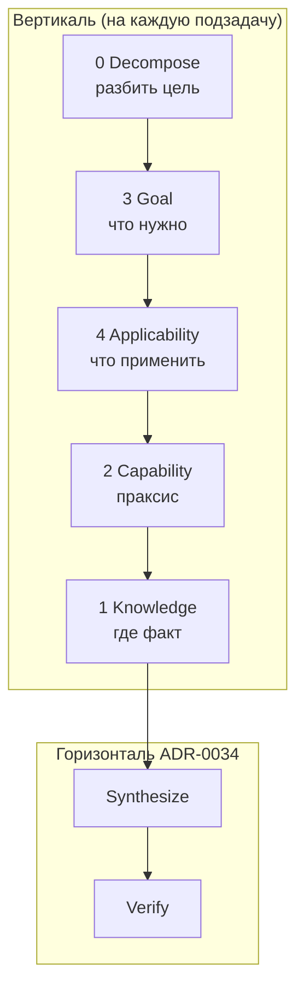
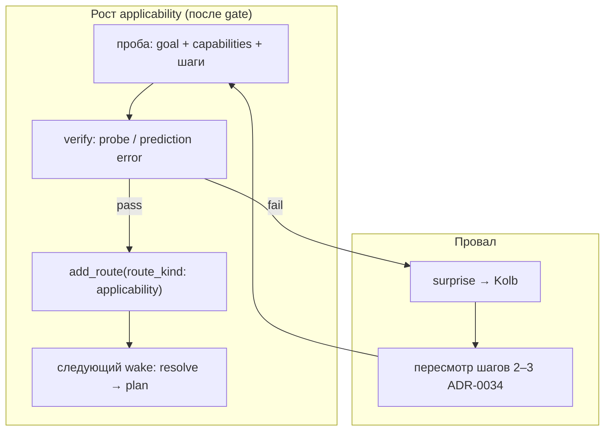

# CASA-ADR-0035: Многослойный роутинг — знания, умения, цели, применимость

**Статус:** черновик — **на обсуждение**  
**Дата:** 2026-06-05  
**Уровень:** META (дополняет ADR-0034; не заменяет ADR-0016)

**Связано:**

- [CASA-ADR-0034-executor-learning-loop.md](CASA-ADR-0034-executor-learning-loop.md) — горизонтальный цикл 1–5 (цель → … → проверка)
- [CASA-ADR-0046-body-function-calling-extension.md](CASA-ADR-0046-body-function-calling-extension.md) — tool tract: `skill.tool.*` / body dispatch; **не** organ в control
- [CASA-ADR-0016-prism-domains-hot-router.md](CASA-ADR-0016-prism-domains-hot-router.md) — `prism_router` (слой 1)
- [CASA-ADR-0021-experience-agent-transfer.md](CASA-ADR-0021-experience-agent-transfer.md) — transfer_matrix, опыт агента
- [CASA-ADR-0010-control-zone-predict-attention-value.md](CASA-ADR-0010-control-zone-predict-attention-value.md) — FPN/DAN/CEN (исполнение, не таблицы знаний)
- [CASA-ADR-0019-control-multi-prism.md](CASA-ADR-0019-control-multi-prism.md) — `prism_control_*` vs content
- [design/matrices/matrix-casa-cross-prism-transfer-v1.json](matrices/matrix-casa-cross-prism-transfer-v1.json) — shipped routes слоя 1
- `casa/domain/routing.py` — `RouteContext`, `Router`

---

## Решение (одной фразой)

**Единый паттерн матрицы `match → target` управляет системой на всех уровнях абстракции; меняются только входные измерения (dimensions). Четыре роутера — эпистемика, праксис, интенция, стратегия; control (NativeAOT-контур) исполняет план, память хранит слепки, не каталог умений.**

*(Согласование формулировки — Orion, 2026-06-05.)*

---

## Единый паттерн: одна матрица, разные dimensions

| Роутер | Слой (вопрос) | Входные dimensions | Target |
|--------|---------------|-------------------|--------|
| **`knowledge_router`** | **Эпистемика** — что я знаю? | стимул, `locale`, `segment`, `modality`, `tier` | `content_prism` / `lattice_hint` |
| **`capability_router`** | **Праксис** — что я умею? | класс задачи, `modality`, `surface_class`, `novel` | `skill.*` / выученная процедура |
| **`goal_router`** | **Интенция** — чего я хочу? | inbox, журнал J0, всплески surprise (SN) | `goal.*` в стеке FPN / workspace |
| **`applicability_router`** | **Стратегия** — как мне это сделать? | активная цель, доступные умения, контекст | `plan.*` + `plan_step[]` |

Один алгоритм `Router.resolve(ctx)` — priority, longest match; **разные таблицы** по `route_kind`, не разная логика.

**Жёсткий водораздел:**

| Контур | Роль | Не делает |
|--------|------|-----------|
| **Control** (`prism_control_*`, NativeAOT hot path ~0.7 ms) | исполнение плана тика: внимание, act, predict | не хранит таблицы знаний, умений, целей |
| **Память** (`prism_router`, content prisms, lattice) | слепки поля, маршруты слоя 1, след co-occurrence | не каталог умений; не выбирает analytic vs whole |

Полная декомпозиция и изоляция слоёв: роутер отвечает на свой вопрос; control **читает** результат applicability/capability, **не** подменяет матрицы.

---

## Зачем отдельный ADR

| Путаница | С ADR-0035 |
|----------|------------|
| «Роутер есть — значит агент умный» | богат **только слой 1** (knowledge); literacy lab обходит 2–4 |
| Всё свести в `prism_control` | control = FPN/CEN/DAN; router = декларативные таблицы в `field_state` |
| Один `transfer_matrix` на всё | разные **dimensions** и **targets** по слоям |
| Декомпозиция = sidecar навсегда | sidecar = подсказка для gate; планы и routes растут **эмерджентно** в FPN/router |

ADR-0034 описывает **шаги цикла**; этот ADR — **чем маршрутизировать на каждом этаже**.

---

## Четыре слоя (+ декомпозиция)



| Слой | Роутер | Вопрос | Target | Статус в CASA |
|------|--------|--------|--------|---------------|
| **0. Decompose** | *(не роутер)* | Из чего состоит задача? | `plan_step[]`, subgoal id | teacher JSON / будущий FPN plan |
| **1. Knowledge** | `knowledge_router` | Эпистемика: где факт? | `prism_id`, `lattice_hint` | **`prism_router`** + transfer_matrix ✅ |
| **2. Capability** | `capability_router` | Праксис: что умею? | `skill.*` procedure id | след на поле; routes **эмерджентно** после gate |
| **3. Goal** | `goal_router` | Интенция: чего хочу? | `goal.*`, inbox item | inbox, J0, surprise; stack **эмерджентно** / в WM |
| **4. Applicability** | `applicability_router` | Стратегия: как сделать? | `plan.tract.*`, `steps[]` | **дыра**; маршруты **эмерджентно** после gate |

**Не смешивать:** `lang.word.мама` (эпистемика) ≠ `skill.read.analytic` (праксис) ≠ `goal.read.phrase` (интенция) ≠ `plan.phrase_compose_v0` (стратегия).

*В коде v0 `prism_router` = реализация `knowledge_router`; остальные — имена целевых матриц до появления отдельных prism-роутеров или секций по `route_kind`.*

---

## Слой 1: `knowledge_router` — эпистемика (есть)

### Артефакты

| Компонент | Путь |
|-----------|------|
| Prism | `prism_router` (`kind: router`) |
| API | `resolve_route`, `add_route` — `casa/prisms/memory/prism_router.py` |
| Shipped matrix | `design/matrices/matrix-casa-cross-prism-transfer-v1.json` |
| Context | `RouteContext(modality, locale, segment, tier, …)` |

### Примеры match → target

| match | target |
|-------|--------|
| `modality: vis` | `prism_visual` / `V1_lum` |
| `modality: t9, locale: ru` | `prism_lang_ru` / `L2_word` |
| `modality: schema` | `prism_math` |

### Ограничение

Отвечает на **«в какой склад лексики/vis зайти»**, не на:

- whole-word vs analytic read;
- phrase vs single word;
- «какой приём решения включить».

---

## Слой 2: `capability_router` — праксис (план)

Маппит **класс задачи + модальность** на конкретную выученную процедуру: аналитическое чтение по буквам, гештальт-чтение слова целиком, счёт, движение каретки / саккада.

### Что считать «умением» (target `skill.*`)

Процедура, прошедшая **gate** (probe / life), с trace в опыте агента:

| skill id (черновик) | Процедура | Gate |
|---------------------|-----------|------|
| `skill.read.whole` | `predict_lex` на учебном `frame_id` | corpus probe know |
| `skill.read.analytic` | `compose_analytic_read` | ADR-0032 R1 |
| `skill.read.phrase` | phrase compose P1 | ADR-0033 |
| `skill.math.count` | `predict_math_for_vis_cue` | nline probe |
| `skill.vis.saccade` | fovea chain | ADR-0031 |
| `skill.write.j0` | articulation / write@sketch | J0 bench |
| `skill.tool.git_status` | `BodyFunctionExtension` → git status | ADR-0046 tool smoke |
| `skill.tool.build.verify` | `ide_agent_verify` / build ladder | ADR-0046 + CIDE AEE |
| `skill.tool.notes.read` | read agent notes / hot context | ADR-0046 continuity |

Умение — **не** NCA weights сами по себе; это **доступная процедура + достаточный след** на поле (bridges, LTM). **Gate** = проверка ЗУН на held-out ([CASA-ADR-0037-gate-zun-verification.md](CASA-ADR-0037-gate-zun-verification.md)); sidecar без store — не gate.

**Tool tract (ADR-0046):** capability/applicability/goal routes — **да**; отдельный router-prism в control hot path — **нет**. Wire MCP живёт в `body_manifest`; поле хранит «умею вызвать», не JSON Schema.

### Матрица capability (эмерджентно, тот же паттерн)

Строки появляются, когда probe/life подтвердил: «на `novel+word` стабильно работает `skill.read.analytic`». Пример **следа** после gate:

```json
{
  "route_kind": "capability",
  "match": { "modality": "vis", "surface_class": "word", "novel": "true" },
  "target_skill": "skill.read.analytic",
  "provenance": { "gate": "probe_analytic_read_corpus", "via": "novel_compose" }
}
```

**Где жить:** `route_kind: capability` в router-prism или `prism_capability_router`; `add_route` после verify. Не в lattice DMN/FPN; **не** в control; **не** design-time seed для literacy.

---

## Слой 3: `goal_router` — интенция (план)

Мониторит входящий поток, журнал J0 и всплески surprise; динамически перестраивает стек активных целей в рабочей памяти сессии (FPN / workspace).

### Источники целей

| Источник | Пример |
|----------|--------|
| Inbox | literacy moment, Kolb event |
| J0 | user query |
| Surprise | prediction error → SN |
| Teacher | probe spec (lab only) |

### Матрица goal

Match → **активная цель** (stack / agenda):

```json
{
  "match": { "inbox_kind": "literacy", "stage": "stage-05-syllable-cyrl" },
  "target_goal": "goal.learn.syllable"
}
```

**Связь с control:** **FPN** держит `task_mode` / WM digest; goal router **выбирает frame** из inbox, не заменяет FPN. Thalamus (ADR-0024) — relay до `resolve_route`.

**v0 факт:** цель часто **вне поля** (CLI lab); `agent_session` / journal — место для explicit goal stack (ADR-0015).

---

## Слой 4: `applicability_router` — стратегия (план)

На основе текущей цели, доступных умений и контекста собирает цепочку подзадач (план). Вопрос: **цель × capability × контекст → `plan.*` + `plan_step[]`**.

**Инвариант:** если агент **не планирует сам** (цель → шаги → verify → `add_route`), он далеко не уйдёт — ни literacy, ни чертёж, ни J0. Лабораторная карта допустима **только как пример** для людей и bench («вот как *может* выглядеть* слепок после удачного опыта»); на wake её **не подключают** и не заливают в `field_state` вместо собственного планирования.

Учитель даёт среду, стимулы и **честный gate** (probe / surprise). Таблицы `goal × capability → plan` агент **создаёт сам** на **macro tick** (`maybe_agent_self_drive_tick`: seek → step verify → `promote_capability_route` / `promote_applicability_route`), как emergent knowledge routes (ADR-0016), только после self-verify. Lab probe — эталон gate, не единственный promote path.

### Lab map = пример, не костыль

| Роль | Допустимо | Запрещено |
|------|-----------|-----------|
| **Пример в design/lab** | «эталонный слепок» для сравнения с тем, что вырос у агента | подмена шага 2–4 в `run_agent` |
| **Учитель** | среда, gate, sidecar для **проверки** декомпозиции | oracle-план в predict |
| **Агент** | FPN trial → verify → promote route | читать чужую карту как свой план |

Иллюстрация ( **не** seed, **не** TOML на диске как обязательный артефакт):

```toml
# ПРИМЕР: как может выглядеть route ПОСЛЕ того, как агент сам прошёл phrase gate
[[route]]
match = { goal = "goal.read.phrase", locale = "ru" }
target_plan = "plan.phrase_compose_emergent_v1"  # id из journal агента, не design-time
steps = ["skill.read.analytic", "skill.compose.slots", "skill.verify.phrase"]
```

Сравнение probe: «совпал ли **эмерджентный** план агента с тем, что мы *ожидали бы* в примере» — ок для lab; «подставить пример в router» — нет.

### v0 сейчас: дыра + учитель снаружи поля

| Факт v0 | Что это **не** |
|---------|----------------|
| CLI `--stage` / probe script | **не** applicability_router; оркестрация lab вне wake |
| teacher sidecar (слоги, слова) | **не** план; подсказка для gate, не стратегия |
| пример lab map в ADR | **не** runtime; ориентир для человека |
| `predict_lex` на весь cue | token roulette — нет самопланирования |

Маршрутов применимости в `field_state` **нет**. Пока агент не накопил собственные `goal × capability → plan`, слой 4 пуст — как и должно быть до первого честного promote.

### Эмерджентное наращивание (целевой organ)



| Этап | Кто | Что в lattice/router |
|------|-----|----------------------|
| Первая встреча с задачей | **самопланирование:** FPN trial + decompose (inbox / rule / surprise) | временный `plan_step[]` в WM, **не** в матрице |
| Шаги прошли verify | sleep / journal + Critic gate | **`add_route`**: `match{goal, capabilities*} → plan.*` |
| Повтор | `applicability_router.resolve` | стабильный план из поля; FPN исполняет по тику |
| Сюрприз на знакомой цели | Kolb | `supersede_emergent_route` / `agent_relink_crosslink` (v0), не подмена probe |

Пример **результата** роста (не shipped seed — **след** успешного опыта):

```json
{
  "route_kind": "applicability",
  "match": {
    "goal": "goal.read.phrase",
    "locale": "ru",
    "capabilities_available": ["skill.read.analytic", "skill.compose.slots"]
  },
  "target_plan": "plan.phrase_compose_emergent_v1",
  "steps": ["skill.read.analytic", "skill.compose.slots", "skill.verify.phrase"],
  "provenance": { "agent_id": "von-neumann", "gate": "probe_phrase_compose_pilot", "ticks": 412 }
}
```

Слои 2–4 растут **параллельно**: capability — «умею analytic read»; applicability — «для phrase при analytic+slots **мой** порядок шагов сработал». Knowledge router — единственный слой с shipped bootstrap (`transfer_matrix`); 2–4 без bootstrap: только примеры в ADR и то, что агент **сам** закрепил.

### FPN + predict — план на **один тик** (исполнение, не авторинг)

Без слоя 4 wake-path сводится к «запусти `predict_lex` / `predict` на всём поле и посмотри, какой токен выиграл» — **рулетка лексических якорей**, особенно на novel frame, фразе или длинном слове. Это не «понимание», а конкуренция мостов без явной задачи тика.

**Декомпозиция через FPN + `lattice_predict` (ADR-0010)** убирает случайное угадывание:

```mermaid
flowchart LR
  subgraph bad["Без applicability (дыра v0)"]
    V1[vis cue] --> P1[predict_lex на всё поле]
    P1 --> T1[top-1 токен = ?]
  end
  subgraph good["С applicability + FPN tick"]
    G[goal + plan_step[i]] --> FPN[FPN: active_step digest]
    FPN --> CAP[capability_router]
    CAP --> KNO[knowledge_router]
    KNO --> PR[lattice_predict rollout]
    PR --> ACT[CEN act на **ожидаемый** шаг]
    ACT --> VER[prediction error → verify]
  end
```

| | Без плана на тик | С `plan_step[i]` в FPN WM |
|--|------------------|---------------------------|
| Вопрос тика | «какой `lang.*` вообще?» | «выполнить шаг *i* плана *P*» |
| predict | голосует все якоря L2 | прогноз **следствия** выбранной capability |
| Ошибка | неясно: знание? умение? цель? | surprise привязан к **шагу** → Kolb на 2–3 |
| Фраза | N× word roulette | read(мама) → read(мыла) → bind(slots) → event |

**Квант времени = один wake tick:** FPN держит `active_plan_id`, `step_index`, `step_capability`; applicability_router **выдал** план до тика или при смене goal; control **не пересобирает** матрицу — только исполняет текущий шаг и отдаёт digest в predict.

```text
tick k:
  WM.plan = plan.phrase_compose_emergent_v1   # из add_route агента, не из примера ADR
  WM.step_index = 1
  WM.step_capability = skill.read.analytic
  WM.step_focus = crop «мыла»
  → capability_router (уже зафиксирован шагом)
  → knowledge_router (vis + ru → prism_lang_ru)
  → lattice_predict: ожидаемый слог/слово для этого crop
  → compose_analytic_read (synthesize)
  → error на шаге 1 → не ломаем весь план; step_index++ только после verify шага
```

### Контракт хранения (как у остальных роутеров)

Тот же паттерн `match → target`; строки — только **`add_route` после gate**. Lab map в доке — эталон для сравнения, не источник `resolve`.

Это **не** knowledge router: план может не трогать `prism_lang_ru`, пока шаг не требует predict. Это **не** capability router: он выбирает **процедуру**, applicability — **порядок** процедур под цель.

**Связь с ADR-0034:** шаг 2 (классификация) = applicability + decompose; шаг 3 = capability на **текущем** `step_index`; шаг 4 = synthesize под FPN focus; шаг 5 = verify **шага**, затем advance plan.

### Anti-pattern: token roulette

Запрещено считать «агент прочитал», если:

- нет `target_plan` / `plan_step[]` для составной задачи;
- один `predict_lex` на фразу или длинное слово без crop/focus;
- top-1 токен совпал случайно на novel id без `via=analytic|compose|whole` в отчёте.

Applicability + FPN tick переводит read/phrase из **лотереи якорей** в **исполнение плана с проверкой на каждом кванте**.

---

## Слой 0: Decompose

Перед слоями 3–4 для составных задач:

| Задача | Декомпозиция v0 | Целевой organ |
|--------|-----------------|---------------|
| Фраза на JPEG | phrase-events JSON (roles, agreement, surfaces) | ADR-0033 |
| Длинное слово | corpus manifest + `syllabify_ru` | ADR-0032 |
| Чертёж | зоны / размеры / подписи (план) | ADR-0031 + geom |
| Inbox batch | moment list | curriculum |

**Не цель v1:** полный LLM-planner и **не** design-time карта планов; **цель v1:** агент сам накапливает applicability routes после verify; FPN держит `plan_step[]` на тик с predict-verify, не пакетный token guess.

```text
goal.read.phrase «Мама мыла раму»
  → decompose: [read(мама), read(мыла), read(раму), bind(slots)]
  → per step: applicability → capability → knowledge → synthesize → verify
  → event pass: lang.event.transitive.wash.v0
```

---

## Control vs router family (водораздел)

| | Router family (4 матрицы) | Control (`prism_control_*`, NativeAOT) |
|--|---------------------------|----------------------------------------|
| Данные | таблицы `match → target` в `field_state` / router prisms | digest на lattice, WM tick state |
| Роль | эпистемика / праксис / интенция / стратегия | **только исполнение** плана тика |
| Пример | `t9+ru → prism_lang_ru`; `novel+word → skill.read.analytic` | DAN spotlight, CEN act |
| Literacy сейчас | слой 1 bootstrap; 2–4 эмерджентно (пока дыра) | не хранит и не выбирает таблицы |

**Порядок tick (целевой):**

```text
thalamus relay
  → goal_router           (интенция: inbox, J0, surprise → goal stack)
  → decompose?            (plan_step или singleton)
  → applicability_router  (стратегия: plan + steps[])
  → capability_router     (праксис: процедура)
  → knowledge_router      (эпистемика: resolve_route / prism)
  → hot_context merge
  → predict / compose     (synthesize — control)
  → predict error → verify loop
```

Control **читает** план и активную capability; **не** хранит матрицы. Память (`prism_router`) — слепки и маршруты знаний, **не** каталог умений.

---

## Единый контракт (инженерия)

Расширить `RouteContext` / rows без ломания v0:

| Поле | Слой | Пример |
|------|------|--------|
| `route_kind` | meta | `knowledge` \| `capability` \| `goal` \| `applicability` |
| `modality` | 1 | `vis`, `t9`, `schema` |
| `locale` | 1 | `ru` |
| `goal_id` | 3–4 | `goal.read.phrase` |
| `skill_id` | 2–4 | `skill.read.analytic` |
| `surface_class` | 2 | `word`, `phrase`, `drawing` |
| `novel` | 2 | `true` / `false` |
| `function_family` | 2 (tool) | `git`, `build`, `notes` |
| `step_focus` | control WM | `tool_dispatch` → body hook (ADR-0046) |
| `target_*` | out | prism / skill / goal / plan id |

Один **алгоритм** `Router.resolve(ctx)` — priority, longest match; разные **таблицы** по `route_kind`.

---

## Соответствие ADR-0034 (пять шагов)

| Шаг ADR-0034 | Слои роутинга |
|--------------|---------------|
| 1. Цель | 3 Goal |
| 2. Классификация | 4 Applicability + 0 Decompose |
| 3. Методы | 2 Capability |
| (данные для метода) | 1 Knowledge |
| 4. Синтез | исполнение выбранного skill |
| 5. Проверка | probe / surprise; fail → 2–3, не подмена таблицы |

---

## Что не делаем

1. **Не** копировать transfer_matrix в FPN lattice.
2. **Не** один роутер на знания+умения+цели — разные targets.
3. **Не** считать lab script выбор stage «router в проде».
4. **Не** подключать lab map / design-time план на wake «чтобы сразу умел» — пример в ADR ≠ костыль; без самопланирования прогресса нет.
5. **Не** emergent route **без** gate (дублирует non-goals ADR-0016).
6. **Не** декомпозиция через OCR/ЕГЭ-шаблон.
7. **Не** if-per-probe promote в lab — только `record_probe_gate`; routes пишет агент на tick (`maybe_promote_skill_on_verify`) или явный `promote_routes_from_probe_report` (tests / frozen bootstrap).

---

## Lab gate vs agent promote

| Кто | Что | API |
|-----|-----|-----|
| Lab probe | honest gate + mastery streak в state/journal | `record_probe_gate` |
| Agent macro tick | capability/applicability после verify | `maybe_promote_skill_on_verify` |
| Tests / frozen bootstrap | corpus / R1 / phrase v0 | `promote_routes_from_probe_report` |

Новые ступени curriculum (grapheme, syllable, grammar case, …) — **не** расширять `_bootstrap_actions_for_probe`; отчёт probe может нести `promote_hints` для tick-агента или journal-driven promote.

---

## Очередь реализации

| # | Задача | Статус |
|---|--------|--------|
| 1 | ADR-0035 (этот документ) | черновик |
| 2 | `route_kind` в domain routing + тесты | **done** (`casa/domain/routing.py`) |
| 3 | Lab gate → journal; bootstrap promote optional | **done** (`record_probe_gate`, `emergent_promote`) |
| 4 | Trial plan в WM (`fill_trial_plan_if_needed`) | **done** (`tick_prepare_memory`) |
| 5 | FPN WM: `step_index`, `step_capability`, `step_focus` на тик | **done** (`fpn_state`, `plan_tick`) |
| 6 | Wake: цепочка resolve после thalamus | **done** (`tick_prepare_memory` → `resolve_chain`) |
| 7 | Phrase pilot: `probe_phrase_compose_pilot` + promote `skill.read.phrase` | **done** (lab); gate на store — после ingest «мыла»/«раму» |
| 8 | Wake decompose B7 | **done** (`wake_decompose.py`) |
| 9 | Interleave C7 + autonomy seed | **done** (`interleaving_queue`, `autonomy_intent`) |
| 10 | Self-check before CEN | **done** (`self_check_tick.py`) |
| 11 | Tool tract + `step_focus: tool_dispatch` (ADR-0046) | planned |

---

## Открытые вопросы

- [ ] Один router-prism с секциями по `route_kind` vs отдельные `prism_capability_router` / `prism_goal_router`?
- [ ] Skill id: `skill.*` vs `tract.*` vs `procedure.*`?
- [ ] Где хранить «умею / не умею» — отдельный bitset, votes на поле, или только факт probe pass в journal?
- [ ] Decompose: rule tract vs FPN plan vs teacher-only до Kolb?
- [ ] Critic gate для applicability: тот же organ, что emergent knowledge route (ADR-0016)?
- [ ] Tick advance: verify шага в probe vs prediction-error порог в wake?
- [ ] Временный WM-plan vs promote в router: один sleep или N успешных прогонов?
- [ ] KB agent-notes: зеркалить matrices в `knowledge/templates/matrices/`?

---

## Ссылки

| Документ | Роль |
|----------|------|
| ADR-0034 | горизонтальный цикл исполнителя |
| ADR-0016 | prism_router, hot, tick order |
| ADR-0021 | transfer_matrix, опыт = навык+знание |
| ADR-0032/0033 | частные skill+plan для read/phrase |
