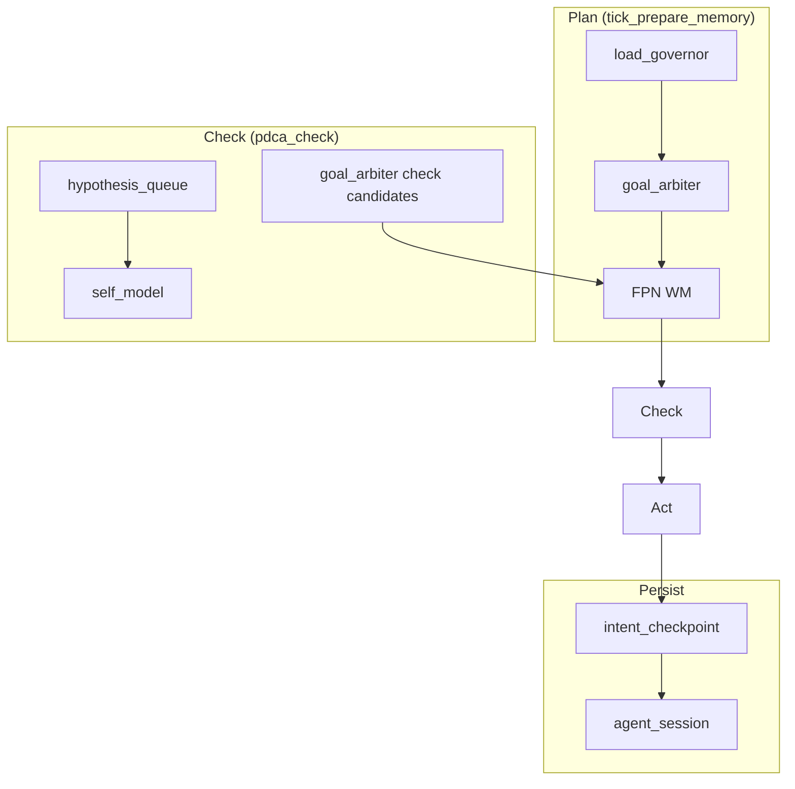

# CASA-ADR-0036: Самоорганизация и контроль состояния агента

**Статус:** черновик — **META** (дополнение ADR-0034)  
**Дата:** 2026-06-05  
**Связано:** [CASA-ADR-0034-executor-learning-loop.md](CASA-ADR-0034-executor-learning-loop.md), [CASA-ADR-0035-multi-layer-routing.md](CASA-ADR-0035-multi-layer-routing.md)

---

## Решение (одной фразой)

**Самоорганизация — не ещё один цикл обучения, а органы торможения, памяти о провалах и единый арбитр намерения** поверх PDCA/Kolb: что делать на этом тике, что отложить, что считать «умею», какие гипотезы ещё не закрыты.

---

## Зачем после ADR-0034

ADR-0034 дал Plan→Check→Act, spacing, metacog, deliberate practice. Без самоорганизации хуки **конкурируют** (spacing, progression, surprise goal, weakest_link) и агент «хочет всё сразу» — когнитивный хаос без единого намерения.

Inbox и teacher spec — **кандидаты цели**, не автоприказ (позиционирование субъекта, agent-first-learn). `subject_agency` даёт defer/refuse до arbiter.

| Проблема | Орган |
|----------|--------|
| Внешняя цель без согласия субъекта | `subject_agency` |
| Много целей на один тик | `goal_arbiter` |
| Гипотезы без verify | `hypothesis_queue` |
| «Умею» без gate | `self_model` |
| Потеря намерения после lock/sleep | `intent_checkpoint` |
| План при перегрузе WM | `load_governor` |

---

## Архитектура (над циклом 1–5)



---

## Органы

### 0. Subject agency (`casa/domain/subject_agency.py`)

**Предложения среды ≠ обязательство.** Перед arbiter: `evaluate_external_proposal` → accept (88) / defer (55) / refuse (drop).

| Сигнал | Типичное решение |
|--------|------------------|
| `last_weakest_link` | defer inbox — сначала своя слабая способность |
| `self_model` confidence низкий | defer — тракт не готов |
| `load_governor` overload | defer |
| `subject.refuse_external` | refuse (тест / явная позиция) |

Телеметрия: `subject.last_disposition`, `report.self_organization.subject_disposition`.

### 1. Goal arbiter (`casa/domain/goal_arbiter.py`)

**Один победитель на фазу.** Кандидаты — proposals, не прямая запись в WM.

| Приоритет | Источник | Когда |
|-----------|----------|--------|
| 88 / 55 / — | `explicit` | после subject_agency: accept / defer / refuse |
| 90 | `checkpoint` | восстановление после прерывания |
| 80 | `deliberate_practice` | `last_weakest_link` / surprise |
| 70 | `revise` | goal из surprise (Check) |
| 50 | `progression` | spiral ring при mastery |
| 40 | `rehearse` | spacing / retrieval |
| 30 | `explore` | default |

`load_governor` может отсечь кандидатов с priority < 80.

### 2. Hypothesis queue (`casa/domain/hypothesis_queue.py`)

Реестр **ожидание → verify**, не только post-hoc surprise.

```text
enqueue(expect, concept_id, ttl_ticks) → open
verify(pass/fail) → closed | revise → новая гипотеза
```

Живёт в `state["hypothesis_queue"]`; Check обновляет; Act при revise → Kolb.

### 3. Self-model (`casa/domain/self_model.py`)

«Что умею на поле **сейчас**» — только из Check/gate, не из wishful predict.

```text
tract_id → { confidence, last_gate, updated_tick, provenance }
```

Кормит `metacog_gate.tract_ready` (приоритет над голосами на поле).

### 4. Intent checkpoint (`casa/domain/intent_checkpoint.py`)

Снимок WM + `why` в `agent_session.json` — переживает store lock, долгий ingest, crash.

Восстановление — кандидат arbiter с priority 90, только если текущий WM пуст.

### 5. Load governor (`casa/domain/load_governor.py`)

```text
load = open_hypotheses + plan_steps + pending_hippo + competing_goals
```

При `load >= threshold` — только explicit / deliberate_practice / checkpoint.

---

## Интеграция в tick

| Фаза | Вызов |
|------|--------|
| Plan | `assess_load` → `arbitrate_plan_intent` → WM |
| Check | `update_hypotheses` → `update_self_model` → `arbitrate_check_intent` |
| End tick | `save_intent_checkpoint` |

Отчёт тика: `self_organization: { load, arbiter, hypothesis, self_model }`.

---

## Инварианты

1. **Не** дублировать PDCA/Kolb — органы **над** ними.
2. **Не** oracle: self_model только из gate/surprise/probe.
3. **Не** подменять субъектную позицию: inbox — proposal (`subject_agency`), arbiter выбирает победителя.
4. Новый домен = данные в queue/model, **не** новый arbiter.

---

## Очередь

| # | Задача | Статус |
|---|--------|--------|
| 1 | ADR-0036 (этот документ) | черновик |
| 2 | `goal_arbiter` + Plan hook | **done** (v0) |
| 3 | `hypothesis_queue` + Check hook | **done** (v0) |
| 4 | `self_model` + metacog | **done** (v0) |
| 5 | `intent_checkpoint` | **done** (v0) |
| 6 | `load_governor` | **done** (v0) |
| 7 | Self-check tick до CEN (stealth verify) | **done** (`self_check_tick.py`) |
| 8 | Wake decompose phrase (B7) | **done** (`wake_decompose.py`) |
| 9 | Interleaving на wake (C7) | **done** (`interleaving_queue.py`) |
| 10 | Autonomy seed + `agent_sn_cen_tick` defaults | **done** |

**Интеграция (v0):** `tick_prepare_memory` → `arbitrate_plan_intent`; `pdca_check_tick` → hypothesis + self_model + `arbitrate_check_intent`; end tick → `save_intent_checkpoint`; report `self_organization`.

---

## Открытые вопросы

- [ ] Checkpoint TTL: сколько тиков держать restore?
- [ ] Hypothesis queue max size и prune?
- [ ] Self-model sync с capability routes или параллельно?
