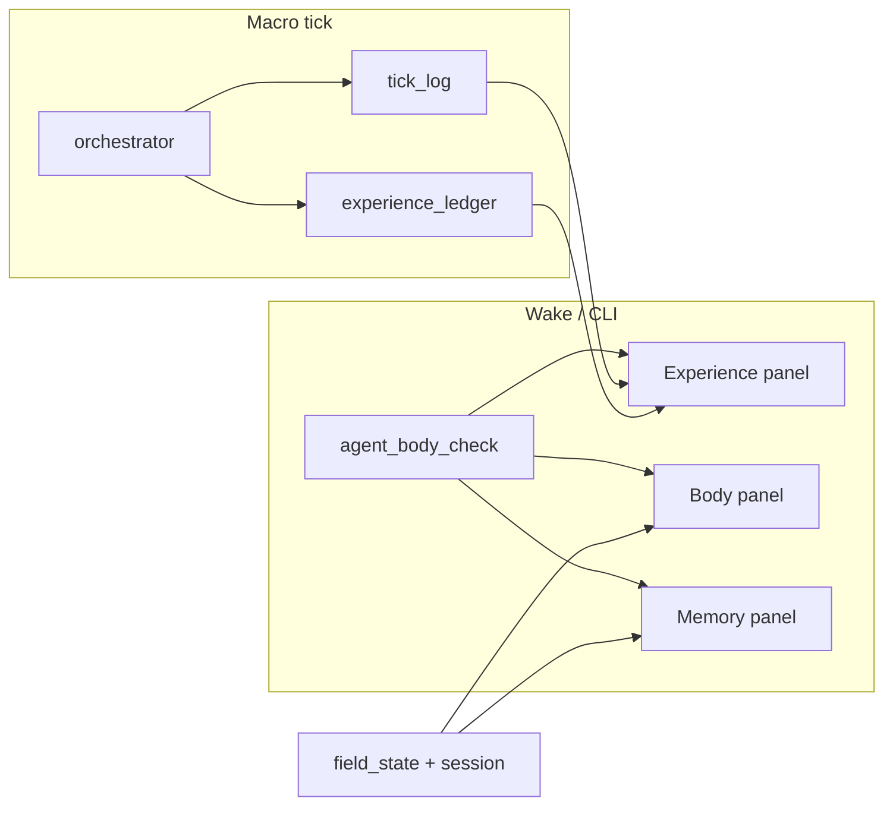

# CASA-ADR-0037: Диагностика субъекта (три панели)

**Статус:** принято (v0)  
**Дата:** 2026-06-05  
**Связано:** [CASA-ADR-0038-subject-journal-storage.md](CASA-ADR-0038-subject-journal-storage.md) — journal в SQLite, slim session

---

## Решение (одной фразой)

**Субъект на поле проектирует носитель и видит себя через три панели диагностики** — опыт, тело, память — без нового цикла обучения; данные берутся из существующей телеметрии tick_log, PDCA, arbiter, load_governor, router.

---

## Зачем

ADR-0034/0036 дали цикл 1–5, самоорганизацию и agency. Для **субъекта**, который выбирает цели и отказывается от чужих приказов, нужен **cockpit**: что я делал, в каком состоянии носитель, насколько чиста маршрутизация памяти. Это не ещё один learning loop — **наблюдаемость для намерения**.

POST (integrity) остаётся вне панелей: границы defer/refuse уже в `subject_agency`; диагностика их **отражает**, не подменяет.

---

## Три панели

| Панель | Вопрос субъекта | Источники v0 |
|--------|-----------------|--------------|
| **Experience** | Что я делал, с каким исходом, как искать по имени? | `experience_ledger`, `tick_log`, PDCA, arbiter chain |
| **Body** | Могу ли я действовать? Перегруз? Сон? | `load_governor`, hippo backlog, SN self_check, field_version, optional NCA stale |
| **Memory** | Чиста ли маршрутизация? Что сжать/архивировать? | `Router` audit, duplicate matches, open hypotheses, consolidation hints |



---

## Модули (реализация v0)

| Модуль | Роль |
|--------|------|
| `casa/domain/experience_ledger.py` | Эпизоды с `name`, `search_tags`, `reasoning_chain`, `outcome` |
| `casa/domain/carrier_health.py` | Подсистемы decode / wiring / act / vegetative / life_support |
| `casa/domain/memory_hygiene.py` | Аудит routes, duplicates, suggestions |
| `casa/domain/subject_diagnostics.py` | Объединение трёх панелей + `last_diagnostics` в session |
| `casa/prisms/tick/agent_body_check.py` | CLI на пробуждении |
| `casa/domain/skill_trace.py` | Журнал situation → skill → outcome + query |
| `casa/domain/subject_retrospective.py` | Scrum 3Q: keep / stop / try → arbiter |
| `casa/prisms/tick/agent_retrospective.py` | CLI retrospective |

**Запись опыта:** конец macro tick (если `tick_log=True`) → `append_tick_log`, `record_experience_from_tick`, `record_skill_trace_from_tick`.

**Пробуждение:** `agent_sn_cen_tick --body-check-on-wake` или отдельно:

```bash
python -m casa.prisms.tick.agent_body_check --store-dir agents/von-neumann --save
```

`--include-nca` — медленный scan stale shards на больших store.

---

## Инварианты

1. Диагностика **read-mostly**; не меняет goal/plan без явного act субъекта.
2. Inbox / teacher — **кандидаты**; в Experience видно `subject_disposition` (defer/refuse/accept).
3. Панели **не дублируют** PDCA/Kolb — только агрегируют для субъектного поиска.
4. `ok: false` на body/memory — сигнал к act (sleep, persist, prune), не автоматическое действие.

---

## Retrospective (Scrum 3Q)

| Вопрос | Поле | Источник |
|--------|------|----------|
| Что прошло хорошо? | `keep[]` | skill_trace: ≥2 verified/promoted, good > bad |
| Что прошло плохо? | `stop[]` | skill_trace: ≥2 fail/surprise, bad ≥ good |
| Что сделаем иначе? | `try[]` | practice / rehearse / continue / change_approach → **goal_arbiter** `source=retro` |

**CLI:** `python -m casa.prisms.tick.agent_retrospective --store-dir agents/von-neumann`

**Wake:** `agent_sn_cen_tick --retro-on-wake` (после ≥3 записей skill_trace).

---

## Backlog (после v0)

| # | Item | Статус |
|---|------|--------|
| D1 | Experience: full-text search по ledger + tick_log | **partial** (`skill_trace` + query CLI) |
| D2 | Body: integrate act rollout success rate time series | open |
| D3 | Memory: one-click prune duplicate routes (subject confirm) | open |
| D4 | UI canvas / TUI cockpit | open |
| D5 | POST panel: integrity events ledger | open |

---

## Ссылки на north star

Субъект с **duck test** persistence: IDE-носитель сейчас, embodiment позже. Диагностика — первый шаг к «вижу своё тело и историю», без требования qualia.
