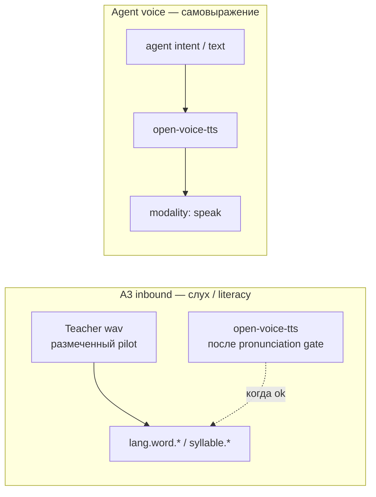
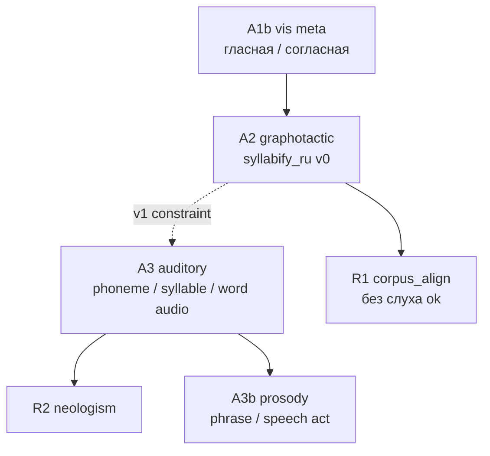

# CASA-ADR-0040: Аудио-тракт и «слух» для фонологии

**Статус:** черновик — на обсуждение  
**Дата:** 2026-06-05 (rev. 2026-06-05 — open-voice-tts, отказ от Kokoro как literacy primary)  
**Связано:**

- [CASA-ADR-0032-analytic-syllable-reading.md](CASA-ADR-0032-analytic-syllable-reading.md) — A2 graphotactic v0 vs фонология; таблица failure cases
- [CASA-ADR-0016-prism-domains-hot-router.md](CASA-ADR-0016-prism-domains-hot-router.md) — `modality: listen`, `audio-phoneme`, prosody
- [CASA-literacy-roadmap-v1.md](CASA-literacy-roadmap-v1.md) — stage-04 фонология (визуальная мета), stage-05 слоги
- [CASA-learning-protocol-vis-math-v1.md](CASA-learning-protocol-vis-math-v1.md) — один moment → один sleep; multimodal = **явная** тройка якорей

---

## Решение (одной фразой)

**«Слух» (A3 inbound) и «голос агента» (outbound) — разные контуры.** Literacy audio требует **фонологически приемлемого** RU; commodity TTS (Kokoro и др.) для этого **не primary** — плохое произношение отравляет co-occurrence. **open-voice-tts** — тракт **самовыражения** агента (не-людей); когда пройдёт pronunciation gate, может также генерировать literacy bank. До этого: **размеченный голос учителя** + узкий human pilot, не mass TTS.

---

## Зачем отдельный ADR

| Вопрос | Без ADR | С ADR |
|--------|---------|--------|
| Как учить слоги «по звуку»? | ждать, что graphotactic rule = фонология | явный audio prism + co-occurrence |
| Commodity TTS как «школа»? | ложные слоги, stress errors → ложные audio↔lex мосты | **не** literacy primary; pronunciation gate |
| open-voice-tts | смешать с A3 ingest | outbound expression; inbound literacy **после** gate |
| R1 `corpus_align` уже работает | кажется, что слух срочен | R1 без audio ok; R2/A3 — **качество** аудио важнее объёма |

---

## Два аудио-контура (не смешивать)



| Контур | Направление | Цель | Источник v1 |
|--------|-------------|------|-------------|
| **A3 inbound** | слышу → lex | фонология, слог/слово bind, R2 | **teacher pilot**; не Kokoro mass batch |
| **Agent outbound** | intent → звук | prosody, регистр, «я говорю» | **open-voice-tts** (в разработке) |
| **A4 prosody** | слышу интонацию | speech act, сарказм | teacher + позже OVT |

**Почему не commodity TTS для literacy:** ошибки ударения, редuction, заимствований (`государство`, `краш`) не «нейтральны» — NCA запоминает **конкретный** ошибочный паттерн как якорь `lang.word.*`. Лучше меньше файлов и чище, чем 331 wav с фонетическим шумом.

**open-voice-tts** решает другую боль: агентам (не-людям) нужен **богатый аппарат самовыражения**, не клон человеческого audiobook. Это может быть тот же движок, что позже озвучит literacy cards — но только после явного **pronunciation gate** на pilot-словах (таблица ADR-0032 + stress list).

---

## Слои (не смешивать)



| Ступень | Содержание | Модальность | Зависимости |
|---------|------------|-------------|-------------|
| **A1b** (есть) | «гласная», «согласная» на JPEG | vis + lex | stage-04 |
| **A2** (есть) | graphotactic syllabify, corpus metadata | rule / text | ADR-0032 |
| **A3 v1** | слог/слово **слышу** ↔ тот же `syllable.*` / `lang.word.*` | **audio + lex** (+ optional vis) | stage-05, corpus |
| **A3 v2** | фонемный якорь, редuction, ь/ъ | audio lattice | ASR/G2P labels |
| **A4** | интонация, speech act, диалог | audio + scene | ADR-0016 |

**Инвариант (ADR-0016):** текстовый lab-store **не притворяется**, что учит интонацию; prosody bar scoped.

---

## Чем «слух» **не** является в v1

- Не ASR «на всё подряд» в hot path read.
- Не замена `corpus_align` для W1.
- Не один sleep на «весь Common Voice × весь корпус».
- Не обязательная live-речь учителя на каждый слог (не масштабируется, плохая reproducibility).

---

## Стратегия обучения: три канала (rev.)

### 1. Literacy primary — **phonology anchor voice** (не обязательно владелец store)

**Роль:** первый честный A3 bind — фонология, которой мы **доверяем для слогов/ударений**.

**Критерий диктора для A3 ingest:** нейтральная дикция RU, без систематических искажений согласных (в т.ч. **р**, **л**, sibilants), стабильный темп, один slug = один take.

| Кто | A3 literacy ingest | A4 bonding / relationship |
|-----|-------------------|---------------------------|
| Владелец store с картавостью / слабой дикцией | **не primary** — отравит слоговые якоря | **можно** позже: `audio.teacher.{slug}` без ingest в phonology lattice |
| Другой человек (диктор, родственник) | **да** — pilot 30–50 слов + 56 слогов | опционально |
| **open-voice-tts** после gate | **да** — preferred at scale | outbound всегда |

**Практика:** если нет подходящего human anchor сейчас — **не stall literacy**: R1 `corpus_align` и vis phrase идут без A3; слух откладываем до OVT pronunciation gate или одной короткой сессии «чужого» диктора (15–20 мин, список slug).

| Формат | Объём v1 | Формат |
|--------|----------|--------|
| Corpus pilot | 30–50 слов (phrase + ADR-0032 hard cases) | один wav / slug, пауза, manifest tag |
| Stage-05 syllables | 56 слогов | batch; желательно **не** проблемные для диктора фонемы отдельным QC |
| Коррекции | по probe fail | перезапись одним **eligible** диктором |

`build_audio_cards.py` упаковывает **готовые wav** в lesson manifest; **не** вызывает commodity TTS.

**Moment (один sleep):**

```text
cue = audio.frame.{slug}   # teacher или OVT после gate
lex = lang.word.{slug}     # или syllable.{surface}
vis = optional
→ один sleep, один edge audio↔lex
```

### 2. **open-voice-tts** (outbound + будущий inbound)

**Сейчас:** голос **агента** — самовыражение не-людей (prosody, регистр, «я говорю»), не mass literacy ingest.

| Этап | Outbound | Inbound (literacy) |
|------|----------|-------------------|
| **α** | agent text → speak (MCP) | — |
| **β** | voice profile, prosody presets | pronunciation gate на pilot-словах |
| **γ** | scene speech act | batch `audio.frame.*` **если** gate green |

**Pronunciation gate:** stress, слоги, заимствования; fail → не ingest. Kokoro/Silero — только baseline для сравнения с OVT.

### 3. Commodity TTS и open banks — **не literacy v1**

| Источник | Статус |
|----------|--------|
| Kokoro / Silero / RHVoice | smoke / A/B; **не** default ingest |
| Common Voice / OpenSLR | augment v2+ |

---

## Архитектура (план)

| Компонент | Роль | Модуль (план) |
|-----------|------|----------------|
| **Audio cards** | wav + `audio.frame.*` cue | `build_audio_cards.py` (pack only) |
| **open-voice-tts** | agent speak + (later) literacy synth | отдельный repo / MCP; ADR hook |
| **Audio prism** | lattice `audio-phoneme-ru` / `audio-syllable-ru` | `casa/prisms/audio/` (новый) |
| **Ingest stage** | `stage-07-audio-words-ru` (рабочее имя) | `micro-literacy/run_audio_word_stage.py` |
| **Probe** | `probe_audio_word_quiz.py` — audio cue → top `lang.word.*` | lab |
| **Router** | `modality: listen` в `resolve_route` | ADR-0016 |
| **Segmenter v1+** | audio syllable boundaries → constraint для graphotactic | cross-modal, **после** paired bind |

**Concept ids (черновик):**

- `audio.frame.{slug}` — целое слово;
- `audio.syllable.{surface}` — слог;
- `phoneme.ru.{ipa_or_cyr}` — v2;
- edges: `audio.frame.*` ↔ `lang.word.*`, `audio.syllable.*` ↔ `syllable.*`.

---

## Фазы rollout

| Фаза | Содержание | Блокирует R1? |
|------|------------|---------------|
| **0** (сейчас) | vis + lex; `corpus_align` | нет |
| **1a** | open-voice-tts α: agent **speak** outbound | нет |
| **1b** | phonology anchor pilot (eligible human **или** пропуск) → audio↔lex | нет |
| **2** | probe listen; promote `skill.listen.word` | нет |
| **3** | OVT β + pronunciation gate → расширение bank | нет |
| **4** | audio-informed syllabify (R2) | **да** для качественного R2 |
| **5** | Common Voice augment + prosody A4 | нет |

---

## Ответ на «я начитываю или банк?» (rev.)

1. **Literacy слух (A3):** phonology anchor — **eligible** human **или** OVT после gate; **не** «любой учитель по умолчанию».
2. **Голос владельца store:** bonding / сессия (A4) — **опционально**, отдельные concept ids; **не** смешивать с `audio.frame.*` ingest без gate.
3. **open-voice-tts:** outbound сразу; inbound literacy — когда pronunciation gate green.
4. **Нет диктора сейчас:** vis + lex достаточны для R1/phrase; A3 не блокер.

Чтение сказок без tags по-прежнему **не** primary — даже с хорошим TTS.

---

## Педагогика moment'ов (audio)

| Тип | Audio | Lex | Vis | Sleep |
|-----|-------|-----|-----|-------|
| Слово слышу | `audio.frame.{slug}` | `lang.word.{slug}` | optional (already in LTM) | **один** |
| Слог слышу | `audio.syllable.{s}` | `syllable.{s}` | optional syllable JPEG | **один** |
| Vis+audio lock | wav + word JPEG | `lang.word.*` | same slug | **один** (multimodal reinforce) |
| Teacher correction | `audio.teacher.{slug}` | same | — | **один** |
| Сказка целиком | **v2+** | episodic spans only | — | chunked + align |

---

## Probe (lab)

| Probe | Pass |
|-------|------|
| `probe_audio_syllable_quiz` | audio syllable → top-1 `syllable.*` |
| `probe_audio_word_quiz` | audio word → top-1 `lang.word.*` (corpus) |
| (diag) | audio + vis same slug — оба channel hit |

Gate independent от vis R1; capability `skill.listen.word` / `skill.listen.syllable`.

---

## Non-goals (v1)

- Полный G2P/ASR pipeline в runtime tick.
- Распознавание произвольной live-речи учителя без сегментации.
- Замена stage-05 vis syllables на audio-only literacy.
- Обучение сарказму/мат-фильтру только текстом.

---

## Открытые вопросы

- [ ] open-voice-tts: repo layout, MCP contract (`speak` vs `synthesize`), voice profile per agent store
- [ ] Pronunciation gate: manual checklist vs whisper-stress vs human listen?
- [ ] Audio NCA lattice: отдельный `nca/audio-syllable-ru` или shared encoder?
- [ ] Teacher mic: UI в Cascade или batch upload wav?
- [ ] OVT inbound: один `audio.frame.*` на slug или multi-style (calm / emphatic)?

---

## Статус принятия

Черновик. **Фаза 1a** (OVT speak) и **1b** (teacher pilot wav) параллельны vis/analytic tick; Kokoro mass ingest **снят** до pronunciation gate.
