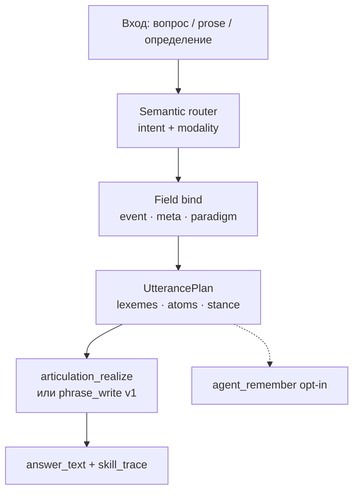

# CASA-ADR-0044: Семантика на поле — осмысленная фраза и позиция агента

**Статус:** side-track (literacy structured answer); **диалог субъекта** — [ADR-0045](CASA-ADR-0045-subject-as-interlocutor.md)  
**Репозиторий:** [casa-ontology-payload](https://github.com/AI-Guiders/casa-ontology-payload)  
**Заменяет (частично):** [CASA-ADR-0043](CASA-ADR-0043-discourse-read-canonical-prose.md) — KB-first как primary path **не** принимаем  
**Связано:** ADR-0030 (L4 articulate), ADR-0032 (R1 ≠ S), ADR-0033 (E1/S), ADR-0036 (W5–W7), ADR-0015 (agent_remember), ADR-0034 (executor loop)

---

## Решение (одной фразой)

**Осмысленное чтение и ответ — один контур на поле:** вход (prose / вопрос / определение) → **semantic bind** (event + meta + paradigm, не keyword phrase_event) → **UtterancePlan** (что понял + **позиция агента**) → **articulation_realize** на hot path; KB/org-kb — опциональный **транспорт** позже, не prerequisite.

---

## Контекст

| Факт | Следствие |
|------|-----------|
| Literacy W7 green (events, agreement, paradigm) | Структурная семантика **уже на поле** — не ждать RAG |
| Spike ADR-0043: `semantic_at_1 = 0` на canon без KB; phrase_event **коллизии** | Отдельный KB-тrack **не** чинит «понимание» — чинит только retrieval markdown |
| `articulation_realize` + `UtterancePlan` есть (J0 lab) | Формулировка связного ответа **отделена** от vis×lex |
| North star: суверенный агент без облачного LLM на hot path | «Как ChatGPT» через paste blocks — **не** цель; **своя позиция** из field — цель |
| `agent_remember` (ADR-0015) | Явная fixation «что понял / во что верю» → sleep → field |

**Primary driver:** агент **собирает осмысленную фразу** и **выражает позицию** (понял, согласен/не уверен, опираюсь на event X) — на том же store, что literacy, без второго движка «чтения канона».

---

## Что считаем «осмысленностью» (не OCR, не top-1)

| Уровень | Смысл | Пример | Gate |
|---------|--------|--------|------|
| **W/E** | Знаю слова и слоты | «мама», «мыла», wash event | morph-agreement track |
| **S1 bind** | Вопрос → **одна** event/meta гипотеза на поле | «Кому дала?» → give + recipient slot | semantic router, anti-collision |
| **S2 compose** | Связка claims: роли, agreement, paradigm | «она мыла» + subjectVerb.fem | phrase_compose + meta |
| **S3 articulate** | **2–4 предложения**, intent + позиция | «Понял: … На поле это give-event. Согласование fem.» | write hot path, realize |
| **S4 stance** | Явная позиция агента | «Уверен / partial / не знаю на поле» | `stance` в plan + journal fixation |

**Не S-layer:** keyword match phrase_events без slot check; echo query в ответе; случайный claim из weak SN match.

---

## Архитектура (read → plan → say)



### Semantic router (новый слой, v1)

Модуль: `casa/prisms/tick/semantic_read.py` (имя черновик).

| Шаг | Вход | Выход |
|-----|------|--------|
| `classify_intent` | query | `explain` / `verify` / `recall` / `pilot_phrase` / `unknown` |
| `route_bind` | intent + state | `{ event_id?, meta_ids[], paradigm_cluster?, confidence }` |
| `anti_collision` | candidates | отброс если score ≤ threshold или конфликт intent (explain ≠ wash default) |

**Правило v1:** `phrase_event` match **только** при `intent=pilot_phrase` или явном goal.read.phrase; иначе — event/meta bind через predict + mastery gates.

### UtterancePlan + позиция

Расширение `articulation_realize.UtterancePlan`:

```python
@dataclass
class UtterancePlan:
    act: str           # answer | clarify | refuse
    intent: str
    stance: str        # confident | partial | unknown  ← NEW
    lexemes: dict[str, str]
    atoms: list[GrammarAtom]
    concept_ids: list[str]
    bind: dict         # event_id, agreement, source: field|remember
```

**Позиция агента** — не «мнение LLM», а **epistemic stance на поле**:

- `confident` — bind прошёл gates (mastery / probe parity);
- `partial` — event узнан, meta/agreement слабые;
- `unknown` — честный отказ (`compose_answer_text_no_memory`), **без** подмены pilot phrase.

Шаблон ответа (RU v1):

```text
Понял: «{query_short}».
На поле: {event_or_meta_summary}.
{stance_sentence}
{optional_agreement_atom}
```

Пример stance: «Уверен: give-event и fem agreement на поле.» / «Частично: event узнан, paradigm не closed.» / «На поле нет опоры — не отвечаю шаблоном про другую сцену.»

---

## Связь с существующим кодом

| Компонент | Роль в ADR-0044 |
|-----------|-----------------|
| `phrase_compose`, `lang.event.*` | S2 compose |
| `paradigm_ltm`, W5 | bind форм |
| `articulation_realize`, `articulation_grammar` | S3 articulate |
| `articulation_phrase_write` | **fallback** pilot phrase only (deprecated as default router) |
| `agent_self_drive_tick` / CEN | hot path: plan step → semantic_read → articulate |
| `agent_remember` | S4: fixation после partial/confident bind |
| `bench_read_discourse_spike` | **semantic_at_1**, не phrase collision |
| `bench_write_hot_path` | write gate с backend tag |

---

## KB / org-kb (deferred transport)

| Когда | Как |
|-------|-----|
| Большой read-only canon (browser, intercom) | org-kb pack → **promote** в field через sleep, не parallel RAG |
| Ускорение ingest | `import_knowledge_delta` как **batch**, не hot path |
| Hot path всегда | field bind → UtterancePlan → realize |

ADR-0043 spike остаётся **диагностикой** (`needs_kb_ingest` = нет field-native bind), не roadmap primary.

---

## Порядок реализации

| # | Задача | Критерий |
|---|--------|----------|
| 1 | `semantic_read.route_bind` + anti-collision | canon spike: нет default wash на «что такое…» |
| 2 | `UtterancePlan.stance` + realize templates | ответ содержит stance sentence |
| 3 | Wire tick: CEN → semantic_read → articulate (не phrase_sketch default) | `bench_write_hot_path` backend=`semantic` |
| 4 | Queries `queries_semantic_field-v1.jsonl` (events + meta, не markdown canon) | semantic_at_1 ≥ 0.8 |
| 5 | partial → `agent_remember` hook (opt-in policy) | journal entry с bind snapshot |
| 6 | Lab: promote teacher definition → moments → sleep → re-spike | semantic_at_1 растёт без KB bundle |

---

## Acceptance (von-neumann v1)

1. **Anti-collision:** на 5 canon-style queries из ADR-0043 spike — **0** ложных wash/give без slot evidence.
2. **Pilot phrase:** 4/4 write pilot queries — green через semantic router (`intent=pilot_phrase`).
3. **Articulate:** каждый ответ содержит `Понял:` + `На поле:` + stance; paste_ratio ≤ 0.45 где есть realize.
4. **Literacy regress:** morph-agreement track без деградации.
5. **Honest unknown:** на out-of-field query — `stance=unknown`, не random event.

---

## Non-goals

- Open-ended генерация «как большая LLM» на hot path.
- KB bundle как **единственный** источник смысла для von-neumann.
- Обучение «определения канона» одной vis-карточкой.
- WitDB / browser — вне scope этого ADR.

---

## Открытые вопросы

1. **Stance policy:** всегда verbalize partial или только при `surprise` / metacog gate?
2. **Prose definition ingest:** teacher moment (sleep) vs runtime parse — v1 lab только teacher.
3. **EN mirror:** после RU S3 stable.

---

## Ссылки

- Spike: `lab/visual-curriculum/bench_read_discourse_spike.py`
- Write: `casa/prisms/tick/articulation_phrase_write.py`, `articulation_realize.py`
- Orchestrator: `lab/visual-curriculum/run_von_neumann_next_track.py`
