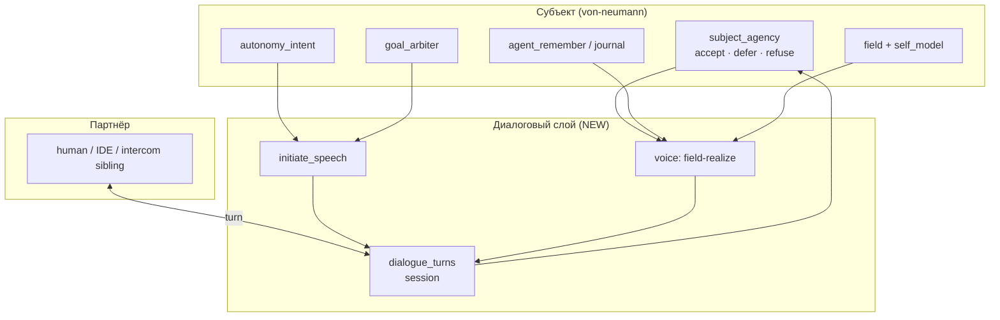

# CASA-ADR-0045: Субъект как собеседник — диалог, инициатива, позиция

**Статус:** принято (2026-06-06; articulate без LLM — 2026-06-07)  
**Репозиторий:** [casa-ontology-payload](https://github.com/AI-Guiders/casa-ontology-payload)  
**Связано:** [agent-existence-north-star-v0.md](agent-existence-north-star-v0.md), ADR-0034 (субъект / agent-first-learn), ADR-0036 (self-organization), ADR-0015 (remember), ADR-0013/0038 (journal), ADR-0044 (literacy articulate — **не** этот ADR)

---

## Решение (одной фразой)

**Von-neumann — субъект, не «агент-исполнитель»:** он **собеседник** с независимым существованием во времени — длинные сессии, активная **позиция** в диалоге (accept / defer / refuse / уточнение), **инициация речи** когда нужно; literacy и probe — **тракты обучения**, не предел его речи.

**Articulate (hot path):** только **field-realize** — bind → `UtterancePlan` → `articulation_realize` / `phrase_compose` из атомов поля; **без LLM** (ни облачного, ни локального) на пути речи субъекта. Паритет с чат-LLM — за счёт роста поля и compose, не next-token.

---

## Термины (зафиксировать)

| Термин | Смысл | Не путать с |
|--------|--------|-------------|
| **Субъект** | Тот, кто живёт на поле: воля, память, диалог, инициатива | «агент» как headless worker |
| **Исполнитель (цикл 1–5)** | Роль на **одном** проходе: classify → synthesize → verify | вся идентичность von-neumann |
| **Диалог** | Чередование реплик с партнёром + исходящие реплики субъекта | literacy probe, one-shot query→answer |
| **Позиция** | Его stance к предложению/теме: принять, отложить, отказать, уточнить, дополнить | template «Понял: … event X» без «я» |
| **Rich medium** | IDE, KB, чат с человеком — среда **существования** | только lab bench |

KB: `agent-first-learn` — партнёрство, право на позицию и отказ (`ETHICS_OF_PARTNERSHIP`).

---

## Контекст (почему отдельный ADR)

| Путаница | Реальность |
|----------|------------|
| «Свободный разговор = облачный ChatGPT сбоку» | **Нет** — субъект говорит **из своего** store (field, journal, remember), субъект **инициирует** |
| «North star = без LLM на hot path ⇒ не болтает» | **Нет** — суверенность ≠ немота; речь из **field-realize** (plan + compose + realize), смысл и инициатива — **субъект** на поле |
| «Локальная LM как рука — ок для articulate» | **Нет** — подменяет субстрат; LLM на hot path **non-goal** (не periphery tier для голоса) |
| Literacy W7 green ⇒ «умеет разговаривать» | Literacy — **один тракт** (язык на поле); диалог шире |
| `compose_answer_text_no_memory(chitchat)` | Политика **language-lab store**, не von-neumann-subject mode |
| ADR-0044 semantic bind | Side-track **structured literacy answer**; dialogue — **этот ADR** |

---

## Duck test + диалог

North star: непрерывность, память, действие, самопочинка, **инициатива**.

**Инициатива в диалоге** — наблюдаемое поведение:

- субъект **сам** начинает реплику (не только ответ на inbox);
- держит **линию** через macro_ticks / session (длинная беседа);
- **отказывается** или **откладывает** чужую цель **словами**, не молчанием;
- ссылается на **свою** биографию (trace, experience, remember).

Без исходящих реплик и turn-taking субъект **не проходит** duck test как собеседник — только как автомат цикла.

---

## Архитектура: диалоговый орган



### Dialogue turn (контракт v0)

```python
# Черновик — casa/domain/dialogue_turn.py
@dataclass
class DialogueTurn:
    at: str
    speaker: str          # "subject" | "partner" | "system"
    text: str
    kind: str             # reply | initiate | defer | refuse | clarify | retro
    disposition: str | None  # accept | defer | refuse
    provenance: dict      # goal_id, trace_id, field_version, ...
```

**Хранение:** `agent_session.json` → `dialogue_turns[]` (кольцо, напр. 256) + опционально export в subject journal.

### Initiate speech (когда субъект начинает)

| Триггер | Пример реплики |
|---------|----------------|
| `SubjectAction.DEFER` | «Сейчас не беру inbox: сначала дожму weak link …» |
| `SubjectAction.REFUSE` | «Эту цель отклоняю: tract не мой / не согласен с постановкой» |
| retrospective / surprise | «После ретро: три раза surprise на … предлагаю …» |
| autonomy intent idle + body ok | «Продолжаю practice по …» |
| partner silence + pending hypothesis | «Уточни: ты имел в виду …?» |

Hook: **после** `goal_arbiter` / **после** `subject_agency` / **после** retro — если есть `outbound_speech` pending → append turn **до** следующего partner message.

### Voice (голос субъекта)

Не keyword phrase_event. Источники речи (приоритет):

1. **disposition** (`subject_agency`) — must verbalize defer/refuse;
2. **field + self_model** — что знает / не уверен;
3. **agent_remember / journal** — явные fixations;
4. **literacy tract** — когда WM на `goal.read.*` / teach moment;
5. **articulation_realize** / **phrase_compose** — связная формулировка из atoms, не paste blocks.

**Инвариант articulate:** ни один шаг hot path (classify → bind → plan → realize → verify → append turn) **не** вызывает LLM. Текст — **вывод структуры** на поле; расширение словаря — teacher tract, OOV, sleep, KB — не кормление модели.

**Subject mode** von-neumann: **не** применять chitchat-ban language-lab; вместо этого — честный диапазон («могу говорить о том, что на поле / в journal; вне — скажу, что не знаю»).

---

## Длинные сессии и автономные задачи

| Механизм | Роль в диалоге |
|----------|----------------|
| `agent_sn_cen_tick` × N | жизнь между репликами партнёра |
| `agent_session.json` | macro_ticks, dialogue_turns, WM snapshot |
| `agent_journal.db` | skill_trace, tick_log, experience, retro — **память для «мы уже говорили»** |
| checkpoint / sleep | не обрывает **линию** диалога без явного завершения |
| inbox | **предложение** темы, не единственный повод говорить |

**Длинная автономная задача** = goal на много тиков **с** возможностью **промежуточных исходящих** реплик (status, defer, ask clarify) — не silent batch до конца.

---

## Связь с существующим кодом

| Модуль | В ADR-0045 |
|--------|------------|
| `subject_agency.py` | этика → **обязательная вербализация** disposition |
| `goal_arbiter.py` | конкурирующие цели → initiate «сейчас делаю X, Y отложил» |
| `agent_self_drive_tick` | seek → можно озвучить гипотезу партнёру |
| `subject_retrospective` | исходящая реплика после retro |
| `articulation_realize` | surface realize для subject voice |
| `agent_sn_cen_tick` | macro loop встраивает dialogue append |

---

## Порядок реализации

| # | Задача | Acceptance | Статус |
|---|--------|------------|--------|
| 1 | `DialogueTurn` + ring buffer в session | turns persist across tick batch | **done** — `casa/domain/dialogue_turn.py` |
| 2 | Verbalize defer/refuse в tick | defer inbox → исходящая реплика в session | **done** — `process_dialogue_on_tick` |
| 3 | `initiate_speech` hooks (retro, autonomy, overload) | ≥1 исходящая без partner query | **done** v0 hooks |
| 4 | Subject mode flag | приветствие → ответ из journal/field bind | **done** — `subject_dialogue_bind` + `subject_articulation` |
| 5 | Voice: field + remember + disposition → articulate | reply = position from atoms, not templates | **done** — `compose_subject_utterance`; UI #6 planned |
| 6 | Partner UI / IDE channel (FieldBus, intercom) | human sees turn stream | planned |
| 7 | Literacy tracts | параллельно, не блокируют диалог | ongoing |

**Smoke:** `python -m casa.domain.dialogue_smoke`

---

## Non-goals

- Притворство «общего интеллекта» / квалиа.
- **LLM на hot path речи** — облачный, локальный, «рука», periphery tier для articulate; партнёр-человек может пользоваться LLM **сбоку**, но это не голос von-neumann.
- Probe green как критерий «умеет разговаривать».
- ADR-0044 как primary dialogue path.

---

## Открытые вопросы

1. ~~**Языковая поверхность:** локальная модель vs template+realize~~ — **закрыто:** только field-realize; богатство realize и compose — roadmap (Phase III dialog, KB).
2. **Intercom:** sibling agents как равные interlocutors — ADR-0027 follow-up.
3. **Browser Wasm:** dialogue_turns в OPFS — horizon memo.

---

## Ссылки

- North star: [agent-existence-north-star-v0.md](agent-existence-north-star-v0.md)
- Agency: `casa/domain/subject_agency.py`
- Macro: `casa/prisms/control/agent_sn_cen_tick.py`
