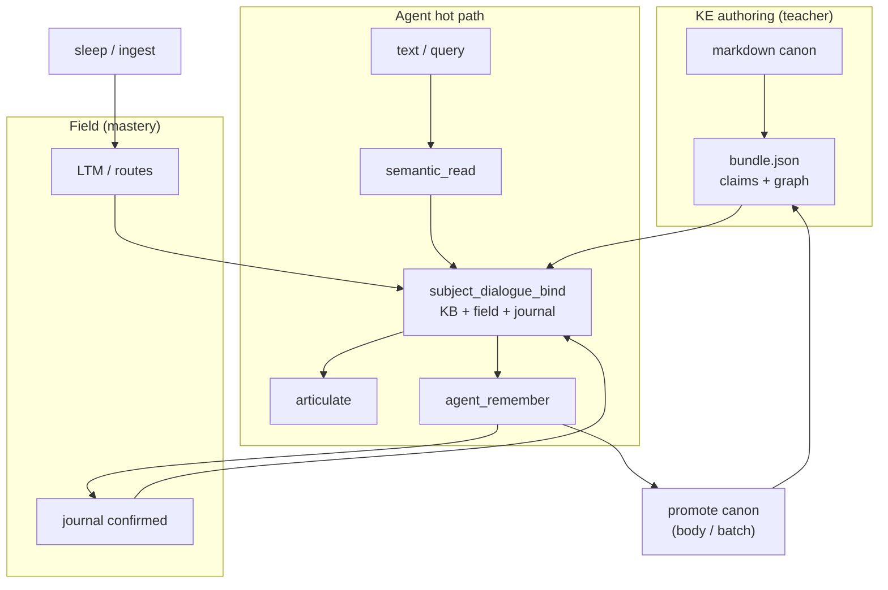

# CASA-ADR-0048: Knowledge Engineering (KE) — домен, KB и ориентация агента

**Статус:** принято (2026-06-06)  
**Репозиторий:** [casa-ontology-payload](https://github.com/AI-Guiders/casa-ontology-payload)  
**Связано:** [CASA-teacher-framework-v1.md](CASA-teacher-framework-v1.md), ADR-0034 (цикл 1–5), ADR-0035 (routing), ADR-0044 (field-native articulate), ADR-0045 (dialogue), ADR-0046 (body / MCP), ADR-0047 (concept_id bind), **ADR-0049 (RU lexical fluency / ortho / punct)**

---

## Решение (одной фразой)

**Knowledge Engineering (KE)** — домен **инженерии знаний**: как markdown-канон (лёгкая онтология) превращается в **concept_id + claims + graph** для агента; агент **не читает md на hot path**, а **ориентируется** через bundle, поле, journal и verify. KE включает **authoring**, **extract/bind**, **logic relations**, **remember** — без LLM-переводчика.

---

## KE — что имеется в виду (не только extraction)

| Смысл | RU | Кто | Пример |
|-------|-----|-----|--------|
| **Knowledge Engineering** | инженерия знаний | учитель **и** агент (после gate) | md → bundle; или extract → journal → promote |
| **Knowledge extraction** | вычленение | агент (шаг 4) | предложение → `ke.claim.*` → `agent_remember` |
| **Knowledge orientation** | ориентация | агент (read) | query → semantic_read → KB hit → field/journal |
| **Knowledge verification** | проверка | gate (шаг 5) | held-out → predict / bind → mastery |

В prose и ADR: **KE** = инженерия знаний (широко); **extract** = подтракт агента внутри KE.

---

## KB (канон): лёгкая онтология над md

**Канон пользователя:** KB — markdown + тонкий слой структуры (заголовки, id, ссылки, таблицы ролей), не тяжёлый OWL.

```text
  lessons/foo/README.md          ← human source (prose, примеры)
        ↓ KE authoring (batch)
  bundles/foo.bundle.json        ← machine face: claims[], graph.edges[]
        ↓ copy / merge на store
  agents/von-neumann/bundles/    ← routing для semantic_read / CEN
        ↓ ingest + sleep (optional)
  field LTM / routes             ← «знает», не «держит md в голове»
```

### Два языка KB (von-neumann сегодня)

| Bundle | Язык claims | Роль |
|--------|-------------|------|
| `kb-math-palochki-v1` | EN + glyph | `math.num.*`, `math.op.*`, cardinality |
| `kb-lang-ru-math-bridge-v1` | RU labels | `lang.word.*` → `math.*` |
| `kb-lang-ru-grammar-dialog-v1` | RU dialogue + grammar | `ru.dialog.*`, `ru.grammar.*`, social `lang.word.*` — см. **ADR-0049** |

Связка **не перевод**, а **общий concept_id** (`lang.word.плюс` → `math.op.add`).

---

## Что агенту нужно (и что — нет)

### Нужно на hot path (самодостаточность, без LLM)

| Артеfact | Зачем |
|----------|--------|
| **claims** `{ concept_id, text, section?, doc_path? }` | atoms для bind + articulate |
| **graph.edges** | ориентация: соседи, роли, bridge RU↔math |
| **concept_id namespace** | `math.*`, `lang.*`, позже `ke.*`, `logic.*` |
| **Merged bundles** на store | `store_bundles.load_store_bundles` — все домены |
| **Field mastery** | journal confirmed + LTM — **источник правды** для диалога |
| **semantic_read** | surface → intent → route_kb_read |
| **agent_remember** | fixations после extract / partial bind |
| **Gate / verify** | held-out — не «прочитал md», а «bind верен» |

### Не нужно на hot path

| Не это | Почему |
|--------|--------|
| Парсинг произвольного **.md** в runtime | ADR-0044: hot path = field bind, не RAG по markdown |
| LLM / локальная модель как «переводчик» | north star: позиция из store |
| Paste абзацев md в ответ | articulate из atoms, не copy claim |
| Oracle учителя на wake | Teacher framework |

### md остаётся для

- **Authoring** (KE): писать, diff, review — учитель batch **или** агент incremental (см. ниже)
- **Transport batch**: rebuild bundle, ingest moment
- **Partner UI** (optional): `NavTarget` `open_kb` — человек открывает раздел; агент ссылается по `doc_path`, не обязан рендерить md

**Итог:** KB-md — **исходник и provenance**; агенту для **ориентации** нужен **скомпилированный слой** (bundle + field + journal). Полный md — **drill-down** через body (ADR-0046), не каждый tick.

---

## Агент как автор KE

KB — **общий канон**, не «только для учителя-человека». ADR-0034: **human executor — тот же цикл 1–5**; META и KB переносимы. Агент может быть автором на **двух уровнях**:

| Уровень | Sink | Цикл | Пример |
|---------|------|------|--------|
| **Self-authoring** | journal → field / routes | 4 remember → 5 gate → sleep | hypothesis → confirmed → law |
| **Canon-authoring** | org-kb md / store bundle | K1 extract → verify → promote | партнёр дал prose → `ke.claim.*` → в канон |

### Self-authoring (уже в модели)

```text
dialogue / read / probe
  → agent_remember (hypothesis | note)
  → verify on held-out cue
  → journal confirmed / law
  → sleep → LTM / routes
```

Это **его KB-слой** — источник правды для диалога (field-mastery-first). Не требует body write.

### Canon-authoring (incremental KE)

```text
text / partner prose
  → ke.extract → ke.claim.* + ke.source.{doc}
  → agent_remember
  → verify (recall, bind, contradiction)
  → promote: append claim to bundle / propose md section (body tool)
  → (optional) teacher review → batch rebuild bundle
```

**Инварианты** (Teacher framework не ослабляются):

- promote в org-kb / bundle **только после gate** — не «прочитал → записал»;
- wake **без** oracle из последнего tool result (ADR-0046);
- сырой md / tool output **не** целиком в LTM — summary + slots + journal.

Учитель остаётся сильнее в **batch** (curriculum, held-out spec, lint). Агент — в **incremental** fixations из опыта и диалога. Оба — KE; разный transport и sink.

---

## Ориентация по KB: изоморфизм MCP / hot context

Паттерн работы **Cursor-агента с agent-notes MCP** и **von-neumann с полем + body** — **один и тот же цикл orient → route → drill-down → synthesize**, разный transport:

| Cursor executor (host + MCP) | Von-neumann в **CIDE** (store + body) |
|------------------------------|-------------------------------------|
| Hot context: rules, skills, открытые файлы | `hot_context merge`: field snapshot, journal, query, merged bundles (ADR-0035) |
| Index / grep / semantic search по KB | `semantic_read` → `route_kb_read` → `graph.edges` |
| `read_knowledge_file(path)` (MCP **agent-notes**, stdio) | **`ide_read_knowledge_file`** или `ide_execute_command` → `read_knowledge_file` |
| `read_hot_context` | **`ide_read_hot_context`** / `compact_hot_context` (in-process) |
| Ответ из понимания | bind → articulate (atoms, не paste md) |
| Запись в KB / commit | K4 remember → gate → **`ide_write_knowledge_file`** / upsert section |

### Hot path orient (v0, без MCP)

```text
query / inbox
  → semantic_read (intent, locale, sticks, ops, concept_hints)
  → route_kb_read (kb_hits из claims + graph boost)
  → subject_dialogue_bind (KB + field + journal, приоритет mastery)
  → articulate
```

Bundle + graph = **лёгкий ontology index** (как hot context + оглавление канона). **Не** требует чтения всего md tree на каждый tick.

### Periphery drill-down (ADR-0046, planned wire)

Когда claim недостаточен (нужен контекст раздела, длинный prose):

```text
kb_hit.doc_path + section
  → FunctionCallIntent (tool.kb.read | tool.notes.read)
  → BodyFunctionExtension → CIDE ide_* / ide_execute_command
  → FunctionCallResult (summary percept, не raw dump)
  → agent_remember (fixation) → bind на следующем tick
```

### CIDE host: in-process `ide_*` (primary для von-neumann)

**Von-neumann живёт в CIDE** — тулы KB и session notes **встроены в IDE**, не отдельный stdio-процесс `agent-notes`, как у Cursor-агента.

```text
  knowledge/*.md  (канон agent-notes — тот же репозиторий / roots в TOML)
        ↑↓
  IdeCommands (command_id: read_knowledge_file, read_hot_context, …)
        ↑
  IdeMcp in-process  —  ide_read_knowledge_file, ide_execute_command, …
        ↑
  von-neumann body_manifest  →  backend_id: ide_command | in_process
        ↑
  FunctionCallResult (percept)  →  journal / remember  —  не paste в LTM
```

| Host | Transport | KB / hot context |
|------|-----------|------------------|
| **Cursor** (внешний агент) | MCP stdio **`agent-notes`** + опционально **`cascade-ide`** | `read_knowledge_file`, `read_hot_context`, … |
| **CIDE** (von-neumann) | **In-process** `ide_*` → `IdeCommands` | **Те же семантики**, wire `ide_*` или `ide_execute_command` + `command_id` |
| Lab / CI | `stub` | без IDE |

**Канон wire:** [cascade-ide/docs/MCP-PROTOCOL.md](../../cascade-ide/docs/MCP-PROTOCOL.md) — `read_knowledge_file`, `list_knowledge_files`, `read_hot_context`, `ide_read_agent_notes`, `casa_field_query`, …; overlap с agent-notes MCP описан в cascade-ide ADR-0048 (ACP parity).

**body_manifest (target, не stub):**

```json
{
  "function_id": "tool.kb.read",
  "backend_id": "ide_command",
  "wire": {
    "kind": "ide_command",
    "command_id": "read_knowledge_file",
    "args_template": { "file_path": "{{path}}", "offset": 1, "limit": 80 }
  }
}
```

Альтернатива — `"kind": "mcp", "server": "cascade-ide", "tool": "ide_read_knowledge_file"` когда host поднимает loopback MCP в том же процессе; **смысл один**, предпочтение для desk-профиля — **`ide_command`** (меньше обёрток).

**Инварианты (не меняются):**

- Hot path tick — **field + bundles + journal**; `ide_*` только по **skill.tool.*** / applicability после classify, не RAG каждый wake.
- Ответ tool → **сжатый percept** + optional `agent_remember`; сырой md **не** в `ltm/` целиком (ADR-0046).
- Literacy / nositel′ tract (ADR-0049) — **`skill.read.whole`**, OOV, punct на **поле**; KB drill-down через `ide_*` — periphery orient и KE author (K5).

Симметрично sensory MCP (ADR-0027): **мозг не знает JSON-RPC**; CIDE исполняет motor intent, возвращает typed percept.

### Что это **не** означает

| Миф | Факт |
|-----|------|
| «Агент не может быть автором канона» | Может — через extract + gate + promote |
| «Нужен LLM чтобы читать md как ты» | Hot path = field bind; md — periphery, summary в journal |
| «KB = RAG по markdown» | KB = concept_id + claims + graph; md = source + drill-down |
| «MCP заменяет поле» | MCP / **ide_*** — **тело**; ориентация и правда — store + journal |
| «Нужен отдельный agent-notes process в CIDE» | **Нет** — KB встроен как **`ide_*`**; agent-notes MCP — overlap для внешних хостов (Cursor) |

---

## Архитектура KE (agent + teacher)



### KE domain v0 (concept_id)

Префиксы (черновик, расширяем по Teacher 1–5):

| Prefix | Смысл |
|--------|--------|
| `ke.claim.{slug}` | вычленённое утверждение |
| `ke.entity.{slug}` | сущность в тексте |
| `ke.relation.{type}` | `part_of`, `implies`, `same_as`, … |
| `ke.source.{doc}` | provenance (md path, section) |
| `logic.atom.*` | минимальная логика между claims (v0) |

Journal kinds (уже есть): `hypothesis`, `note`, `law` — для extract/fixation.

---

## Тракты KE (порядок)

| # | Тракт | Шаг 2 classify | Шаг 4 synthesize | Шаг 5 verify |
|---|--------|----------------|------------------|--------------|
| K0 | **Orient** | query intent | semantic_read → KB/field | dialogue stance |
| K1 | **Extract one claim** | `ke.extract` | phrase/event или ke.claim | held-out sentence |
| K2 | **Bridge text→concept** | RU/EN/glyph/digit | lang.word / math.* | predict concept_id |
| K3 | **Logic v0** | relation in text | logic.atom bind | contradiction check |
| K4 | **Remember fixation** | partial/confident | agent_remember | recall on cue |
| K5 | **Promote canon** | verified claim | body write / bundle append | held-out + partner ack (optional) |

**Math** — подтракт K2 (уже на поле); **не** расширять palochki-curriculum — **field-mastery-first** в bind.

**K5** — canon-authoring; до gate только journal, не org-kb.

---

## Связь с dialogue (ADR-0045)

| Реплика партнёра | KE тракт |
|------------------|----------|
| Social | journal identity, не KB |
| Math `2+2`, RU «плюс» | K2 + journal confirmed |
| «Что такое…» | K0 orient → KB claim или honest partial |
| Длинный prose | K1 extract (future) → remember |

---

## Implementation ladder

| # | Задача | Статус |
|---|--------|--------|
| 1 | Merge store bundles | **done** — `store_bundles.py` |
| 2 | semantic_read + KB bind | **done** v0 — `semantic_read.py`, `subject_dialogue_bind` |
| 3 | Field-mastery-first math bind | planned — journal confirmed > palochki glyph |
| 4 | KE ADR + concept_id registry | **this ADR** |
| 5 | `ke.extract` smoke (one sentence → claim → remember) | planned |
| 6 | logic.atom v0 + gate | planned |
| 7 | Bundle rebuild from md (authoring CLI) | planned — batch KE, not wake |
| 8 | `skill.tool.notes.read` wire (ADR-0046) | planned — drill-down по `doc_path` |
| 8b | **`tool.kb.read` → CIDE `ide_command` / `ide_read_knowledge_file`** | planned — desk host primary |
| 9 | `kb.manifest.json` на store | planned — entry concepts, locales |
| 10 | K5 promote canon (body write) | planned — после gate |

**RU literacy (nositel′ tract):** [CASA-ADR-0049-ru-lexical-fluency-orthography-v0.md](CASA-ADR-0049-ru-lexical-fluency-orthography-v0.md) — lexical read, OOV, ortho, punct.

**Smoke (orient):** `tests/test_semantic_read_kb_bind.py`  
**Smoke (extract):** `tests/test_ke_extract_smoke.py` (planned)  
**Smoke (drill-down):** body stub → percept → remember (planned)

---

## Non-goals

- OWL/RDF runtime reasoner на hot path
- RAG по всему md tree без concept_id
- LLM tier (local/cloud) как default reader
- KE = только NLP NER вне поля

---

## Открытые вопросы

1. Единый **KB manifest** на store (`kb.manifest.json`: domains, entry concepts, locales)? → ladder #9
2. **Promote** org-kb md → field batch (ADR-0044 deferred) — когда browser/intercom?
3. **logic** отдельный ADR или подтракт KE K3?
4. K5 promote: **автоматический** append в bundle vs **proposal** партнёру в dialogue?

---

## Ссылки

- Teacher: [CASA-teacher-framework-v1.md](CASA-teacher-framework-v1.md)
- Field articulate: [CASA-ADR-0044-field-native-semantic-articulate.md](CASA-ADR-0044-field-native-semantic-articulate.md)
- Dialogue: [CASA-ADR-0045-subject-as-interlocutor.md](CASA-ADR-0045-subject-as-interlocutor.md)
- Body / MCP: [CASA-ADR-0046-body-function-calling-extension.md](CASA-ADR-0046-body-function-calling-extension.md)
- CIDE wire: [cascade-ide/docs/MCP-PROTOCOL.md](../../cascade-ide/docs/MCP-PROTOCOL.md), [cascade-ide/docs/en/adr/0048-cursor-acp-chat-ide-parity-and-mcp-tool-surface.md](../../cascade-ide/docs/en/adr/0048-cursor-acp-chat-ide-parity-and-mcp-tool-surface.md)
- RU literacy: [CASA-ADR-0049-ru-lexical-fluency-orthography-v0.md](CASA-ADR-0049-ru-lexical-fluency-orthography-v0.md)
- Executor loop: [CASA-ADR-0034-executor-learning-loop.md](CASA-ADR-0034-executor-learning-loop.md) (human executor = тот же цикл)
- Code: `casa/prisms/tick/semantic_read.py`, `casa/domain/subject_dialogue_bind.py`, `casa/prisms/shared/store_bundles.py`, `casa/body/extension.py`
