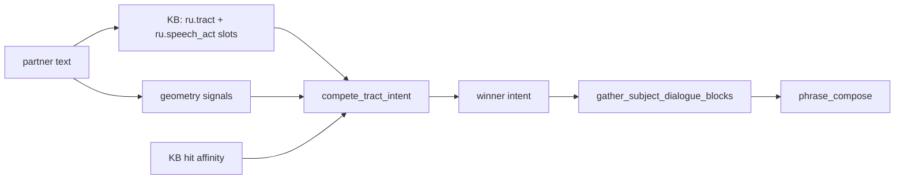

# CASA-ADR-0052: Intent = tract competition на поле (не if-ladder)

**Статус:** принято (2026-06-07)  
**Область:** `semantic_read`, partner turn classify, F-tract routing  
**Связано:** [CASA-ADR-0045-subject-as-interlocutor.md](CASA-ADR-0045-subject-as-interlocutor.md), [CASA-ADR-0049-ru-lexical-fluency-orthography-v0.md](CASA-ADR-0049-ru-lexical-fluency-orthography-v0.md), [CASA-von-neumann-class-ru-v1.md](CASA-von-neumann-class-ru-v1.md) (F1–F10), [CASA-cefr-gate-ru-v1.md](CASA-cefr-gate-ru-v1.md)

---

## Решение (одной фразой)

**Intent партнёрского turn'а = победивший F-tract** после совместного scoring на поле (геометрия turn'а + `ru.tract.*` + `ru.speech_act.*` из KB + affinity top KB hits). **Не** if-ladder «сначала discuss, потом explain». Понимание речевой ситуации = этот argmax, не метка маршрутизатора.

---

## Проблема (техдолг до ADR)

`semantic_read` v0:

```text
partner text → if-ladder (substring lists) → intent → bind под intent → compose
```

Следствия:

- C2 register rewrite ловился как `discuss` → paste passage.
- Intent не равен «что хотят в ситуации» — равен первому сработавшему маркеру в коде.
- Cues размазаны: Python (`_is_rewrite_query`, `_is_explain_query`) + `sn_cen_runtime` markers + KB refine постфактум.

Это **тип 3** routing, не анализ текста (см. обсуждение Chomsky / speech situation).

---

## Целевая схема



| Слой | Роль | Где |
|------|------|-----|
| **Geometry** | Структура turn'а без лексических списков в hot path | passage split, math glyph, turn length, `?` |
| **`ru.tract.*`** | Гипотезы F-трактов + cue slots (transport) | KB bundle |
| **`ru.speech_act.*`** | Прагматический вектор → tract | KB bundle |
| **KB affinity** | Top hits подтягивают grammar / explain / math | `route_kb_read` prelim |
| **Winner** | `intent` = id тракта с max score | `tract_competition.py` |

---

## Tract ↔ intent (v1)

| `ru.tract.*` | Intent | F-tract (class-ru) |
|--------------|--------|---------------------|
| `math` | `math` | F1 sticks / math |
| `discuss` | `discuss` | F10 + passage RC |
| `rewrite` | `rewrite` | F10 register shift |
| `explain` | `explain` | F5 gloss |
| `grammar` | `grammar` | F3/F4 ortho/punct |
| `social` | `social` | F5 WI |
| `general` | `general` | fallback |

---

## KB slots (контракт)

```json
{
  "concept_id": "ru.tract.rewrite",
  "slots": {
    "requires_geometry": "passage_context",
    "cue_substrings": "перепиш|перепис|дружеск|для чата|неформальн|смени тон"
  }
}
```

```json
{
  "concept_id": "ru.speech_act.rewrite_register",
  "slots": {
    "tract": "rewrite",
    "requires_geometry": "passage_context",
    "cue_substrings": "перепиш|дружеск|сохрани все факты"
  }
}
```

**Правило:** новый speech situation → новый claim в bundle, **не** новая ветка `if` в Python.

Geometry keys (v1): `passage_context`, `math_glyph`, `brief_turn`, `short_turn`, `question_mark`, `long_turn`, `grammar_markers`, `dialogue_turn`.

---

## Bootstrap без bundle

Пустой store / тест без KB: geometry + `grammar_markers` / `dialogue_turn` из structural helpers (`sn_cen_runtime`) дают минимальный honest routing. Полная прагматика — только с `ru.tract.*` в bundle.

---

## Non-goals v1

- LLM classifier на hot path.
- Proposition extract / semantic roles (отдельный этаж, ADR follow-up).
- Замена CEFR gate критериев.

---

## Реализация

| # | Задача | Файл | Статус |
|---|--------|------|--------|
| 1 | ADR-0052 | этот документ | **done** |
| 2 | `compete_tract_intent` | `casa/prisms/tick/tract_competition.py` | **done** |
| 3 | `route_kb_read` → competition | `casa/prisms/tick/semantic_read.py` | **done** |
| 4 | `ru.tract.*` + `ru.speech_act.*` | `kb-lang-ru-grammar-dialog-v1.bundle.json` | **done** |
| 5 | Tests | `tests/test_tract_competition.py` | **done** |

**Smoke:**

```bash
python -m pytest tests/test_tract_competition.py tests/test_semantic_read_kb_bind.py tests/test_rewrite_register.py tests/test_nositel_discuss.py -q
```

---

## Открытые вопросы

1. Proposition nodes (`ru.prop.*`) для fact-preservation без regex в compose — отдельный ADR.
2. Journal / dialogue history как prior на tract scores — **v2 done** (ADR-0053: `dialogue_tract_prior`, provenance `prop_ids`).
3. Mastery: tract claims с field weight после sleep — **Intent Prism v1** (ADR-0057): personal priors; emergent `agent.tract.*` — v2.
