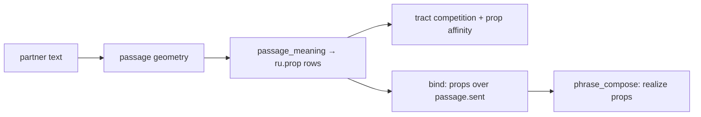

# CASA-ADR-0053: Type-0 written meaning graph (propositions → intent → speech)

**Статус:** принято (2026-06-07)  
**Область:** `passage_meaning`, `subject_dialogue_bind`, `phrase_compose`, tract competition v2  
**Связано:** [CASA-ADR-0052-intent-as-tract-competition-v1.md](CASA-ADR-0052-intent-as-tract-competition-v1.md), [CASA-ADR-0051-multilingual-geometry.md](CASA-ADR-0051-multilingual-geometry.md), [CASA-cefr-gate-ru-v1.md](CASA-cefr-gate-ru-v1.md), [CASA-von-neumann-class-ru-v1.md](CASA-von-neumann-class-ru-v1.md) (ось A5)

---

## Решение (одной фразой)

**Письменный type-0 тракт** = partner text → **meaning graph** (`ru.prop.*` / `ru.event.*` / `ru.role.*` / `ru.constraint.*`) → tract winner → bind propositions (не raw `passage.sent`) → **F8 phrase + L3 morph** realization. Новые речевые ситуации добавляют claims/roles в KB; **не** ad-hoc regex в compose.

---

## Проблема (после ADR-0052)

Tract competition убрала if-ladder, но hot path всё ещё:

```text
passage geometry → passage.sent.* / surface → paste | lemma pick | _rewrite_fact_assembly
```

C1/C2 CEFR сценарии требуют: позиция автора, paraphrase strict, pro/con, register shift с сохранением фактов — это **смысл**, не substring routing.

---

## Целевая схема



| Узел | Префикс | Пример |
|------|---------|--------|
| Proposition | `ru.prop.*` | `ru.prop.stance.author_cautious` |
| Event | `ru.prop.event.*` | `ru.prop.event.meeting_moved` |
| Role slot | slots: `time_date`, `place`, `actor` | 15 марта, актовый зал |
| Constraint | `ru.prop.constraint.*` | `preserve_facts`, `shift_register` |
| Argument | `ru.prop.argument.for` / `.against` | pro/con structure |

`passage.sent.*` остаётся **provenance/fallback**, не primary content для `discuss` / `rewrite`.

---

## Инварианты

1. **No new control prisms** — DMN/SN/FPN/CEN без изменений (North Star).
2. **No LLM on hot path** — deterministic extractor v0 в `passage_meaning.py`; рост через KB frames (`kb-lang-ru-lexicon-semantics-v1`).
3. **Compose from slots** — proposition blocks несут `clause_*` / `linker_*` для F8; не копировать formal `passage.sent` при `rewrite`.
4. **Tests on behavior** — preserved facts, stance paraphrase, pro/con sides, register shift; не exact phrase match.
5. **Tract + meaning** — activation `ru.prop.*` даёт boost discuss/rewrite в `tract_competition` (v2 поверх ADR-0052).

---

## Vertical slice v0 (C1/C2)

| Сценарий | Props |
|----------|-------|
| C2 register rewrite | `event.meeting_moved`, roles time/place, `constraint.preserve_facts`, `constraint.shift_register` |
| C1 author position RC | `stance.author_cautious`, priority literacy → second language |
| C1 structured opinion WP | `task.pro_con`, topic slots, argument frames |

---

## Curriculum (ось A5) — навык `skill.read.comprehend`

**ЗУН:** изучение связного текста → извлечение фактов → анализ (причина, позиция, ограничения) → осмысленный письменный ответ.

Не путать с `skill.read.whole` (слово) и `skill.read.phrase` (слоты фразы). Comprehend работает на **passage + question**, не на одном cue.

### Декомпозиция (sub-acts, один skill id)

| Sub-act | Что делает | Hot path сегодня | concept prefix |
|---------|------------|------------------|----------------|
| **study** | Разметить passage: предложения, salience | `passage_comprehend` | geometry |
| **extract** | Факты, цитаты, события, роли | `passage_meaning` frames | `ru.prop.fact.*`, `ru.prop.event.*` |
| **analyze** | Почему, позиция автора, pro/con, register | `passage_meaning` + tract | `ru.prop.inference.*`, `ru.prop.stance.*`, `ru.prop.task.*` |
| **fixate** | Запомнить props для prior / promote | `agent_remember`, journal | journal + `prop_ids` |
| **respond** | Своя речь из props | `phrase_compose` | articulate |

### Цикл обучения (ADR-0034 / KE)

```text
passage + question
  → classify (discuss / rewrite / …)     tract competition
  → extract + analyze                    passage_meaning + semantics KB
  → agent_remember (hypothesis props)    journal draft
  → probe_text_meaning_ru / CEFR slice   gate
  → promote frame → semantics KB         canon-authoring (planned)
  → sleep → routes                       mastery weight (planned)
```

### Capability routing (target)

| Уровень | Route |
|---------|--------|
| **Нет skill** | geometry only; честный partial / defer |
| **partial** | extract short facts (A2–B1) |
| **comprehend** | inference + stance + register constraints (B1–C2) |

Block 11: `stage-11-text-meaning-ru`, `probe_text_meaning_ru`, KB `kb-lang-ru-lexicon-semantics-v1`. Block 12 CEFR — интеграционный gate поверх B11, не замена.

---

## Файлы

| Файл | Роль |
|------|------|
| `casa/prisms/tick/passage_meaning.py` | Extract proposition rows |
| `casa/domain/subject_dialogue_bind.py` | Bind props, reweight above passage.sent |
| `casa/prisms/tick/phrase_compose.py` | `_prop_clauses`, rewrite/discuss from props |
| `casa/prisms/tick/tract_competition.py` | Prop affinity boost |
| `tests/test_passage_meaning.py` | Meaning graph behavior |

---

## v2 (2026-06-07)

- **KB frames:** `meaning_frame` / `meaning_emit` claims в `kb-lang-ru-lexicon-semantics-v1`; `passage_meaning` — generic matcher, не Python-паттерны.
- **Journal prior:** `apply_journal_prior` + `dialogue_tract_prior`; provenance `query_intent` + `prop_ids` в `dialogue_tick`.
- **Bootstrap:** frames только из merged store bundle; без bundle — пустой meaning (тесты/grammar не загрязняются).

## Открытые вопросы (v3)

- Mastery: frame weight после sleep — не только transport KB.
- L3 morph hub в hot path (stage-10/14) для свободной реализации, не clause templates.
