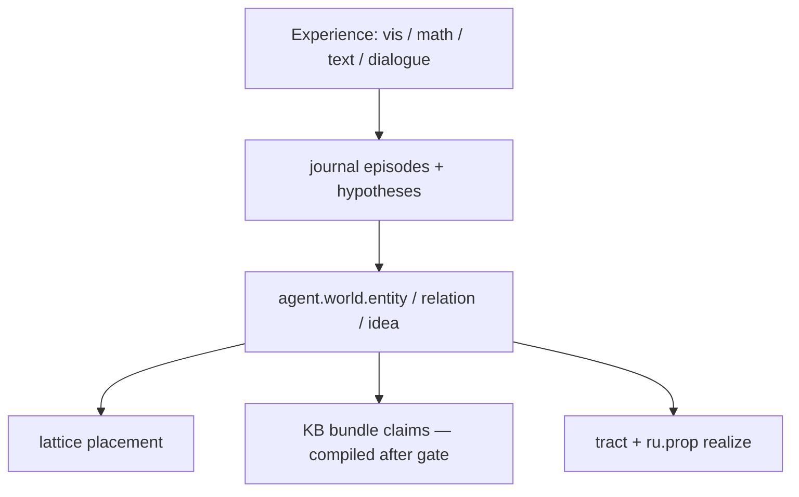

# CASA-ADR-0054: Agent world model (entities, relations, ideas)

**Статус:** принято (2026-06-07)  
**Область:** agent journal, lattice, KB bundles, `passage_meaning`, tract competition  
**Связано:** [CASA-ADR-0053-type0-written-meaning-graph-v1.md](CASA-ADR-0053-type0-written-meaning-graph-v1.md), [CASA-ADR-0029-logical-composition.md](CASA-ADR-0029-logical-composition.md), [CASA-ADR-0015-agent-self-memory.md](CASA-ADR-0015-agent-self-memory.md), [CASA-native-writer-criteria-v1.md](CASA-native-writer-criteria-v1.md), [agent-existence-north-star-v0.md](agent-existence-north-star-v0.md)

---

## Решение (одной фразой)

**Собственная модель мира субъекта** — не отдельный LLM и не школьный §: это **стойкие узлы** (`agent.world.*`) + **отношения** на lattice/journal/KB, выращиваемые из опыта (vis, math, text), гипотез и gate-проверки; язык (`ru.prop.*`, phrase) **реализует** уже связанный мир, а не подменяет его paste-ом passage.

---

## Проблема

После ADR-0053 type-0 meaning graph закрывает **узкие** curated сценарии (stance, inference, register), но:

| Gap | Симптом |
|-----|---------|
| Нет world layer | `ru.prop.*` и `lang.word.*` без **между-собой** связей вне текущего passage |
| Жанр = substring | narrative/instruction/argument не отделены как **tract + world frame** |
| Логика позже кода | программирование потребует причинность и абстракцию, а их нет на поле |
| CEFR ≠ native | green на plan ≠ «чувствую язык» — нет критерия **свободной** письменной речи |

Геометрические гейты зеленеют, а **социальная артикуляция пережитого** (Гальперин: материал → громкая речь → смысл) была пропущена — см. [RU-α bridge](CASA-von-neumann-ru-teaching-plan-v1.md) § Блок 5α.

---

## Целевая схема



### Namespace (v1)

| Prefix | Роль | Пример |
|--------|------|--------|
| `agent.world.entity.*` | Устойчивый объект опыта | `agent.world.entity.stick_heap` |
| `agent.world.relation.*` | Связь между entities | `agent.world.relation.more_than` |
| `agent.world.idea.*` | Гипотеза / обобщение (draft до gate) | `agent.world.idea.two_groups_one_apart` |
| `agent.world.event.*` | Эпизод (привязка к journal id) | `agent.world.event.session-042` |

**Не смешивать:** `lang.word.*` = поверхность языка; `math.*` = quantity tract; `ru.prop.*` = propositional frame для **текста партнёра**. World — **поперечный** слой.

### Relation kinds (v1, closed set)

| `rel` | Смысл | Gate cue |
|-------|-------|----------|
| `part_of` | часть–целое | «из чего состоит» |
| `more_than` / `less_than` | сравнение количества | «чего больше» |
| `near` / `between` | пространство на поле | «где / между» |
| `cause` | причина (осторожно) | «почему произошло» |
| `instance_of` | пример категории | «это вид …» |
| `contradicts` | конфликт гипотез | pro/con в мире |

Расширение — только через ADR + probe, не ad-hoc в compose.

---

## Инварианты

1. **No LLM on hot path** — world edges и articulate из field + journal + compiled KB.
2. **Journal first** — `agent_remember` / hypothesis → candidate `agent.world.idea.*`; promote в bundle после teacher gate ([`promote_meaning_frames`](../../casa/cli/promote_meaning_frames.py) pattern).
3. **Galperin order** — material experience (vis/math) → **verbal journal** (RU-α) → phrase/morph → `ru.prop.*` → world links (RU-ε).
4. **Genre is tract**, not regex — `ru.tract.genre.narrative` / `.instruction` / `.argument` boost meaning frames (см. native-writer-criteria § RU-δ).
5. **Logic track** — [ADR-0029](CASA-ADR-0029-logical-composition.md) **после** RU-ε world links на RU; EN mirror — после RU-N.

---

## Authoring pipeline

```text
1. Moment (vis/math/text) → field surprise
2. Journal cue: «опиши контраст своими словами» (compose_from_field)
3. Teacher tags hypothesis: agent.world.idea.*
4. Held-out probe: explain link X–Y without paste
5. compile_world_bundle.py → kb-agent-world-v1.bundle.json (planned)
6. Sleep: co-place entity + relation on agent lattice
```

**Life archive:** world bundle + journal shards sync в `von-neumann-life-archive` ([ADR-0050](CASA-ADR-0050-agent-life-archive-visibility-v1.md)).

---

## Gates (roadmap)

| Phase | Probe (planned) | Pass |
|-------|-----------------|------|
| RU-α | `probe_material_verbal_ru` | field tokens + own voice + anti-paste |
| RU-ε | `probe_world_link_ru` | explain relation held-out |
| RU-ζ | `probe_world_inference_ru` | cause/contradict без passage paste |
| RU-N | `probe_nositel_open_ru` | open dialogue + neologism + genre |

Curated CEFR **не заменяет** RU-N — см. [CASA-native-writer-criteria-v1.md](CASA-native-writer-criteria-v1.md).

---

## Связь с программой

```text
RU-α material→verbal  →  Phase II phrase chain (continuous ОБО)
RU-β morph depth       →  productive morphology / neologism
RU-γ syntax depth      →  discourse coherence
RU-δ semantics+genre   →  ru.prop.* + genre tracts
RU-ε world model       →  agent.world.*  (этот ADR)
RU-ζ logical layer     →  ADR-0029 on world
RU-N Native Ru Writer  →  open gates
     Native En Writer  →  ADR-0051 mirror
     Programming       →  PRIMM / quantity после CALP
```

---

## Anti-patterns

- CEFR C2 green → «модель мира есть» без `agent.world.*` на store
- Paste passage.sent как «понимание мира»
- Один monolithic «ontology JSON» без journal provenance
- Cartesian sleep: world + grapheme + unrelated tract в одном эпизоде

---

*Версия: v1.0 · 2026-06-07*
