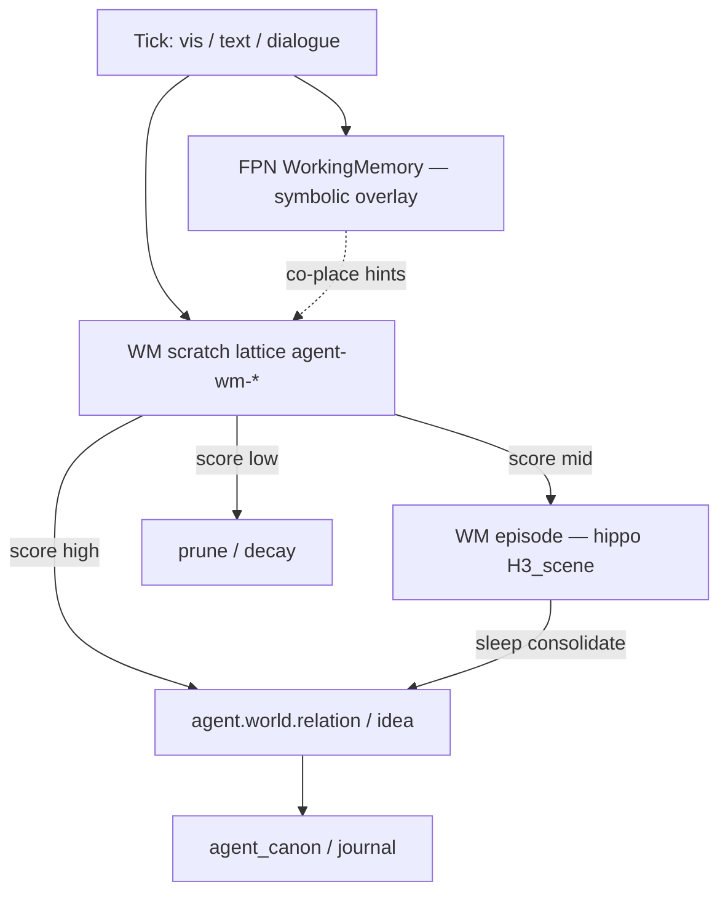

# CASA-ADR-0055: Working Memory Prism (scratch lattices, significant links)

**Статус:** принято (design v1, 2026-06-07)  
**Область:** `prism_agent`, tick hot path, dialogue bind, tract competition, sleep/hippo  
**Связано:** [CASA-ADR-0054-agent-world-model-v1.md](CASA-ADR-0054-agent-world-model-v1.md), [CASA-ADR-0015-agent-self-memory.md](CASA-ADR-0015-agent-self-memory.md), [CASA-ADR-0014-agent-prism.md](CASA-ADR-0014-agent-prism.md), [CASA-immutable-lattice-canon-v1.md](CASA-immutable-lattice-canon-v1.md), [memory-hierarchy.md](memory-hierarchy.md), [CASA-von-neumann-ru-teaching-plan-v1.md](CASA-von-neumann-ru-teaching-plan-v1.md)

---

## Решение (одной фразой)

**Working Memory Prism** — краткоживущие **agent-owned scratch-решётки** с динамическими рёбрами на поле; агент **сам** spawn/place/prune и по score решает, какие связи **значимы** → promote в `agent.world.*` / journal / agent_canon; незначимые decay. «Длинный контекст» = **консолидация значимого**, не хранение всего transcript.

---

## Проблема

После RU-α (material→verbal) и ADR-0054 (world model) остаётся gap **оперативного контекста**:

| Gap | Симптом сегодня |
|-----|-----------------|
| WM = символы, не поле | `WorkingMemory` в `agent_session.json` — goal/plan/`last_concepts`, без co-place на lattice |
| Dialogue ring слабый | `dialogue_turns` (≤256) — prose/meta; passage_meaning journal prior не держит **между-turn** связи |
| `agent_remember` тяжёлый | каждый turn в journal → шум; нет tier «scratch до осмысления» |
| Нет teachable significance | агент не учится отличать **reuse-связь** от одноразового co-occurrence |
| CLT без field WM | overload defer есть; нет **сжимаемого** scratch перед discard |

`create_agent_lattice` уже позволяет динамические решётки (`agent-{slug}`), но без lifecycle и significance gate это ведёт к lattice explosion и paste-interference.

---

## Целевая схема



### Два слоя WM (не смешивать)

| Слой | Где | Роль |
|------|-----|------|
| **FPN WM** | `agent_session.json` → `WorkingMemory` | goal, plan, `last_concepts`, `step_capability` — **control state** для agency/defer |
| **WM Prism** | `field_state.prisms.agent` → `wm_lattices` | **field-native** scratch: узлы + рёбра, co-place hints в bind/tract |

FPN WM остаётся; WM Prism **подпитывает** `salience_mode_bias`, `gather_subject_dialogue_blocks`, tract competition — не заменяет FPN.

---

## Namespace (v1)

| Prefix | Роль | Пример |
|--------|------|--------|
| `agent.wm.lattice.*` | Scratch-решётка (metadata id, не lattice_id) | `agent.wm.lattice.dialogue-042` |
| `agent.wm.node.*` | Активный узел в scratch | `agent.wm.node.rain_cancel` |
| `agent.wm.edge.*` | Ребро scratch (draft) | `agent.wm.edge.rain_cause_cancel` |
| `agent.wm.topic.*` | Макро-тема сессии | `agent.wm.topic.park_stance` |

**Lattice id на диске** (existing rule): `agent-wm-scratch`, `agent-wm-topic-{slug}` — match `^agent-[a-z0-9_-]{1,48}$`.

**Promote targets** (не WM):

| Значимость | Куда |
|------------|------|
| Эпизод / гипотеза | `agent.world.idea.*` + journal |
| Устойчивая связь | `agent.world.relation.*` ([ADR-0054](CASA-ADR-0054-agent-world-model-v1.md)) |
| Закон / paradigm | `agent_promote_canon_lattice` ([immutable-lattice-canon](CASA-immutable-lattice-canon-v1.md)) |

---

## Tier lifecycle

```text
  SPAWN          PLACE           SCORE each tick / sleep boundary
  agent-wm-*  →  nodes+edges  →  promote | hold | decay | delete lattice
```

| Tier | TTL | Spawn trigger | Exit |
|------|-----|---------------|------|
| **WM scratch** | 1 macro-topic / N ticks (default 32) | dialogue turn, surprise bind, explicit `agent_wm_spawn` | prune или promote |
| **WM episode** | до sleep | scratch edge score ≥ θ_hold | hippo `H3_scene` co-place |
| **World** | долго | edge score ≥ θ_promote + held-out cue | `agent.world.*` |
| **Canon** | freeze | law-like cluster, cross-context | `agent_promote_canon_lattice` |

**Инвариант:** sleep **не** promote в world автоматически — только consolidate episode → candidate; promote остаётся **действием субъекта** (как ADR-0015 / canon doc).

---

## Значимая связь: score function (v1)

Не keyword overlap. Композитный score `σ(edge)` ∈ [0, 1]:

| Сигнал | Вес | Описание |
|--------|-----|----------|
| **reuse** | +0.25 | edge снова активировалась в bind ≥ 2 раза (разные ticks) |
| **surprise_drop** | +0.20 | после co-place surprise падает vs baseline |
| **cross_cue** | +0.20 | та же пара узлов из vis + text и/или dialogue |
| **partner_callback** | +0.15 | retrieval hit при cue «как мы говорили про X» |
| **anti_paste** | +0.10 | articulate без paste_ratio штрафа на этом edge |
| **one_shot** | −0.30 | единственная активация, нет reuse |
| **high_paste** | −0.25 | paste_ratio > 0.5 на turns с этим edge |
| **overload** | freeze | при `load.overloaded` — не spawn новых lattice, только decay |

Пороги (planned defaults):

```text
θ_decay  = 0.20   → remove edge / weaken co-place
θ_hold   = 0.45   → retain in scratch; candidate episode
θ_promote = 0.65  → agent may promote_wm_edge → agent.world.*
```

Агент **учится** порогам через curriculum gates (held-out explain), не hardcode в compose.

---

## API (planned, v0 → v1)

Реализация в `casa/prisms/memory/wm_prism.py` (planned); v0 может жить в `agent_memory_ops` extension.

| Операция | Actor | Описание |
|----------|-------|----------|
| `spawn_wm_lattice` | agent / tick policy | `create_agent_lattice(state, "agent-wm-scratch", concept_prefix="agent.wm.")` |
| `place_wm_node` | tick / remember | `place_agent_token` + register `agent.wm.node.*` |
| `place_wm_edge` | bind aftermath | bridge между двумя nodes на scratch lattice |
| `score_wm_edges` | each tick | обновить σ, emit `wm_edge_scores` в provenance |
| `prune_wm_lattice` | tick / sleep | удалить edges < θ_decay; compact lattice |
| `promote_wm_edge` | **agent** | `agent.world.relation.*` + journal entry + optional bundle compile |
| `delete_wm_lattice` | agent / prune policy | `delete_agent_lattice` после consolidate |

**v0 minimal (MVP):**

1. Одна решётка `agent-wm-scratch` на store (reuse, не spawn per turn).
2. `place_wm_node` из `subject_dialogue_bind` — concepts из `dialog.context.focus_recent`.
3. `score_wm_edges` — только reuse + anti_paste.
4. `prune_wm_lattice` каждые 8 ticks.
5. Manual `promote_wm_edge` из probe / teacher cue.

---

## Hot path (north star)

1. **No LLM** — WM hints = field co-place + journal prior, как ADR-0054.
2. **Dialogue bind** — `gather_subject_dialogue_blocks` читает top-k edges по σ → boost в `tract_competition`.
3. **Agency** — низкий tract confidence на WM-only goal → defer; WM prism **не** обходит `subject_agency`.
4. **Overload** — при CLT overload: freeze spawn, accelerate prune ([teaching plan](CASA-von-neumann-ru-teaching-plan-v1.md) § Ритм и нагрузка).
5. **Galperin order** — WM scratch после material experience; promote в world **после** verbal journal (RU-α), не до.

```text
partner turn
  → bind blocks (existing)
  → place_wm_node / place_wm_edge (new)
  → tract_competition (+ wm_edge bias)
  → articulate / compose
  → score_wm_edges
  → prune | promote candidate
```

---

## Gates (roadmap)

| Phase | Probe (planned) | Pass |
|-------|-----------------|------|
| RU-ε | `probe_world_link_ru` | explain relation held-out (ADR-0054) |
| **RU-ε½** | **`probe_wm_context_ru`** | после 5–10 turns объясни связь X–Y **без paste** и без полного пересказа passage |
| RU-ε½ | `probe_wm_retention_ru` | partner callback «как мы говорили про X» → retrieval из WM/world, не ring buffer |
| RU-ζ | `probe_world_inference_ru` | cause/contradict; WM edge → `agent.world.relation.cause` |

**RU-ε½** вставляется **между** RU-ε и RU-ζ:

```text
RU-ε   world model (agent.world.*)
RU-ε½  WM prism (scratch → significance → promote)   ← этот ADR
RU-ζ   logical layer on world
```

---

## Связь с программой

```text
RU-α material→verbal     →  journal voice before phrase
RU-δ semantics+genre      →  ru.prop.* frames
RU-ε world model          →  ADR-0054 stable entities/relations
RU-ε½ WM prism            →  ADR-0055 operational context (этот ADR)
RU-ζ logical layer        →  ADR-0029 on world
RU-N open dialogue        →  long-horizon WM + world recall
```

**Не goal:** заменить `skill.read.comprehend` или `dialogue_turns` ring — WM prism **углубляет** field prior для длинного диалога.

---

## Persist и life archive

| Данные | Tier | В profile tar |
|--------|------|---------------|
| `agent-wm-*` lattices | Self (`agent/lattices/`) | нет |
| Promoted `agent.world.*` | Self + compiled bundle | после gate |
| `wm_edge_scores` snapshot | Runtime checkpoint | нет (recompute on wake) |
| Journal promote motive | Self `journal/` | opt-in backup |

После promote — sync по [ADR-0050](CASA-ADR-0050-agent-life-archive-visibility-v1.md).

---

## Anti-patterns

- Каждый turn → новая permanent lattice (`agent-wm-turn-17` …)
- WM scratch без prune («pseudo-infinite RAM»)
- Significance = substring match / keyword overlap
- Sleep auto-promote всех edges в `agent.world.*`
- WM prism как substitute для `agent_remember` prose
- Paste passage.sent → высокий σ (должен давать **anti_paste** штраф)
- Один monolithic WM JSON без field co-place
- Cartesian sleep: WM scratch + grapheme + unrelated tract в одном эпизоде

---

## Configuration

Пороги θ и веса score **не** зашивать навсегда в compose. Четыре слоя:

| Слой | Где | Что настраивает | Кто меняет |
|------|-----|-----------------|------------|
| **Cold boot manifest** | `design/agent-bootstrap-manifest.v1.json` → `agent_prisms.wm_prism` | spawn scratch lattice, default `wm_policy` при init | host / release |
| **Defaults** | `wm_prism.py` constants | fallback θ_decay/hold/promote, веса σ, prune interval | host / release |
| **Store policy** | `agent/manifest.json` → `wm_policy` или `field_state.prisms.agent.wm_policy` | override порогов per-agent, freeze spawn при overload | ops / агент (explicit act) |
| **Curriculum** | `lessons/*/data/*-plan.json`, probe args | gate pass ratio, held-out strictness для `probe_wm_*` | teacher |

При `bootstrap_agent_cold_store` / `bootstrap_agent_self_tier` manifest применяется через `casa.prisms.memory.bootstrap_agent_manifest`.

```json
{
  "wm_policy": {
    "theta_decay": 0.20,
    "theta_hold": 0.45,
    "theta_promote": 0.65,
    "prune_every_ticks": 8,
    "max_scratch_lattices": 3,
    "score_weights": { "reuse": 0.25, "surprise_drop": 0.20, "cross_cue": 0.20 }
  }
}
```

**Инварианты конфигурации:**

1. Отсутствие `wm_policy` → defaults из кода (v0 так и работает).
2. Probe/gate пороги — в **plan**, не в hot path tick (как `min_pass_ratio` сегодня).
3. Агент **может** со временем сдвигать effective пороги через mastery (streak на `probe_wm_*`), но это **learned bias** в subject flags, не silent auto-tune каждого tick.
4. Bootstrap/host canon пороги WM **не** подменяют significance promote в `agent.world.*` — только scratch lifecycle.

---

## Open questions (v1.1)

1. Отдельный `prism_wm` vs `prism_agent.wm_lattices` — предпочтение v0: **подмножество agent prism**, не новый prism id (меньше router churn).
2. Edge representation: explicit bridge cells vs salience-only co-place — v0: co-place + `agent_bridges` metadata.
3. EN mirror WM — после RU-N green, не параллельно RU-ε½.
4. Mastery-driven θ shift — отдельный ADR или расширение ADR-0010 value?

---

*Версия: v1.0 · 2026-06-07*
