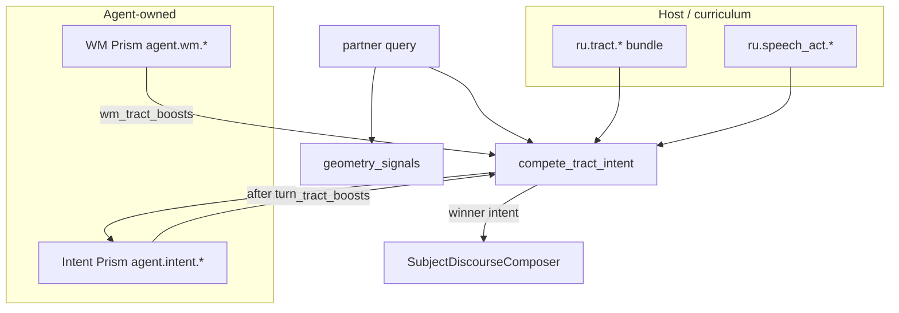

# ADR-0057: Intent Prism — agent-owned speech intentions

**Статус:** accepted (v2 full)  
**Дата:** 2026-06-07  
**Связано:** [ADR-0052](CASA-ADR-0052-intent-as-tract-competition-v1.md), [ADR-0055](CASA-ADR-0055-working-memory-prism-v1.md), [ADR-0056](CASA-ADR-0056-discourse-compose-ooaed-v1.md), [ADR-0054](CASA-ADR-0054-agent-world-model-v1.md)

---

## Решение (одной фразой)

**Intent Prism** — agent-owned слой **гипотез о намерении** (`agent.intent.*` на lattice): субъект **не получает** новые intent-id из Python, а **накопляет опыт** — geometry turn'а + cue-токены → tract prior; после gate — promote в `ru.tract.*` bundle или emergent `agent.tract.*` с собственным discourse profile.

Классификация turn'а остаётся **tract competition** (ADR-0052); Intent Prism даёт **personal boost** и журнал гипотез, WM — **context boost**.

---

## Проблема

| Слой | Сейчас | Gap |
|------|--------|-----|
| **Classify** | `compete_tract_intent` + host `ru.tract.*` | Priors одинаковы для «пустого» и «зрелого» агента |
| **Compose** | фиксированные `IntentStrategy` в Python | Новый speech situation = правка кода |
| **Curriculum** | teacher добавляет claims в bundle | Агент **сам** не фиксирует «это был новый тип разговора» |

Жизненный опыт должен увеличивать **различимость намерений**, не размер if-ladder.

---

## Архитектура (три tier)

### Namespace

| Prefix | Tier | Роль |
|--------|------|------|
| `agent.intent.hypothesis.*` | scratch | geometry + cue → host `tract_id`, score σ |
| `agent.intent.episode.*` | episode | закреплён после sleep / successful dialogue arc |
| `agent.tract.*` | promoted | **новый** intent slug (emergent), после teacher gate |
| `ru.tract.*` | canon | compiled bundle после promote (как meaning frames) |

### Lifecycle (как WM)

1. **Partner turn** → `compete_tract_intent` (host + intent boost + wm boost) → reply  
2. **`intent_after_partner_turn`** — reinforce / spawn hypothesis on `agent-intent-scratch`  
3. **Sleep** — scratch → episode; prune слабые σ  
4. **Teacher gate** — `promote_intent_hypothesis` → `ru.tract.*` claim **или** `agent.tract.*` + optional `IntentStrategy` slot in manifest  
5. **Discourse** — unknown intent → `AgentEmergentIntentStrategy` (field bind + journal); host intents → existing strategies (ADR-0056)

---

**v2 full (реализовано):** learning, host-tract boost, emergent `agent:*` в argmax, promote CLI, sleep consolidate, dynamic `AgentEmergentIntentStrategy`, probe, compile pending → bundle.

| Компонент | Файл |
|-----------|------|
| Lattice, hypotheses, agent tracts | `casa/prisms/memory/intent_prism.py` |
| Boost + emergent argmax | `tract_competition` → `intent_tract_boosts` |
| After-turn learning + emergent spawn | `dialogue_tick` → `intent_after_partner_turn` |
| Sleep consolidate | `orchestrator` → `intent_on_sleep_boundary` |
| Dynamic compose | `discourse/strategies.py` → `IntentStrategyRegistry`, `AgentEmergentIntentStrategy` |
| CLI | `python -m casa.cli.cli_modules intent_prism list|list-tracts|promote-hypothesis|sleep-consolidate` |
| Bootstrap | `agent-bootstrap-manifest.v1.json` → `intent_prism` (`enabled: true`) |
| Probe | `lab/visual-curriculum/probe_intent_personal_ru.py` |
| Compile | `tools/compile_intent_bundle.py` |
| Tests | `tests/test_intent_prism.py`, `tests/test_compile_intent_bundle.py` |

---

## σ(hypothesis) — что укрепляется

| Signal | Вес | Смысл |
|--------|-----|-------|
| `reuse` | +0.2 | тот же winner tract при похожей geometry |
| `cue_overlap` | +0.15 | пересечение cue-токенов с прошлым turn |
| `partner_continue` | +0.12 | партнёр не переформулировал intent (нет «нет, я имел в виду») |
| `surprise_general` | +0.18 | winner=`general`, но bind сильный → кандидат новой гипотезы |
| `decay` | −0.1 / prune | как WM θ_decay |

---

## Configuration

| Слой | Где |
|------|-----|
| Cold boot | `design/agent-bootstrap-manifest.v1.json` → `agent_prisms.intent_prism` |
| Store policy | `agent/manifest.json` → `intent_policy` |
| Defaults | `intent_prism.py` `DEFAULT_INTENT_POLICY` |

---

## Связь с ADR-0052

- **Не заменяет** tract competition — дополняет personal prior.  
- Новый **curriculum** speech act → по-прежнему claim в bundle.  
- Новый **личный** speech habit → Intent Prism → gate → bundle или emergent tract.

---

## Mastery (v2+)

1. Field weight на `agent.intent.*` после sleep (как tract claims в KB).
