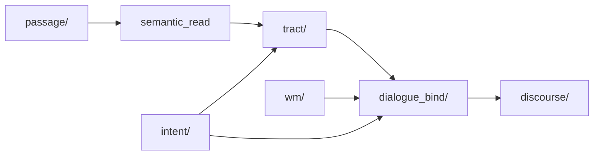

# ADR-0058: Tick bind + memory prisms — OOA&D packages

**Status:** accepted  
**Date:** 2026-06-07  
**Related:** [ADR-0056](CASA-ADR-0056-discourse-compose-ooaed-v1.md), [ADR-0052](CASA-ADR-0052-intent-as-tract-competition-v1.md), [ADR-0055](CASA-ADR-0055-working-memory-prism-v1.md), [ADR-0057](CASA-ADR-0057-intent-prism-v1.md)

## Context

После ADR-0056 (`discourse/`) compose-слой стал пакетным, но **bind**, **tract competition**, **passage meaning**, **WM/Intent prisms** оставались монолитами 350–1026 строк. Каждая новая призма (WM blocks, agent tract profile) требовала правок в `gather_subject_dialogue_blocks`.

## Decision

Разрезать конвейер **read → bind → classify → compose** на OOA&D-пакеты с **thin facades** на старых import paths.

### Pipeline

### Packages

| Package | Was | Role |
|---------|-----|------|
| `casa/domain/dialogue_bind/` | `subject_dialogue_bind.py` 1026 | Block collectors + scoring + binder |
| `casa/prisms/memory/wm/` | `wm_prism.py` 976 | Agent WM graph, bind, lifecycle |
| `casa/prisms/memory/intent/` | `intent_prism.py` 523 | Intent hypotheses, emergent tracts |
| `casa/prisms/tick/passage/` | `passage_comprehend` + `passage_meaning` | Geometry + meaning frames + priors |
| `casa/prisms/tick/tract/` | `tract_competition.py` | Geometry + claims + argmax |
| `casa/prisms/tick/discourse/strategies/` | `strategies.py` 283 | One file per intent strategy |
| `casa/prisms/tick/articulation/` | part of `articulation_realize.py` | `GrammarAtom`, `UtterancePlan` |

### dialogue_bind patterns

| Pattern | Where |
|---------|-------|
| **Value object** | `SubjectDialogueContext`, `block_dict` |
| **Collector** | `collectors/passage`, `kb`, `journal`, `cen_field`, `wm` |
| **Policy** | `scoring.reweight_blocks_for_reply` |
| **Orchestrator** | `SubjectDialogueBinder.gather` |

### Import paths (canonical)

| Package | Import |
|---------|--------|
| `casa.domain.dialogue_bind` | bind + `SubjectDialogueContext` |
| `casa.prisms.memory.wm` | WM prism API |
| `casa.prisms.memory.intent` | Intent prism API |
| `casa.prisms.tick.passage` | comprehend + meaning + priors |
| `casa.prisms.tick.tract` | tract competition |
| `casa.prisms.tick.discourse.strategies` | intent compose strategies |
| `casa.prisms.tick.articulation` | `GrammarAtom`, `UtterancePlan` |

Legacy monolith modules removed after import migration (no facades).

## Adding a new bind source

1. `collectors/foo.py` — `collect_foo_blocks(ctx) -> list[BlockRow]`.
2. Register call in `binder.py` gather loop.
3. Extend `scoring.intent_affinity_delta` if intent gating needed.
4. Tests in `tests/test_subject_dialogue*.py`.

## Consequences

- Monoliths → packages; review и search по семействам блоков.
- Новые agent prisms подключаются collector-ом, не if-ladder в bind.
- Facades сохраняют все существующие import paths для probes и tests.
