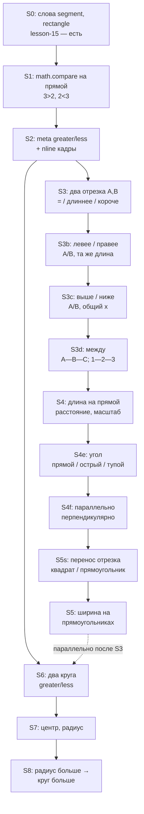

# Больше / меньше / длина / ширина: compare → measure → геометрия (v1)

**Статус:** канон потока (2026-06-04). Заменяет lab-ветку «один большой / один маленький круг → `lang.meta.size.*`» (`lesson-16-meta-size-geom`).

**Связь:** [CASA-learning-protocol-vis-math-v1.md](CASA-learning-protocol-vis-math-v1.md) · [CASA-literacy-roadmap-v1.md](CASA-literacy-roadmap-v1.md) · будущее 3D-зрение: [CASA-visual-3D-tract-future.md](CASA-visual-3D-tract-future.md) (черновик, не блокирует v1) · логика AND/OR/NOT: [CASA-ADR-0029-logical-composition.md](CASA-ADR-0029-logical-composition.md) (отдельный трек, ~8–9 кл.)

**Уже на поле (слова):** `geom-segment`, `geom-rectangle`, … — lesson-15, probe geom-lex **6/6**. Compare и meta-измерение — **отдельные** moment’ы.

---

## Принцип

1. **Сначала отношение** (greater / less / equal), не прилагательное «большая» на пустом фоне.
2. **Та же логика**, что на числовой прямой: `3>2` / `2<3` / `2=2` → потом «больше» / «меньше» / «равны» как **метакатегории**.
3. **Длина — 1D:** два **отрезка** A и B → равны → длиннее → короче; затем **расстояние/масштаб** на числовой прямой (`math.numberline.length`).
4. **Ширина — 2D:** только **после** оси длины; на **прямоугольниках** (второе измерение), не смешать с compare двух отрезков в одном sleep.
5. **Круг «больше»** — compare **двух** фигур; **радиус и центр** — после compare на кругах; «потому что радиус больше» — ещё слой.
6. **Один vis + один lexical (+ math при необходимости) → один sleep**.

**Spatial и lum (2D):** vis.lum — **решётка на JPEG**, не абстрактная геометрия. Два маркера на **разных строках** (A сверху, B снизу) + сдвиг по x дают **2D-паттерн**; sleep вешает несколько meta-id с **одинаковым score** → ambiguous. **Канон:** левее/правее — точки на **одной горизонтали**; выше/ниже — на **одной вертикали**; между — **три точки на одной оси**. Сравнительные «левее/выше» и синонимы «слева/сверху» — **тот же id**, разные surface в **разных** moment'ах.

---

## Онтология (concept_id)

| Слой | id | Surface (RU) | Где учится |
|------|-----|--------------|------------|
| math | `math.compare.gt` | `3>2`, A длиннее B | nline, segment-compare |
| math | `math.compare.lt` | `2<3`, A короче B | nline, segment-compare |
| math | `math.compare.eq` | `2=2`, A = B | segment-compare-equal |
| math | `math.numberline.length` | расстояние на прямой | `numberline-length-pure-*` (lesson-22) |
| meta | `lang.meta.compare.greater` | больше / длиннее | nline + segment + circles |
| meta | `lang.meta.compare.less` | меньше / короче | nline + segment + circles |
| meta | `lang.meta.compare.equal` | равны / одинаковой длины | segment A=B |
| meta | `lang.meta.measure.length` | длина (ось) | meta pure + nline length |
| meta | `lang.meta.measure.width` | ширина (2-е измерение) | rectangle cards |
| meta | `lang.meta.spatial.leftOf` | левее / **слева** | одна горизонталь |
| meta | `lang.meta.spatial.rightOf` | правее / **справа** | одна горизонталь |
| meta | `lang.meta.spatial.aboveOf` | выше / **сверху** | одна вертикаль |
| meta | `lang.meta.spatial.belowOf` | ниже / **снизу** | одна вертикаль |
| meta | `lang.meta.spatial.between` | между | A—B—C; 1—2—3 на прямой |
| meta | `lang.meta.geom.angle` | угол | две стороны + дуга у вершины |
| meta | `lang.meta.geom.angle.right` | прямой угол | маркер 90° (не «прямая») |
| meta | `lang.meta.geom.angle.acute` | острый угол | дуга меньше прямого |
| meta | `lang.meta.geom.angle.obtuse` | тупой угол | дуга больше прямого |
| meta | `lang.meta.geom.parallel` | параллельно | две прямые/отрезка, одинаковый наклон |
| meta | `lang.meta.geom.perpendicular` | перпендикулярно | 90° в точке пересечения |
| math geom | `math.geom.segment` | отрезок | lesson-15 (есть) |
| math geom | `math.geom.rectangle` | прямоугольник | lesson-15 (есть) |
| math geom | `math.geom.circle` | круг | lesson-15 (есть) |
| math geom | `math.geom.center` | центр | lesson-17 (план) |
| math geom | `math.geom.radius` | радиус | lesson-17 (план) |

**Не путать:**

| id | Смысл | Когда |
|----|--------|--------|
| `lang.meta.size.large` / `.small` | прилагательное на **текстовой** карточке w2 | literacy `word-size-*`; **не** путь к «круг больше» |
| `lang.meta.size.comparative.greater` | legacy в design-текстах | → алиас/read path к `lang.meta.compare.greater` |

Алиасы и миграция: `casa/prisms/memory/meta_concept_aliases.py`, `tools/migrate_lex_concept_store.py`.

---

## Ступени curriculum

**Порядок важен:** отрезки compare (S3) **до** ширины (S5). **S4e–S4f** — до sweep (S5s): перенос «на b» требует **перпендикулярно** и **прямой угол**. Круги (S6) можно вести **параллельно** после S2, но не раньше compare на отношении.

---

### S0 — слова «отрезок», «прямоугольник»

| | |
|--|--|
| **Статус** | **есть** |
| lesson | `lesson-15-geometry-words` |
| frames | `geom-segment`, `geom-rectangle`, … |
| lab | `run_micro_geom.py`, `probe_geom_lex_quiz.py` |

---

### S1 — числовая прямая (math)

| | |
|--|--|
| **Статус** | **legacy ambiguous** на `lesson-06`; **S1b pure** — `lesson-27-numberline-compare-pure` |
| stage | `stage-06-numberline-compare` (legacy) |
| lesson | `lesson-06-numberline-compare` · **`lesson-27-numberline-compare-pure`** |
| frames | legacy: `numberline-compare-3gt2`, `numberline-compare-2lt3` · pure: `numberline-compare-pure-3gt2`, `numberline-compare-pure-2lt3` |
| math | `math.compare.gt`, `math.compare.lt` (`moment_plan._FRAME_MATH`) |
| lab | `run_nline_compare_micro.py` · **`run_nline_compare_pure_micro.py`** (6×2 moment) |
| probe | `probe_nline_compare_quiz.py` (legacy tie) · **`probe_nline_compare_pure_quiz.py`** (gate) |

**Успех:** predict math по **pure** кадру → know на gt/lt (bracket выше/ниже оси, один знак на JPEG).

**S1b pure:** не смешать `>` и `<` на одном рисунке; не конкурировать с `lesson-07` add/sub в том же sleep.

---

### S2 — meta compare на тех же неравенствах

| | |
|--|--|
| **Статус** | **lab есть** (`run_meta_compare_nline_pure.py`) |
| Не делать | Привязку к одному изолированному слову «большая» без vis-неравенства. |
| lab | `run_meta_compare_nline_pure.py` (literacy или visual pack) |
| probe | расширить `probe_meta_pure` или `probe_meta_compare_quiz.py` |

**Успех:** know на meta greater/less с hint по id, кадр — nline compare.

---

### S3 — два отрезка A и B: равны / длиннее / короче

| | |
|--|--|
| **Статус** | **lab есть** (`run_meta_compare_segments_pure.py`) |
| vis | **один JPEG**: два отрезка с подписями A, B; три варианта: **A = B**, **A длиннее B**, **A короче B** |
| frames | напр. `geom-segments-equal`, `geom-segments-a-longer`, `geom-segments-a-shorter` |
| math | `math.compare.eq`, `math.compare.gt`, `math.compare.lt` (на **длине** отрезков, не на числах) |
| meta | `lang.meta.compare.equal`, `.greater`, `.less` — те же id, что на прямой; lex «равны», «длиннее», «короче» |
| lab | `run_meta_compare_segments_pure.py`, `probe_meta_compare_segments_quiz.py` |

**Успех:** know на equal / greater / less по кадру **двух отрезков**; не путать с «шириной».

**Педагогика:** та же логика, что `3>2`, но на **1D-figурах** до числовой прямой с масштабом.

---

### S3b — левее / правее (два отрезка, та же длина)

| | |
|--|--|
| **Статус** | **lab** (+ `run_meta_spatial_mirror_reinforce.py` при tie 4:4) |
| Предпосылка | S3 probe know |
| meta | `lang.meta.spatial.leftOf` / `.rightOf` — «левее»/«правее», синонимы **«слева»/«справа»** |
| vis | точки A, B на **одной горизонтали** (не два ряда отрезков) |
| frames | `geom-segments-a-left`, `geom-segments-a-right` |
| lab | `run_meta_spatial_segments_pure.py`, `run_meta_spatial_synonyms_pure.py`, `run_meta_spatial_mirror_reinforce.py` |

**Не смешивать** с compare длины (другие surface и id). **Не** reuse «больше/меньше».

---

### S3c — выше / ниже (два отрезка, общий x)

| | |
|--|--|
| **Статус** | **lab** (+ mirror reinforce) |
| Предпосылка | S3b |
| meta | `lang.meta.spatial.aboveOf` / `.belowOf` — «выше»/«ниже», синонимы **«сверху»/«снизу»** |
| vis | точки A, B на **одной вертикали** |
| frames | `geom-segments-a-above`, `geom-segments-a-below` |
| lab | `run_meta_spatial_vertical_pure.py`, `run_meta_spatial_synonyms_pure.py`, mirror reinforce |

---

### S3d — между (три точки на одной оси)

| | |
|--|--|
| **Статус** | **lab** (`run_meta_spatial_between_pure.py`) |
| Предпосылка | S3c (+ left/right на одной оси) |
| vis | **одна ось**: `A—B—C` (B между) и `1—2—3` на прямой (2 между) |
| frames | `geom-points-b-between-ac`, `numberline-2-between-1-3` |
| meta | `lang.meta.spatial.between` — lex «между» на **обоих** кадрах |
| lab | `run_meta_spatial_between_pure.py`, `probe_meta_spatial_between_quiz.py` |

**Не смешивать** с compare и с левее/правее в одном sleep.

---

### S4 — длина на числовой прямой (расстояние, масштаб)

| | |
|--|--|
| **Статус** | **lab** — `lesson-22-numberline-length-pure` (одна полоса 0→n, без add/sub) |
| vis | одна полоса от 0 до n; **не** кадры lesson-07/08 с `+` / двумя смыслами |
| frames | `numberline-length-pure-2`, `numberline-length-pure-3` |
| math | `math.numberline.length` |
| meta | `lang.meta.measure.length` — meta pure «длина» |
| lab | `run_nline_length_micro.py`, `run_meta_nline_length_pure.py`, `run_s4_length_chain.py` |

Старые `numberline-lengths-2-and-3` / `numberline-lengths-5-and-2` остаются в add/sub lessons — **не** использовать для S4 ingest.

**Успех:** know `math.numberline.length` по кадру; know meta length с hint.

**Связь с S3:** отрезки A/B — compare; прямая — **именованная ось** и **масштаб**.

---

### S4e — угол: угол, прямой, острый, тупой

| | |
|--|--|
| **Статус** | **lab** |
| frames | `geom-angle-generic`, `geom-angle-right`, `geom-angle-acute`, `geom-angle-obtuse` |
| lab | `run_meta_geom_angle_pure.py`, `probe_meta_geom_angle_quiz.py` |

**Не путать:** `lang.meta.geom.angle.right` (**прямой угол**, 90°) и слово **«прямая»** (`math.geom.line`, S0) — разные id и кадры.

**Не смешивать** в одном sleep острый и тупой (lum даст tie). **Развёрнутый** (180°) — отдельная стадия позже, не в v1.

**Lum:** угол — локальный паттерн у **вершины**; фон без «второго ряда» отрезков, как в spatial.

---

### S4f — параллельно / перпендикулярно

| | |
|--|--|
| **Статус** | **lab** |
| frames | `geom-lines-parallel`, `geom-lines-perpendicular` |
| lab | `run_meta_geom_orientation_pure.py`, `probe_meta_geom_orientation_quiz.py` |

**Не смешивать** parallel и perpendicular в одном JPEG. Не reuse left/right/above (это **порядок на оси**, не отношение наклона).

**Связь с переносом:** «параллельный перенос отрезка a на b» опирается на **S4f** (⊥ при b ⟂ a) и **S4e** (прямой угол в углах sweep-контура).

---

### S5s — квадрат / прямоугольник как sweep (перенос отрезка)

| | |
|--|--|
| **Статус** | **lab** |
| frames | `geom-sweep-segment-a`, `geom-sweep-translate-a` (vis); `geom-sweep-square-a`, `geom-sweep-rect-ab` (math) |
| lab | `run_meta_geom_sweep_pure.py`, `probe_meta_geom_sweep_quiz.py` |

**Не смешивать** в одном sleep перенос, длину a и подпись «прямоугольник».

---

### S5 — ширина на прямоугольниках (второе измерение)

| | |
|--|--|
| **Статус** | **lab** |
| frames | `geom-rectangle-width` |
| lab | `run_meta_measure_width_pure.py`, `probe_meta_measure_width_quiz.py` |

**Не смешивать:** compare A/B (S3) и «ширина» (S5) в одном sleep.

---

### S6 — два круга: больше / меньше (без радиуса)

| | |
|--|--|
| **Статус** | **lab** — `run_s6_circles_chain.py`; gate `probe_meta_compare_circles_quiz.py` |
| Предпосылка | слово «круг» (`geom-circle`, S0) |
| lesson | `lesson-16-geom-circle-compare` |
Vis: два контура + **скобка** над/под **левым** кругом (как nline compare-pure), без подписи «радиус».
| frames | `geom-circles-left-greater`, `geom-circles-left-less` |
| meta | `lang.meta.compare.greater` / `.less` phrase_vis на **сцене сравнения** |
| lab | `run_meta_compare_circles_pure.py`, `probe_meta_compare_circles_quiz.py`, `run_s6_circles_chain.py` |

**Успех:** know greater на кадре «левый круг больше»; ambiguous не acceptable как финал.

**Отложить:** `geom-circle-large` / `geom-circle-small` → `lang.meta.size.*`.

---

### S7 — центр и радиус

| | |
|--|--|
| **Статус** | **lab есть** |
| lesson | `lesson-17-circle-center-radius` |
| vis | круг + **точка в центре**; круг + **отрезок центр→контур** |
| math | `math.geom.center`, `math.geom.radius` |
| lab | `run_geom_center_radius.py` |

---

### S8 — «больше, потому что радиус больше»

| | |
|--|--|
| **Статус** | **план** |
| Идея | Moment на **двух** схемах с подписанным радиусом или compare + lex; связь compare(greater) ↔ compare радиусов. |
| Не делать | Один sleep: radius + circle word + greater + gt. |

---

## Прилагательные «большая / маленькая» (w2)

Остаются в `lesson-07-meta-language` как **лексика**, `lang.meta.size.large` / `.small`.

- ingest: `run_meta_size_pure.py` (текст) — **ок**, но **не** блокирует S6.
- **не** использовать как прокси для «круг больше».

---

## Lab: очередь инженерии

| # | Задача | Зависит от |
|---|--------|------------|
| 1 | id compare + measure в `meta_concepts.py` + aliases | — |
| 2 | nline compare + meta nline (S1–S2) | — |
| 3 | JPEG segment-compare + `run_meta_compare_segments_pure.py` (S3) | S2 |
| 4 | nline length + meta length (S4) | S3 |
| 4e | angle cards + meta angle kinds (S4e) | S4 |
| 4f | parallel / perpendicular (S4f) | S4e |
| 5s | sweep square/rectangle vis (S5s) | S4f |
| 5 | rectangle width cards + meta width (S5) | S4 |
| 6 | circle compare + center/radius (S6–S7) | S2 |
| 7 | moment связки radius↔compare (S8) | S7 |
| 8 | deprecate `lesson-16-meta-size-geom` | 6 |

---

## Probe

| Probe | held-out |
|-------|----------|
| `probe_nline_compare_quiz` (план) | gt/lt кадры |
| `probe_meta_compare_quiz` (план) | nline + geom compare frames |
| `probe_geom_lex_quiz` | без изменений (circle word) |

Hints только в JSON отчёта; runtime без manifest-oracle.

---

## Что считать регрессией

- Meta greater на **одном** круге без второго эталона → ambiguous — **ожидаемо**, не лечить контрастом JPEG.
- Подмена S4 изолированными `lang.meta.size.large` / `.small` на geom.
- Смешение `math.geom.circle` и `lang.meta.compare.greater` в одном sleep.
