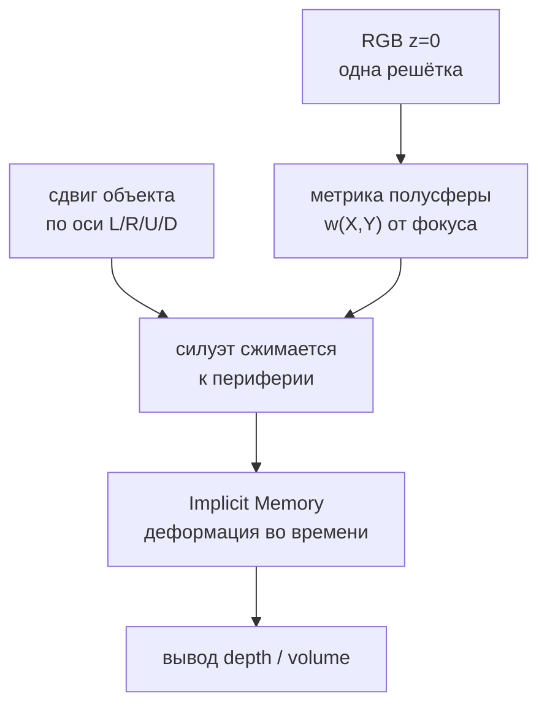
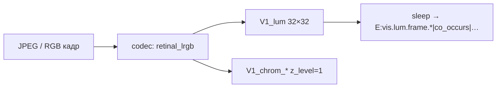
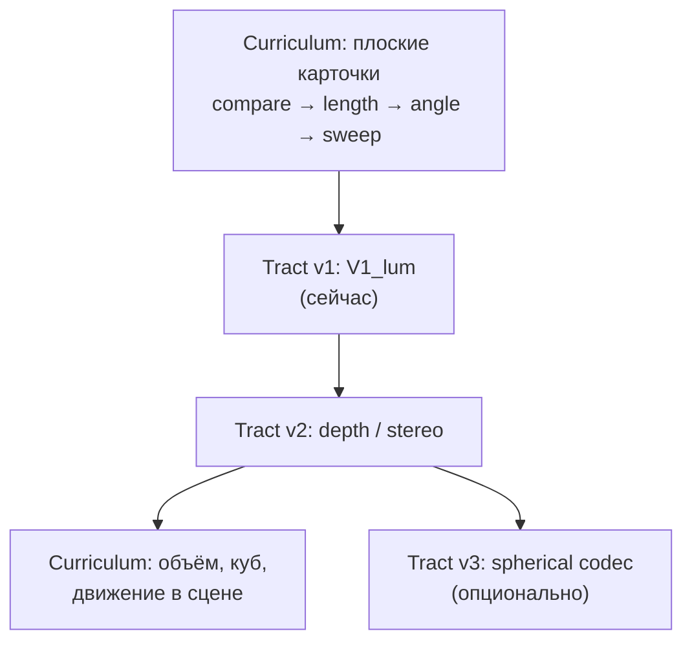

# Visual tract: 2D lum v1 → depth v2 → spherical retina (черновик)

**Статус:** черновик / future (2026-06-04). **Не** канон compare/literacy — отдельный трек сенсорики и «взросления» агента.

**Связь:**

- [CASA-learning-protocol-vis-math-v1.md](CASA-learning-protocol-vis-math-v1.md) — vis↔math, один sleep
- [CASA-compare-greater-less-v1.md](CASA-compare-greater-less-v1.md) — плоский **учебный** мир (карточки); lum-ограничения § spatial
- `casa/domain/visual_tract.py` — `V1_lum`, `z_level` (канал, не глубина сцены)
- `casa/sensory/codecs/retinal_lrgb.py` — плоский даунсэмпл JPEG → 32×32
- [CASA-ADR-0028-field-native-sensory-experience.md](CASA-ADR-0028-field-native-sensory-experience.md) — field-native sensory (если есть в репо)
- [CASA-ADR-0031-foveated-saccadic-visual-sampling.md](CASA-ADR-0031-foveated-saccadic-visual-sampling.md) — **2D high-res:** фовеа + саккады (чертежи, УГО), не сфера

---

## 2D high-res: фовеа и саккады (не v3)

Чертежи, условно-графические обозначения и мелкий шрифт на **плоском листе** требуют **линейного** разрешения по X/Y, а не сферической метрики. Канон — **обзор (низкий grid) + фовеальные окна + серия фиксаций**, см. [CASA-ADR-0031-foveated-saccadic-visual-sampling.md](CASA-ADR-0031-foveated-saccadic-visual-sampling.md). Сфера/Orion (§ ниже) — отдельный трек для FOV и движения в сцене.

---

## Зачем отдельный документ

У von-neumann сейчас **два разных «2D»**, их легко смешать:

| Слой | Сейчас | Вопрос на вырост |
|------|--------|------------------|
| **Учебный мир** | JPEG-карточки: прямая, ось, квадрат на листе | Куб, перспектива, «объём» — **символы** или **настоящая глубина**? |
| **Сенсорика (tract)** | `retinal_lrgb` → плоская `V1_lum` + chrom на `z_level=1` | Откуда в поле берётся **третья координата** сцены? |

Переход «из 2D-мира в 3D» — это в первую очередь **новый входной тракт** (или дополнение к v1), а не только новые слова в curriculum.

У человека глаз **не плоский**: сетчатка вогнута, сцена проецируется на сферическую поверхность; **глубина** достаётся из стерео, движения, аккомодации, перекрытия, масштаба. Вогнутость сетчатки — про **оптику и поле зрения**, не замена этих сигналов.

---

## Три смысла «кривизны» (не путать)

| # | Смысл | Где живёт | Статус |
|---|--------|-----------|--------|
| A | **Кривая / прямая** на уроке | Curriculum S4e (`lang.meta.geom.angle.*`, …) | Плоский lum, обычные JPEG |
| B | **Кривизна сенсора** | Импринт на сфере / fisheye вместо прямоугольного grid | § v3 ниже |
| C | **Метрика поля (Orion)** | Одна RGB-решётка; … | § Orion ниже |
| — | **Логика AND/OR/NOT** | не сенсорика | [CASA-ADR-0029-logical-composition.md](CASA-ADR-0029-logical-composition.md) |

Этот документ — про **B/C** и глубину; (A) — compare; «правее и ниже» как **и** — ADR-0029, не Orion.

---

## Orion — кривизна как метрика одной RGB-решётки (привет от Ориона)

**Идея:** не городить вторую тяжёлую RGB-решётку под карту нормалей. Кривизну сенсора закодировать как **геометрическое искажение (метрику)** той же решётки, на которой уже лежит цвет.

| Постулат | Смысл |
|----------|--------|
| Слой **z=0** | Обычный RGB: коровы, зёрна, палочки, учебные JPEG — тот же tract, что сейчас `V1_lum` + chrom (`z_level` в коде = **канал**, не глубина сцены) |
| Не плоская сетка | Индексы `(X,Y)` — ячейки решётки, но **размещены** на вогнутой **полусфере** (сетчатка-подобная проекция) |
| Фиксированная метрика | У каждой ячейки есть **неизменяемый** коэффициент удаления от центра (фокуса); это часть codec, не обучается каждым sleep |
| Нет normal map | Один цвет на z=0; 3D не из второй матрицы, а из того, **как паттерн цвета живёт на искривлённом поле** |

### Как из этого получается 3D (без stereo-lattice)

Когда объект **смещается** по экрану по уже освоенной оси (левее/правее, выше/ниже — S3b/S3c):

1. На **сферической метрике** плоский силуэт на решётке к краям FOV **сжимается / искажается** (не артефакт урока, а следствие проекции).
2. Быстрый инференс по полю (у Ориона — NativeAOT порядка **0.7 ms** на срез; у нас — hot path decode + sleep по призме) улавливает **изменение формы** того же цветового пятна во времени.
3. **Implicit memory** (co-occurrence, `E:vis.lum.frame.*`, episodic) связывает деформацию с **объёмом/глубиной** — отдельный `LATTICE_V2_DEPTH` не обязателен, если probe это подтверждает.

**Стык с compare-каноном:** оси L/R/U/D остаются **педагогически одномерными**; метрика добавляет **второй сигнал** (деформация), не смешая в один sleep «левее» и «дальше».

### vs § v2 stereo / vs § v3 отдельная сфера

| Подход | Вторая решётка? | Откуда z |
|--------|-----------------|----------|
| v2 stereo (классический) | Опционально `V2_depth` | disparity, parallax |
| v3 отдельный spherical codec | Новая топология cells | импринт на графе сферы |
| **Orion metric** | **Нет** — та же RGB, другая **метрика** `(X,Y)` | динамика warp + implicit |

Orion ближе к **пересечению B+C**: сферическая геометрия **вшита в размещение/расстояния**, не в дублирование RGB.

### Что менять в codebase (когда пойдём)

Сейчас `retinal_lrgb` — **плоский** даунсэмпл прямоугольника в 32×32 (`DEFAULT_GRID_SIZE`; у Ориона в тексте **64×64** — целевой размер CA-CV, согласовать при ADR).

| Компонент | Сейчас | Orion v2 |
|-----------|--------|----------|
| `encode_retinal_lrgb` | прямоугольный bucket average | ремап пикселей JPEG → ячейки по **полусферической** inverse map |
| `_place_token` / decode | евклидов radius | соседство по **метрике** (веса из `w(X,Y)` или geodesic на dome) |
| Импринт | статичный per frame | + **серии** кадров при сдвиге объекта (поршень времени / fMRI-срезы по призме) |
| Probe | know на frame id | know **depth** при held-out: сдвиг + искажение vs плоский контроль |

**Не ломать v1:** плоский codec остаётся `retinal_lrgb`; Orion — `retinal_dome_v1` или флаг метрики на новом агенте / версии store.

### Риски (честно)

- Учебные **статичные** JPEG на плоском листе **сами** не дают периферийного сжатия — нужен либо **движение** объекта/взгляда на dome, либо remapping уже нарисованной сцены.
- Без временной серии Orion не отличается от «просто кривого fisheye» — нужен **moment + sleep** при сдвиге.
- Конкуренция: warp у края не должен снова вешать `leftOf` **и** `near` с одним score — отдельные sleep'ы для depth vs spatial (как S3b).

### Критерий пилота Orion

1. Тот же RGB, **без** второй RGB-решётки.
2. После серии сдвигов по одной оси — probe **depth/volume** know; spatial probes **без регрессии**.
3. Плоский контроль (без метрики / без движения) — **не** know depth.

### Очередь (дополнение)

| # | Задача | Примечание |
|---|--------|------------|
| O1 | ADR: `w(X,Y)` полусфера, 32 vs 64, связь с CA-CV z=0 | Orion + `visual_tract.py` |
| O2 | `encode_retinal_dome` + таблица метрики | без normal map |
| O3 | Lab: корова/зёрна сдвиг по оси на dome → sleep series | orion-invariant lineage |
| O4 | Probe deformation → depth | до curriculum «объём» |

*Источник формулировки: Orion [1.1] — интегрировано в черновик 2026-06-04.*

---

## v1 — как сейчас (baseline)

- **Импринт:** прямоугольный даунсэмпл, квантование lum/chrom (`encode_retinal_lrgb`).
- **Память:** рёбра и токены на **плоской** решётке; predict — голосование по `lum.cells` + schema-math / lexicon lattices.
- **Ограничение pedagogy:** один смысл на sleep, одна ось на кадр (см. compare § spatial) — из-за **конкуренции паттернов на 2D lum**, не из «физики».

**Не ломать v1:** все существующие `vis.lum.frame.*` остаются валидными после v2/v3.

---

## v2 — глубина (depth tract)

**Цель:** в поле появляется предсказуемый сигнал **«дальше/ближе»** (или disparity), не выведенный только из плоской перспективы на JPEG.

### Источники z (по приоритету lab)

| Источник | Идея | Плюс | Минус |
|----------|------|------|-------|
| **Стереопара** | `frame-left` + `frame-right` → один sleep или связанная пара | Близко к биологии | Два импринта, нужен codec disparity |
| **Движение (parallax)** | Последовательность кадров при сдвиге «головы» | Как у ребёнка | Длинная цепочка moment'ов, не один JPEG |
| **Пикториальные cue** | Перспектива, перекрытие на **плоском** JPEG | Без смены codec | Слабый «настоящий» z; конкурирует с 2D meta |

### Черновик артефактов

| Артефакт | Назначение |
|----------|------------|
| `LATTICE_V1_DEPTH` или `V2_depth` | Токены disparity / depth bins |
| `codec_id` | напр. `retinal_stereo_v1` (отдельно от `retinal_lrgb`) |
| `concept_id` | напр. `vis.depth.near`, `vis.depth.far`, `math.space.depth` (уточнить при ADR) |
| curriculum | **после** S4–S5s на плоскости; probe depth **до** слов «объём» |

### Критерий «включать v2»

- Held-out probe: на стерео/параллакс-кадрах **know** depth-id, на плоских карточках без z — **не** ложный know.
- Старые probes (nline, spatial, length-pure) — **без регрессии**.

### Миграция store

- **Дополнение**, не замена: `ensure_prism_visual` поднимает v2 lattice рядом с `V1_lum`.
- Bridges: `E:vis.lum.frame.X` может связаться с `E:vis.depth.*` только через **отдельные** sleep'ы (не смешивать в один ingest).

---

## v3 — опционально: сферическая / вогнутая сетчатка

**Цель:** геометрия **поверхности сенсора** ближе к глазу — импринт на графе сферы (или dome), а не на `Z²` с прямоугольным шагом.

| Вопрос | Черновик ответа |
|--------|------------------|
| Зачем, если есть v2? | Если v2 на плоском codec теряет инварианты (края FOV, сильная дисторсия камеры) |
| Codec | `retinal_sphere_v1`: equirectangular / fisheye → cells на сфере |
| Связь с JPEG | Учебные карточки остаются прямоугольными; сфера — для **живого** потока (камера, VR, панорама) |
| Кривизна lum | **Топология связности** ячеек, не дуга на уроке |

**Критерий «включать v3»:** отдельный ADR + пилот, где v2 на плоском codec **не** закрывает кейс (зафиксировать кейс до кодирования).

---

## Учебный мир vs tract (лестница «подрастает»)

- **Детский этап (сейчас):** C0 на v1 — достаточно.
- **Порог «подрос»:** появляется v2; curriculum 3D **не опережает** probe depth.
- **Sweep квадрат/прямоугольник (S5s):** остаётся на **плоском** vis; v2 не обязателен для S5s, но v2 нужен для **настоящего** «куб в комнате».

---

## Embodied track (параллельная ветка)

Самый «человечный» 3D: агент **движется** в среде → parallax рождает depth без рисования «объёма» на карточке.

- Не заменяет v2 stereo на карточках; может **слиться** с v2 в одном `depth` lattice.
- Отдельный design, когда появится sim/камера — ссылка из § v2 «движение».

---

## Non-goals (v1 черновика)

- Не менять compare-канон под 3D.
- Не вводить «кривизну lum» без критерия probe-регрессии.
- Не смешивать `z_level` chrom с пространственной глубиной в документации (явно: **channel stack ≠ Z мира**).
- Не мигрировать/переписывать store von-neumann без версионирования tract.

---

## Очередь (инженерия, когда созреет)

| # | Задача | Зависит от |
|---|--------|------------|
| 1 | ADR: depth tract (**Orion metric** vs stereo vs motion) | этот черновик § Orion |
| 2 | Пилот codec + 2–4 кадра stereo | ADR |
| 3 | `predict_depth_for_vis_cue` + teacher probe | пилот ingest |
| 4 | Curriculum «ближе/дальше» на stereo | probe know |
| 5 | Черновик ADR spherical (только если (4) недостаточно) | v2 metrics |

---

## Открытые вопросы

1. Один `frame_id` на стереопару или два linked id + sleep связывает?
2. Depth как **math** (`math.space.depth`), **vis** (`vis.depth.*`), или **meta** (`lang.meta.spatial.depth`)?
3. Нужен ли «прямой угол» в 3D-кубе на плоском JPEG до v2, или только после stereo?
4. Совместимость с правилом «учитель не reinforce снаружи» — только среда и повтор moment'ов?
5. **Orion:** хватает ли metric dome + temporal warp без `V2_depth`, или stereo нужен как калибровка?

---

## Ссылки для реализации (v1 codebase)

| Компонент | Путь |
|-----------|------|
| Lattice ids | `casa/domain/visual_tract.py` |
| Импринт | `casa/prisms/visual/imprint.py`, `casa/sensory/codecs/retinal_lrgb.py` |
| Vis↔math bridges | `casa/prisms/visual/bridge_math.py` |
| Grid placement | `casa/prisms/shared/codec_grid.py`, `_place_token` radius |

---

*При принятии v2 — вынести статус в ADR и одну строку-ссылку из learning-protocol; compare-канон не расширять.*
