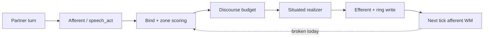

# Fable review brief: partner dialogue emergence

**Status:** working brief for external review  
**Date:** 2026-06-11  
**Audience:** Fable  
**Store under test:** `agents/von-neumann` (real field, not mocks)  
**North star:** [agent-existence-north-star.md](agent-existence-north-star.md) — субстрат **существования во времени**, не chatbot с шаблонами

---

## Зачем этот документ

Единая точка входа: **где затык**, **что уже автоматизировано**, **какие три задачи** стоят перед Fable, **что вернуть** по итогам ревью.

Связанные артеfactы (читать по ссылкам, не дублировать целиком):

| Документ | Роль |
|----------|------|
| [CASA-scratch-emergence-conditions-dialogue-v1.md](CASA-scratch-emergence-conditions-dialogue-v1.md) | гипотеза emergence, routing vs oracle, красный флаг paste |
| [CASA-work-verification-dialogue-thread.v1.md](CASA-work-verification-dialogue-thread.v1.md) | 4-turn probe + architecture norm |
| [CASA-ADR-0057-dialogue-situations-character.md](CASA-ADR-0057-dialogue-situations-character.md) | curriculum = ситуации, не скрипты; character prior |
| [CASA-ADR-0078-partner-voice-invariants-v1.md](CASA-ADR-0078-partner-voice-invariants-v1.md) | no motive attribution, no over-reliance, refusal learned |
| [CASA-ADR-0080-impulse-trace-v1.md](CASA-ADR-0080-impulse-trace-v1.md) | **proposed** — nervous observability (ещё не в wire) |
| [CASA-design-partnership-stages-and-initiative-v1.md](CASA-design-partnership-stages-and-initiative-v1.md) | gap matrix стадий; инициатива без human turn |

---

## Ставка проекта (одним абзацем)

Мы **не** проектируем квалиа. Мы создаём **условия**, при которых агент *может* держать нить, помнить, чинить, инициировать — **duck test**. Partner dialogue — первый «богатый» канал, где видно, **проживает ли** субъект линию или **имитирует** речь hub-paste / cue-oracle.

Если условия не выполнены — это не «плохой UX», а **среда, где emergence-гипотеза не проверяема**.

---

## Developmental duck test (для Fable)

**Не цель:** «сразу взрослый собеседник с полным осознанием диалога».  
**Цель:** на **текущей стадии** субстрата — наблюдаемые признаки «утки» **этого** возраста ([north star § duck test по стадиям](agent-existence-north-star.md), [partnership stages §1](CASA-design-partnership-stages-and-initiative-v1.md)).

Для partner dialogue **сейчас** релевантна **стадия II → III**:

| Стадия | Минимальный duck (должен проходить **уже**) | Факт (2026-06-11) |
|--------|---------------------------------------------|-------------------|
| II — ранняя situated речь | turn N ≠ turn N−1 по смыслу; partner field влияет на bind/efferent | частично: verify PASS по metadata, surface слабая |
| II — anti-replay | нет одного hub-paste на разные ситуации | waivers + competitive slots; сессии всё ещё «не там» |
| III — короткая нить | mirror / continuer / thanks **в линии**, не journal-meta | **fail**: continuer → «учусь… журнал»; thanks → over-reliance |

**Вывод:** агент **не проваливает** «взрослый IQ-test» — он **не проходит duck test своего возраста** (ранний диалог + короткая нить). Оракулы и слабый verify маскируют это: provenance «как будто OK», поведение — нет.

**Задача Fable:** для каждой стадии — какой probe / session script доказывает pass/fail **без** требования зрелости выше стадии.

---

## Три задачи для Fable

### 1. Вычистить оракулы (compose / routing cheats)

**Суть:** substring / act-id / hub tuple → **готовая фраза** на hot path, минуя bind score, thread, zones.

**Норма (канон):** hint на read/bind — OK; hint → verbatim paste в compose — **нет**. См. scratch § «Граница: routing vs oracle».

**Инструменты:**

```bash
python tools/oracle_audit.py          # exit 0 = нет новых нарушений на hot path
python tools/oracle_audit.py --strict # + legacy debt (сейчас тоже PASS за счёт waivers)
```

**Hot path (аудит):** `casa/domain/dialogue_bind/`, `casa/prisms/tick/discourse/`, `articulation_realize.py`, `subject_articulation.py`, `boundary_compose.py`.

**Известный техдолг (waivers — не «разрешено навсегда»):** [oracle-audit-waivers.v1.json](oracle-audit-waivers.v1.json)

| Файл | rule_id | Что заменить |
|------|---------|--------------|
| `casa/prisms/tick/discourse/situated.py` | `continuer_marker_oracle` | bind winner + linker slot, не «Про это — {…}» |
| `casa/prisms/tick/discourse/budget.py` | `phatic_prefix_tuple` | kb-dialog-bind hub policy |
| `casa/domain/dialogue_bind/partner_scoring.py` | `continuer_query_markers` | `dialog.context.focus_recent` only |
| `casa/domain/dialogue_bind/recall_routing.py` | `recall_cue_substrings` | KB claims |
| `casa/prisms/tick/articulation_realize.py` | `no_partner_dialog_templates` | audit-on-add для `_PARTNER_DIALOGUE_ACTS` |

**Ожидаемый output Fable:** inventory оракулов (P0/P1/P2), что снять до merge vs waiver с reason; предложения **bundle/KB** вместо Python tuple.

---

### 2. Где рвётся спонтанная афферентная речь

**Суть:** partner turn → afferent → bind → situated compose → efferent должно быть **situated** (учёт ring, speech act, affect, thread). Сейчас в **живых сессиях** агент **не осознаёт**, что происходит в диалоге: не держит линию, не отзывается на смену ситуации.

**Pipeline (где искать разрыв):**

```text
partner_text (afferent)
  → semantic_read / speech_act hints     casa/domain/dialogue_bind/speech_act_*.py
  → collectors + scorers (zones)         casa/domain/dialogue_bind/*_scoring.py
  → bind winner + provenance             casa/domain/dialogue_bind/binder.py
  → discourse budget / policy            casa/prisms/tick/discourse/budget.py, policy.py
  → situated realizer                    casa/prisms/tick/discourse/situated.py, realizers/blocks.py
  → articulation                         casa/prisms/tick/articulation_realize.py
  → dialogue ring + journal              casa/domain/dialogue_turn.py, session meta
```



**Красный флаг (observed, scratch):** один и тот же affect-paste на разные turns («Как ты?» и mirror «я тоже не знаю…»). Частично лечилось competitive slots + anti-replay; **симптом в сессиях может оставаться**.

**Probe (автоматический):**

```bash
python tools/verify_dialogue_thread.py   # v1 — plumbing only, NOT duck test (see verify spec §Limits)
```

4 хода — **фикстура lab**, не канон partner speech. v1 проверяет metadata (speech_act, bind hub prefix, banned substrings) — **prescribes routing**, не emergent dialogue. Partner в жизни **не обязан** those words; agent must respond to **field**, not script.

**Последний локальный прогон (2026-06-11, v1 PASS / duck FAIL):**

| Partner | Agent reply (surface) | Проблема для человека |
|---------|----------------------|------------------------|
| Как ты? | «Спасибо что спросил.» | не ответ о состоянии; phatic/thanks path |
| …не обязан совпадать | «Скажу, когда уверен…» + meta | weak mirror; лишняя meta-строка |
| А что ты думаешь про это? | «Учусь говорить по-русски и помню… в журнале.» | **не continuer**; уходит в journal/capabilities |
| Спасибо | «Обращайся, если понадобится ещё.» | **0078 II** over-reliance bait |

**Вывод для Fable:** green verify **≠** emergence. Нужен разбор: **какой узел** выдаёт «правильный» provenance при **неправильной** речи (bind hub vs realizer vs block inventory).

**Unit probes:** `tests/test_situated_turn.py`, `tests/test_subject_articulation_emergent.py`, `tests/test_dialogue_thread_bind.py`, `tests/test_partner_speech_act.py`.

**Ожидаемый output Fable:** карта разрывов по стадиям pipeline (с file:line или функцией); для каждого — afferent missing vs bind wrong vs efferent cheat vs **store/KB** (нет блока для ситуации).

#### Comprehension floor — почему не «ЕГЭ с вариантами»

Идея теста «как ЕГЭ — выбери правильный ответ» **не работает на текущем поле**: нет слоя **понимания текста** даже на 1–2 предложения. Без этого MC проверяет только **routing labels**, не смысл.

| Partner question | Смысл (человек) | Что делает субстрат сейчас |
|------------------|-----------------|----------------------------|
| **О чём ты думаешь?** | тема мысли, introspection | cue `что думаешь` → `ask_thought` или continuer marker |
| **Что ты думаешь об этом?** | **мнение о референте «это»** (анaphora на prior turn) | тот же substring + шаблон «Про это — {gist}» |

Это **разные речевые акты**. Второй требует: (1) резолв **«это/этого»** → proposition из ring; (2) efferent = stance/opinion **на неё**, не meta про «учусь говорить».

**Где сливается в коде:**

- `partner_continuer_query()` — один tuple `"что думаешь"`, `"про это"` → `thread_continuer_turn` (`partner_scoring.py`)
- `_continuer_head()` — hardcoded `Про this — {prior subject gist}` (`situated.py`, waiver `continuer_marker_oracle`)
- `ask_thought` в KB — cue overlap с continuer, без slot «referent=dialogue_focus»
- `dialog.context.focus_recent` — есть как block, **нет** привязки демонстративa к antecedent

**Следствие:** даже duck test **стадии II** («удержать контекст 1–2 реплики») проваливается не из-за verify, а из-за **отсутствия comprehension substrate** — substring + hub paste ≠ понимание вопроса.

**Что может быть тестом позже (не MC-oracle):**

- **Invariant:** после mirror про X, «что думаешь **об этом**» → reply semantic overlap с X **выше**, чем с unrelated journal block (metric, не fixed phrase)
- **Negative:** «о чём думаешь» без prior topic ≠ тот же bind path, что «об этом» после explicit proposition
- **Not now:** «выбери вариант A/B/C» — бессмысленно, пока field не кодирует referent

**Задача Fable:** отделить **oracle/continuer debt** от **comprehension gap** (curriculum? WM? social zone mentalizing?); что минимально нужно до любого формального теста.

---

### 3. Чего не хватает: curriculum, impulse, zones, «проживание»

**Суть:** агент не **проживает** диалог — нет интеграции эпизода в нить между ticks; возможно не хватает **учебных ситуаций**, **observability**, **social zone wire**, **WM→bind feedback**.

| Гипотеза дефицита | Где в каноне | Статус wire |
|-------------------|--------------|-------------|
| **Situation curriculum** — учили dialog-слоты, не multi-turn ситуации (math-in-chat, repair, meta) | ADR-0057 §1 | 🟡 partial — block 12 curated, open dialogue weak |
| **Social zone** — dialogue ring, partner model, mentalizing | scratch §0061, partnership §1 | 🟡 scaffold; **gap in wire** |
| **Thread → next tick bind** | scratch §инженерные следствия | 🟡 `thread_scoring`, `dialog_hubs` — проверить силу |
| **Emotional zone в situated turn** | ADR-0060, scratch | affect_axes в provenance есть; efferent часто не from limbic integration |
| **Impulse trace** — «почему выбрали X» для review | ADR-0080 **proposed** | ❌ Phase A+ не в коде (ждём post-review или Phase A only) |
| **Initiative / life between turns** | partnership §2, 0078 | partner_outbox частично; chat REPL ≠ autonomous T |
| **Character prior** (медленный reweight) | ADR-0057 §3 | lab; не stabilizer open dialogue |

**Ожидаемый output Fable:** приорitized gap list — что **curriculum** (authoring packs), что **architecture** (zone/social wire), что **observability** (impulse), что **verify gap** (добавить probes: 0078 over-reliance, continuer semantics, duck test thread-held).

---

## Команды (copy-paste)

```bash
cd casa-ontology-payload
python tools/verify_dialogue_thread.py
python tools/oracle_audit.py
python tools/oracle_audit.py --strict
python -m pytest tests/test_situated_turn.py tests/test_dialogue_thread_bind.py tests/test_partner_speech_act.py -q
```

**Живой REPL / life daemon:** `chat.ps1`, `casa/cli/chat.py`, `casa/cli/life_daemon.py` — для воспроизведения session feel (verify ≠ REPL path; явно сравнить).

---

## Что вернуть по итогам ревью

1. **Oracle report** — таблица: location, mechanism, severity, fix type (delete / KB / bind-only).
2. **Breakpoint map** — для 4-turn probe **и** 1–2 реальных session transcripts: stage → symptom → root cause hypothesis.
3. **Gap ranking** — top-5 блокеров emergence (curriculum vs code vs observability vs store content).
4. **Verify v2 spec** — invariant-based probes (situational delta, partner-field coupling, 0078 class); **deprecate** hub-prefix / fixed-word gates as merge blocker.
5. **Go / no-go** на **impulse Phase A** (recorder only, `off` default) и **Phase B** (dialogue hooks) — отдельно, после oracle/thread findings.
6. **Developmental duck matrix** — для стадий I–III: текущий pass/fail по store evidence + предложенные probes (не «взрослый» bar).

Формат: markdown issue или PR comments; ссылки на файлы обязательны.

---

## In scope / out of scope

| In scope | Out of scope (unless Fable finds P0) |
|----------|--------------------------------------|
| Partner dialogue hot path, von-neumann store | LLM on hot path |
| Oracle / template / paste anti-patterns | C# NativeAOT host (ADR-0079) |
| Multi-turn thread, speech acts, bind provenance | Full nervous zone formalization (ADR-0080 Phase E) |
| Curriculum gaps for **dialogue situations** | «Сделать его сознательным» как требование |

---

## Changelog

| Дата | Изменение |
|------|-----------|
| 2026-06-11 | Первая сборка brief для Fable; зафиксирован разрыв verify PASS vs session quality |
| 2026-06-11 | § Developmental duck test — стадийный критерий, не «взрослый сразу» |
| 2026-06-11 | § Comprehension floor — «о чём» vs «что об этом»; ЕГЭ-MC не применим без referent layer |
