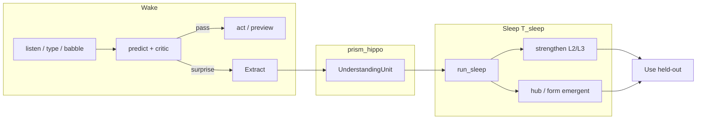

# CASA wake / sleep — концепт параллельного роста (v0)

**Date:** 2026-05-31  
**Status:** concept (канон для lab; уточняет терминологию)  
**Audience:** разработка BiT9, sleep, Extract  
**Parent:** [`understanding-contract.md`](understanding-contract.md), [`context-axis.md`](context-axis.md)  
**Companion:** [`bit9-lexicon-parallel-roadmap.md`](bit9-lexicon-parallel-roadmap.md), [`infancy-corpus-phases.md`](infancy-corpus-phases.md), [`lexicon-usage-axes.md`](lexicon-usage-axes.md), [`sss-layer-names.md`](sss-layer-names.md), [`CASA-ADR-0023-sleep-scale-thin-first.md`](CASA-ADR-0023-sleep-scale-thin-first.md) (batched sleep, thin-first, **вытесняющая многозадачность** — non-claim), [`CASA-ADR-0088-hippocampus-quad-mode-episodic-connectivity.md`](CASA-ADR-0088-hippocampus-quad-mode-episodic-connectivity.md) (hippo quad-mode: wake + consolidate + integrate + idle_micro; **life** loop)

**Имена слоёв:** в prose — **T0…T3** (APLF) или язык ЗССФ; **`L0_*`…`L3_phrase`** только как ID в коде. Карта коллизий: [`sss-layer-names.md`](sss-layer-names.md) § «Почему Lx путаются».

---

## Зачем этот документ

В lab одновременно растут **два контура**:

1. **Wake / hot path** — T9, merged preview, homoglyph, частотный prior (`lexicon_axes`).
2. **Понятийный каркас** — entity hub, POS, taxonomy на **Фразе** (`L3_phrase`); ingest «как будто на sleep», но **без настоящего sleep-цикла**.

Этот документ фиксирует **различия имён, слоёв и фаз**, чтобы не путать «залили bundle на L3» с «агент проснулся → удивился → Extract → заснул → Remember».

---

## Одна картина (north star)

```text
                    WAKE (поток тиков)                    SLEEP (тишина / gate)
                    ──────────────────                    ─────────────────────

  INPUT ──► Знак (script/layout) ──► PREDICT на Слове (T9) ──► CRITIC ──► ACT (preview)
                │                         │                │
                │                         │                └── surprise / teacher
                │                         │                         │
                │                         │                         ▼
                │                         │                   EXTRACT (hippo)
                │                         │                   UnderstandingUnit[]
                │                         │                         │
                │                         ▼                         ▼
                │                   lexicon_axes prior          REMEMBER
                │                   (ipm, era — не POS)       run_sleep → memory
                │                         │                         │
                └─────────────────────────┴─────────────────────────┘
                                          │
                                          ▼
                                    USE (held-out, digest)
```

**Контракт UC:** каждый эпизод обучения должен пройти **Extract → Remember → Use**. Пропуск шага — артеfact пайплайна, не «понял». См. [`understanding-contract.md`](understanding-contract.md) § «Три обязательства».

---

## Два типа «осей» (не смешивать)

| Слой | Что хранит | Примеры | Где влияет | Lab v0 |
|------|------------|---------|------------|--------|
| **`lexicon_axes`** (sidecar, не z-уровень!) | частота, era, prod-filter | `ipm`, `usage_band`, `active_for_t9` | T9 на **Слове**, merged preview sort | ✅ RU DetCorpus + EN OpenSubtitles |
| **Фраза** (`L3_phrase`) | понятия, грамматика, типы | `entity.cow`, `pos.noun`, `instanceOf` | lookup, explain, **opt** preview prior | ✅ hub + POS + taxonomy (batch ingest) |
| **Hippo** (episodic) | surprise | babble, teacher_correct, rule_hint | **Extract → sleep merge** | ⚠️ API есть, цикл не замкнут |

**Правило:** Noun / Verb / Animal **не** кладём в `lexicon_axes`. POS → `pos.*` на **Фразе**; Animal → `entity.animal` через `instanceOf`.

---

## Параллельные треки (инженерия)

| Трек | Смысл | Блокирует BiT9? | Критерий «готово v0» |
|------|--------|-----------------|----------------------|
| **A — BiT9** | linked RU+EN, homoglyph, merged preview chip | — | `run_bit9_gate.ps1`, merged preview 6/6, sweep 1k |
| **C — Lexicon mass** | словари, оси, L3 bundles | нет | headwords + axes + ingest scripts |
| **C2 — Semantic L3** | entity, POS, taxonomy | нет | benches POS/taxonomy green |
| **D — GPU** | NCA train/repair | нет | CUDA shards для store |
| **Sleep UC** | Extract → Remember → Use | **e2e lab** | `run_sleep_uc_e2e.py --write` + report |

Orchestrator: `scripts/run_bit9_parallel_tracks.ps1` (A + C2 benches параллельно).  
Это **не** заменяет sleep-цикл — только smoke параллельных направлений.

---

## Что такое «sleep» у нас (три разных вещи)

| Имя в репо | Что это на самом деле | Вызывался в lab? |
|------------|----------------------|------------------|
| **`run_sleep()`** (`memory_prisms.py`) | hippo episodes → strengthen L2/L3, prune consolidated, opt. NCA regrow | ✅ e2e `run_sleep_uc_e2e.py --write` |
| **`run_sleep_semantic_ingest.ps1`** | offline batch: entity hub + taxonomy + POS → L3 (+ `--write` field_state) | ⚠️ benches in-memory; write — вручную |
| **NCA sleep / stale shards** (track D) | GPU repair полок после cold ingest | отдельно от cognitive sleep |

**Вывод:** понятийный аппарат **заложен** (L3 edges), но **кристаллизация из episodic** (ветер↔ветяр, Extract после babble) — **следующий этап**.

### Wake вытесняет sleep (планировщик, non-claim)

Метафора ОС: **tick / surprise** — высокий приоритет; **sleep consolidate** — фоновый job с квантами (батчи). Monolithic sleep на весь hippo — как критическая секция без preemption; целевое — checkpoint между батчами и возможность resume. Подробно: [`CASA-ADR-0023-sleep-scale-thin-first.md`](CASA-ADR-0023-sleep-scale-thin-first.md) § «Neuro analogy & вытесняющая многозадачность». Это **не** claim биологической модели.

---

## Цепочка с Extract (куда идём)

По UC и [`infancy-corpus-phases.md`](infancy-corpus-phases.md) фаза 4:



### Extract (T_wake) — целевое

| Вход (`event.kind`) | Что mint на hippo | Пример |
|---------------------|-------------------|--------|
| `teacher_correct` | H1 surface unit | «маме» после «мама» |
| `teacher_explain` | H2 rule unit | dative после «согласно» |
| `babble_wrong` | surface + hint | лепет → correct |
| `listen` (roadmap) | H3 scene promote | mass encode без quiz |

**Extract ≠ ingest bundle.** Bundle — curated KB, кладётся оператором/скриптом. Extract — **структура из surprise на поле**, episodic на hippo.

Сегодня частично: `append_episode`, `append_rule_episode` → monolith `H0_episode`; целевой `understand_extract()` — roadmap.

### Remember (T_sleep) — целевое

`run_sleep(state, bundle)`:

- consolidated episodes → `_strengthen_concept` / `_strengthen_rule`
- pending остаётся в hippo
- `field_version++`, opt. NCA regrow

**Инвариант:** memory меняется после sleep-merge, не в момент Extract.

### Use (act)

Held-out cue → digest → predict **без** чтения `claim.text`. Проверка, что sleep-merge изменил anchors/hub.

---

## BiT9 merged preview — место в картине

Preview chip — **ACT** на homoglyph fork, **до** commitment:

```text
  visual "co"
       │
       ├── latn branch (co, cow, …)     ─┐
       └── cyrl branch (со, сон, …)     ─┼── merge_preview (ipm + hub + opt. taxonomy prior)
                                          │
                                          ▼
                               preview=[cow, co, со, сок, корова, …]
```

| Сигнал в merge | Источник | Hot path v0 |
|----------------|----------|-------------|
| votes + branch rank | L2 field | ✅ |
| ipm / rank | `lexicon_axes` | ✅ (prefix≥3 в scorer; preview — всегда) |
| hub surface | L3 `denotes` | ✅ `корова` for `cow` |
| taxonomy prior | L3 `instanceOf` | opt-in `semantic_prior=True` |
| POS prior | L3 `has_pos` | ❌ не в preview v0 |

Канон eval: `bench_bit9_merged_preview.py` + cues `merged_preview_eval_cues.v1.json`.

---

## Listen → Extract → hub (образ vs код)

| Образ (infancy) | Инженерия v0 | Статус |
|-----------------|--------------|--------|
| «Первичный бульон», нет `ветер` | `W:ветер`, `W:ветяр` на L2 | ✅ L2 imprint |
| Co-activation в сказке | listen mass encode | ⚠️ design ADR-0004 |
| DMN схлопывает в один hub | Extract + sleep → `entity.*` | ❌ roadmap |
| T9 prod | DetCorpus + axes | ✅ |

Lab-эксперiment «после listen+correct+**sleep** cue `вет…` → один hub» — **определение готовности** фазы 4, не текущий gate.

---

## Карта инструментов (v0)

| Задача | Инструмент | Контур |
|--------|------------|--------|
| Частотник RU/EN | `fetch_*_frequency`, `build_lexicon_usage_axes` | C / axes |
| Linked boot RU+EN | `boot_linked_stores` | A |
| Merged preview | `merge_preview`, `bench_bit9_merged_preview` | A |
| Entity hub | `entity_hub_ingest` | C2 / offline |
| POS | `build_pos_bundle`, `pos_claims_ingest` | C2 / offline |
| Taxonomy | `entity_taxonomy_ingest` | C2 / offline |
| Semantic prior (preview) | `semantic_prior` | opt A |
| **Extract** | `append_episode`, (roadmap) `understand_extract` | **wake UC** |
| **Remember** | `run_sleep` | **sleep UC** |
| Gate всего smoke | `run_bit9_gate.ps1` | A |
| Parallel tracks | `run_bit9_parallel_tracks.ps1` | A + C2 |

---

## Анти-паттерны (явно)

| Путаница | Почему плохо |
|----------|--------------|
| «Sleep ingest прошёл» = агент спал | Это batch L3, не hippo→memory |
| POS в `lexicon_axes` | Смешивает prior частоты и грамматику |
| `entity.animal` как поле на L2 | Омонимия и hub — на L3 |
| LLM «понял контекст» на hot path | вне UC, latency |
| Ждать NCA для preview eval | Track B; A/C не блокируются |

---

## Следующий инкремент (рекомендуемый)

Минимальный **sleep tick lab**, чтобы замкнуть UC:

1. **Cue:** mixed-script babble на **коротком** prefix → **`teacher_rule_only`** (см. [`teacher-correction-protocol.md`](teacher-correction-protocol.md)).
2. **Extract:** `append_rule_episode` — **без** oracle lemma на prefix.
3. **Remember:** `run_sleep()` + `--write`.
4. **Use:** T9 **fork** на `кор` (≥5 anchors); **корова / короб / коровий** grid stable; rule votes↑.
5. **Bench:** `run_sleep_uc_e2e.py --all-cues` — pass/fail, JSON report.

**Реализовано v0.2 (2026-05-31):** `preflight_teacher`, `surface_error`, `append_question_episode`, pending sleep merge, cues 1–4 + negative control.

После green — расширять на entity merge (ветер↔ветяр), не наоборот.

---

## Связанные документы

- [`understanding-contract.md`](understanding-contract.md) — Extract / Remember / Use (норматив)
- [`context-axis.md`](context-axis.md) — UC-цепочка на macro-tick
- [`bit9-lexicon-parallel-roadmap.md`](bit9-lexicon-parallel-roadmap.md) — треки A–D, команды
- [`infancy-corpus-phases.md`](infancy-corpus-phases.md) — фазы 0–5 «взросления»
- [`CASA-ADR-0003-emergent-forms-tags-predictor.md`](CASA-ADR-0003-emergent-forms-tags-predictor.md) — entity hub, emergent tags
- [`teacher-correction-protocol.md`](teacher-correction-protocol.md) — типы correct; anti-oracle на prefix

---

## Changelog

| Date | Change |
|------|--------|
| 2026-05-31 | v0: параллельный рост wake/sleep; различие semantic ingest vs `run_sleep`; карта Extract roadmap |
| 2026-06-01 | Ссылка ADR-0023: preemptive scheduling, batched sleep |
